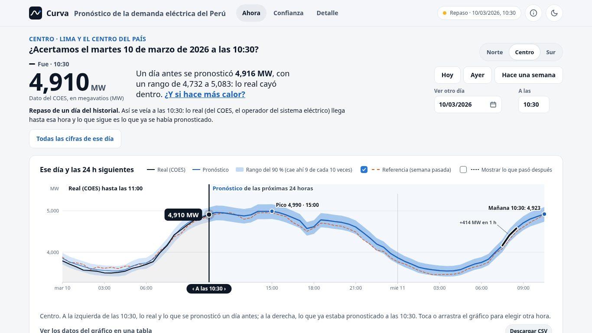
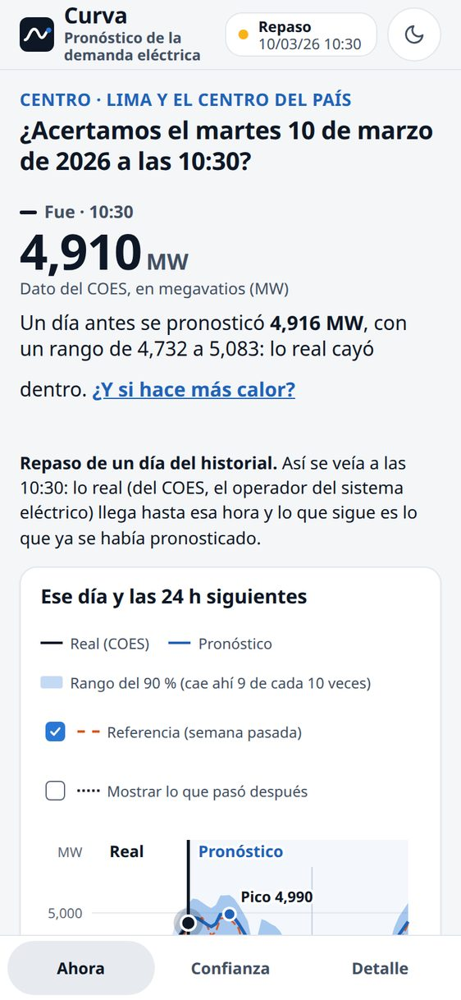

<a id="inicio"></a>

<div align="center">

<h1>Curva</h1>

<p>
  <strong>El pronóstico de la demanda eléctrica del Perú, media hora a media hora, que dice cuánto acertó.</strong><br>
  Para cada área del SEIN (Norte, Centro y Sur): la demanda de ahora, lo que viene en las próximas 24 horas con su rango,
  y lo que dijo ayer frente a lo que pasó.
</p>

<p>
  
  
  
</p>

<p>
  <a href="#levantarla">Levantarla</a> ·
  <a href="#resultados">Resultados</a> ·
  <a href="#documentacion">Documentación</a> ·
  <a href="#investigacion">La investigación detrás</a> ·
  <a href="#contexto">Contexto académico</a>
</p>

</div>

<table>
  <tr>
    <td width="72%"></td>
    <td width="28%"></td>
  </tr>
</table>

<p align="center"><sub>«Ahora», de día: el repaso del martes 10 de marzo de 2026 a las 10:30, en escritorio y en el celular.</sub></p>

## Qué es

**Curva** es una app web que pronostica la demanda eléctrica de las tres áreas operativas del Sistema Eléctrico
Interconectado Nacional (SEIN) del Perú cada 30 minutos, a 1 y a 24 horas, y pone a la vista qué tan bien le fue.
Tiene tres pantallas:

- **Ahora**: la demanda de este momento (o de cualquier hora del historial, en repaso), el pico del día y el gráfico
  de lo real frente a lo pronosticado, con su rango. Tocar el gráfico fija la hora.
- **Confianza**: el error mes a mes y día a día en la prueba de 2026, si el rango cumple lo que promete (también en
  vivo) y cómo se compara con lo que publican otros operadores.
- **Detalle**: el modelo, los escenarios («¿y si hace más calor?»), el diagnóstico y el registro en vivo.

Por detrás, una API FastAPI ejecuta los modelos entrenados en este repositorio sobre la demanda que publica el COES.

<p align="right">(<a href="#inicio">volver arriba</a>)</p>

<a id="levantarla"></a>

## Levantarla en 3 pasos

Con [uv](https://docs.astral.sh/uv/) y Python 3.12:

```bash
# 1. Clonar e instalar
git clone https://github.com/R0SEWT/tetouan-power-forecast && cd tetouan-power-forecast
uv sync --extra dev --extra app

# 2. Entrenar el modelo una vez (unos 4 minutos en una laptop). Necesita las capas silver del SEIN en data/
#    (o donde apunte TETOUAN_DATA); sin ellas, sáltalo: la app responde con datos de prueba sintéticos
uv run python -m app.backend.pronosticador_real entrenar

# 3. Levantar la API y la web, y abrir http://localhost:8080
app/levantar.sh
```

`app/levantar.sh` usa el modelo real si encuentra los datos y, si no, el de prueba. La API también sirve la web en
http://localhost:8000/. Con Docker: `docker build -t curva .` y `docker run --rm -p 8000:8000 curva` (con el modelo
real, montando los datos: ver el [`Dockerfile`](Dockerfile); todavía sin probar de punta a punta).

<p align="right">(<a href="#inicio">volver arriba</a>)</p>

<a id="resultados"></a>

## Resultados clave

| | Cifra | Dónde está |
|---|---|---|
| **El modelo de la app, prueba de 2026, a 24 h** | Error medio de **71.9 MW** en el Centro (27.9 en el Norte y 44.6 en el Sur); el Random Forest, 78.1 MW en el Centro | [`docs/app-hcd.md`](docs/app-hcd.md), iteración 4; [notebook 04](notebooks/04_sein_modelos_fundacionales.ipynb) |
| **Frente a la mejor referencia ingenua, 2026, a 1 h** | Le gana en las tres áreas: **52 %** menos error en el Norte, **58 %** en el Centro y **29 %** en el Sur | [notebook 03](notebooks/03_sein_prueba_2026.ipynb) |
| **¿El rango cumple lo que promete?** | Prueba de 2026, a 24 h: el rango del 90 % cubrió el **91.1 / 89.6 / 91.8 %** (Centro / Norte / Sur). En vivo, desde el 23 de octubre, el del 80 % cubrió **73.2 %** en el Centro y **74.3 %** en el Norte: queda corto, y la app lo dice | [`docs/app-hcd.md`](docs/app-hcd.md), iteraciones 4 y 8 |
| **Validación externa, Ceuta** | Sin haber visto un verano: **2.31 %** de MAPE frente a **4.62 %** de la mejor referencia | [`docs/historico.md`](docs/historico.md) |
| **Usabilidad medida** | Fijar otra hora y otro día (T1): **15 → 6 acciones**; peso de «Ahora» **78 → 44 KB**; 0 infracciones de axe | [`docs/auditoria/plan.md`](docs/auditoria/plan.md) |

Todo lo de usabilidad es medido con un arnés sintético (atención predicha, KLM, axe), no con personas: ver los límites
en [`docs/auditoria/metodo.md`](docs/auditoria/metodo.md).

<p align="right">(<a href="#inicio">volver arriba</a>)</p>

<a id="documentacion"></a>

## Mapa de la documentación

| Documento | Qué tiene |
|---|---|
| [`docs/producto-final.md`](docs/producto-final.md) | El producto: visión, usuarios, ideas priorizadas y riesgos |
| [`docs/app-hcd.md`](docs/app-hcd.md) | La app con diseño centrado en las personas: iteraciones, mediciones antes y después, decisiones |
| [`docs/auditoria/`](docs/auditoria/metodo.md) | La auditoría de atención: [método](docs/auditoria/metodo.md), [línea base](docs/auditoria/linea-base.md), [plan de PR con sus umbrales](docs/auditoria/plan.md) y la [ronda de juego](docs/auditoria/plan-juego.md) |
| [`docs/estado-del-arte.md`](docs/estado-del-arte.md) | Los trabajos sobre el dataset de Tetuán y dónde se ubica el proyecto |
| [`docs/historico.md`](docs/historico.md) | Cómo sortear un solo año de histórico, con la validación externa en Ceuta |
| [`docs/negocio.md`](docs/negocio.md), [`docs/investigacion.md`](docs/investigacion.md), [`docs/datos.md`](docs/datos.md) | Negocio, investigación previa y datos de Tetuán |
| [`docs/peru/`](docs/peru/tablas.md) | Las tablas de referencia del SEIN y sus fuentes |
| [`app/medicion/`](app/medicion/) | El arnés de medición de la app (tareas, KLM, axe, peso, atención) |

<p align="right">(<a href="#inicio">volver arriba</a>)</p>

<a id="investigacion"></a>

# La investigación detrás de Curva

Curva sale de un proyecto de investigación sobre pronóstico de demanda eléctrica de muy corto plazo ante niveles no
vistos, de Tetuán a El Niño de 2026 en el SEIN, siguiendo CRISP-DM.

<a id="propuesta"></a>

## La propuesta

Un pronóstico de demanda eléctrica de muy corto plazo falla cuando la demanda llega a niveles que el modelo no vio
al entrenar. Proponemos **una sola metodología, puesta a prueba tres veces**, cada vez en una situación más difícil:

- se pronostica la **razón** entre la demanda futura y la media de las últimas 24 horas, en vez del nivel;
- con un **modelo global** de todas las zonas o áreas;
- contra la mejor de tres **referencias ingenuas** (lo mismo que ahora, que ayer o que la semana pasada a esa hora);
- con **origen móvil** e intervalos por *bootstrap* de días.

**Objetivo general:** desarrollar y validar esa metodología de modo que se sostenga cuando la demanda se sale de lo
que el modelo vio, y medir qué ayuda más a adaptarla durante un evento extraordinario.

| | Acto 1 · Tetuán | Acto 2 · Ceuta | Acto 3 · SEIN (Perú) |
|---|---|---|---|
| **Pregunta** | ¿Se puede pronosticar a 1 h con un solo año de datos? ¿Cómo queda frente al estado del arte del dataset? | ¿La elección generaliza a un sistema vecino y a veranos que el modelo no vio? | Durante El Niño extraordinario de 2026, ¿qué ayuda más a adaptar el pronóstico de cada área: información exógena o reentrenar? |
| **Datos** | UCI 849: 2017, cada 10 min, tres zonas | Red Eléctrica: demanda de Ceuta, 2019 a 2026, cada 10 min | COES: Norte, Centro y Sur, 2016 a 2026, cada 30 min, más clima, El Niño, fallas y SAIDI |
| **Lo difícil** | El verano y una transferencia de carga que el entrenamiento no contiene | Siete veranos, entrenando con y sin un verano previo | Un nivel de demanda nunca visto, distinto en cada área |
| **Papel en el paper** | Objetivo específico 1, con la tabla contra el estado del arte | Objetivo específico 2 | **Caso central:** la mitad o más de los resultados |

La spec completa del proyecto y de la app, y el borrador de la estructura del paper, están en el
[PR #11](https://github.com/R0SEWT/tetouan-power-forecast/pull/11).

<p align="right">(<a href="#inicio">volver arriba</a>)</p>

<a id="peru"></a>

## El caso central: el SEIN durante El Niño de 2026

El COES opera el SEIN y necesita anticipar la demanda de cada **área operativa** (Norte, Centro y Sur): los enlaces
entre áreas tienen límite, y El Niño golpea distinto a cada una. Pronosticamos la demanda de cada área **cada 30
minutos**, a dos horizontes:

- **1 hora:** la operación en tiempo real (redespacho, reserva, arranque de unidades rápidas);
- **24 horas:** el programa del día siguiente, comparable con la Programación Diaria que publica el COES.

**Por qué ahora.** El Niño Costero de 2026 es extraordinario: el ICEN llegó a 3.98 en agosto, el mayor desde
1997-98, y la demanda del Norte crece entre 10 y 17 % sobre el año anterior, el doble o el triple de lo normal.

**Diseño.**

- **Partición:** entrenamiento 2016-2024, validación en 2025 (un año normal) y prueba en 2026, fuera de la
  distribución.
- **Regla de información:** cada variable entra solo con lo que se sabía al predecir, con su rezago real de
  publicación.
- **Exógenas por grupos** (ablación M0 a M4): clima de ERA5, El Niño (ICEN y Niño 1+2), fallas en curso del COES y
  SAIDI de Osinergmin.
- **Experimento de adaptación:** modelo fijo frente a reentrenado cada semana, con y sin exógenas.
- **Supuesto de colaboración COES-ENFEN:** el operador recibiría los pronósticos de clima y de El Niño. En el
  histórico se simula con el dato observado más un error de pronóstico realista.

**Hipótesis, escritas antes de ver la prueba:** a 1 h las exógenas aportan poco, porque la demanda reciente ya
absorbe el nivel; a 24 h pueden aportar más, sobre todo en el Centro (Lima) y en la costa norte. "Sin efecto" también
es un resultado y se reporta con su intervalo.

<p align="right">(<a href="#inicio">volver arriba</a>)</p>

<a id="avance"></a>

## Avance y resultados

| Acto | Qué está hecho | Lo que dice | Falta |
|---|---|---|---|
| **1 · Tetuán** | Negocio, datos y preparación ([`01_datos_preparacion`](notebooks/01_datos_preparacion.ipynb)); modelado y evaluación ([`02_modelado_evaluacion`](notebooks/02_modelado_evaluacion.ipynb)); [estado del arte](docs/estado-del-arte.md) | Le gana a la mejor referencia ingenua en los 24 meses-zona del origen móvil; en la prueba de noviembre y diciembre, el error queda entre 41 y 56 % por debajo de ella | Las conclusiones del notebook 02 |
| **2 · Ceuta** | Validación externa ([`experimentos/ceuta`](experimentos/ceuta/), [`docs/historico.md`](docs/historico.md)) | El objetivo en razón gana en los 25 pares de verano e historia; sin haber visto un verano, 2.31 % de MAPE frente a 4.62 % de la mejor referencia | — |
| **3 · SEIN** | Ingesta del COES y de las exógenas (notebooks [`00_medallon_coes`](notebooks/00_medallon_coes.ipynb) y [`00c_exogenas`](notebooks/00c_exogenas.ipynb)); comprensión y preparación ([`01_sein_datos_preparacion`](notebooks/01_sein_datos_preparacion.ipynb)); línea base de 2025 ([`experimentos/sein`](experimentos/sein/)); modelado y evaluación en 2025 ([`02_sein_modelado_evaluacion`](notebooks/02_sein_modelado_evaluacion.ipynb)); prueba de 2026 ([`03_sein_prueba_2026`](notebooks/03_sein_prueba_2026.ipynb)); modelos fundacionales y modelo híbrido ([`04_sein_modelos_fundacionales`](notebooks/04_sein_modelos_fundacionales.ipynb), scripts en [`experimentos/fundacionales`](experimentos/fundacionales/)); [tablas de referencia](docs/peru/tablas.md); base de la app | En 2026, con El Niño extraordinario, el modelo fijo le gana a la mejor referencia en las tres áreas y los dos horizontes (a 1 h, 52 % en el Norte, 58 % en el Centro y 29 % en el Sur); reentrenar cada semana y las exógenas aportan como mucho alrededor de 1 %, y a 24 h el clima empeora el pronóstico. Extensión (notebook 04): combinar un Chronos-2 ajustado con feriados y un XGBoost que usa el pronóstico de un modelo fundacional baja el error del Random Forest en las tres áreas y los dos horizontes (Centro a 24 h: de 86.1 a 75.2 MW en 2025 y de 78.1 a 71.9 en 2026) | La comparación con la Programación Diaria del COES (opcional) |
| **App** | Frontend propio y backend FastAPI que ejecutan el XGBoost global sobre las capas reales: pronóstico a 1 h y 24 h, escenarios, sensibilidad y diagnóstico ([`pronosticador_real.py`](app/backend/pronosticador_real.py)) | En 2026, a 1 h, el mismo error que el XGBoost del notebook 03 | La demo en la 4060 |
| **Paper** | Objetivos y estructura en tres actos, con las tablas de Tetuán y Ceuta | — | Redacción, con los resultados de 2026 |

<p align="right">(<a href="#inicio">volver arriba</a>)</p>

<a id="como-esta-hecho"></a>

## Cómo está hecho

```
UCI 849 (Tetuán) ─┐
REE (Ceuta) ──────┤
COES: IEOD ───────┼──► bronze ──► silver (auditado) ──► gold          [Google Drive, procesado en Colab]
ERA5, ICEN, ──────┘     (con procedencia: ruta, sha256, fecha)
Niño 1+2, SAIDI,                         │
eventos del COES                         ▼
                        notebooks por tramo de CRISP-DM (01 datos y preparación, 02 modelado y evaluación)
                                         │
                        src/tetouan_power_forecast: medallón, ingesta, variables con la regla de información,
                        modelos en razón, evaluación contra las referencias (con tests)
                                         │
                                         ▼
                        app: backend FastAPI que ejecuta el modelo + frontend web para el celular
```

Lo pesado se baja y se procesa en Colab; las capas viven en el Drive. La demo final corre en una máquina propia con
GPU, detrás de Tailscale.

<p align="right">(<a href="#inicio">volver arriba</a>)</p>

<a id="empezar"></a>

## Reproducir la investigación

**En Colab.** Cada notebook instala el paquete desde `develop` en su primera celda:

```python
!pip install -q git+https://github.com/R0SEWT/tetouan-power-forecast@develop
```

| Para | Notebook |
|---|---|
| Las capas de Tetuán | [`00_medallon`](https://colab.research.google.com/github/R0SEWT/tetouan-power-forecast/blob/develop/notebooks/00_medallon.ipynb) |
| Las capas de Ceuta | [`00b_ceuta`](https://colab.research.google.com/github/R0SEWT/tetouan-power-forecast/blob/develop/notebooks/00b_ceuta.ipynb) |
| La demanda por área del COES (unos 3,950 días) | [`00_medallon_coes`](https://colab.research.google.com/github/R0SEWT/tetouan-power-forecast/blob/develop/notebooks/00_medallon_coes.ipynb) |
| Las exógenas del SEIN | [`00c_exogenas`](https://colab.research.google.com/github/R0SEWT/tetouan-power-forecast/blob/develop/notebooks/00c_exogenas.ipynb) |
| Comprensión y preparación del SEIN | [`01_sein_datos_preparacion`](https://colab.research.google.com/github/R0SEWT/tetouan-power-forecast/blob/develop/notebooks/01_sein_datos_preparacion.ipynb) |
| Modelado y evaluación del SEIN en 2025 (2 a 3 h) | [`02_sein_modelado_evaluacion`](https://colab.research.google.com/github/R0SEWT/tetouan-power-forecast/blob/develop/notebooks/02_sein_modelado_evaluacion.ipynb) |
| La prueba de 2026 (unas 3 h; retoma desde la caché si se cae) | [`03_sein_prueba_2026`](https://colab.research.google.com/github/R0SEWT/tetouan-power-forecast/blob/develop/notebooks/03_sein_prueba_2026.ipynb) |
| Modelos fundacionales y modelo híbrido (un minuto: solo evalúa pronósticos ya generados) | [`04_sein_modelos_fundacionales`](https://colab.research.google.com/github/R0SEWT/tetouan-power-forecast/blob/develop/notebooks/04_sein_modelos_fundacionales.ipynb) |

Los notebooks montan el Drive y dejan las capas en `Mi unidad/datalake/tetouan-power-forecast`. Para guardar cambios
desde Colab, crea tu rama en GitHub y usa *Archivo › Guardar una copia en GitHub* eligiendo esa rama.

**En local**, con [uv](https://docs.astral.sh/uv/):

```bash
uv sync --extra dev
uv run pytest -q
uv run ruff check .
uv run tetouan all      # las capas de Tetuán en data/ (las del SEIN, mejor en Colab)
```

**La app.** Sirve el XGBoost global del notebook 02, que empató con el Random Forest en 2025 y en 2026 y pesa
unos 130 MB en vez de 1 GB. Necesita las capas silver del SEIN en `data/` (o donde apunte `TETOUAN_DATA`). Los
modelos se entrenan una vez (unos 4 minutos en una laptop) y quedan en `data/modelos/sein/app/`:

```bash
uv sync --extra dev --extra app
uv run python -m app.backend.pronosticador_real entrenar
TPF_PRONOSTICADOR=real uv run uvicorn app.backend.main:app
```

y abrir http://localhost:8000/, donde la API también sirve la web, comprimida (o `app/web/index.html`, que busca la API
en el puerto 8000; o correr `app/levantar.sh`, que levanta la API y la web en http://localhost:8080, con el modelo real
si encuentra los datos). La web abre en «Ahora» (hoy y las próximas 24 h, con la fecha de los datos reales a la vista)
y tiene «Confianza» (el error mes a mes y día a día) y «Detalle» (modelo, escenarios y diagnóstico); ver
[`docs/app-hcd.md`](docs/app-hcd.md), iteración 8. Sin `TPF_PRONOSTICADOR=real`, la API
responde con datos de prueba sintéticos. Para los intervalos usa los errores fuera de muestra de 2025 del notebook 02
(`reportes/sein/modelado/predicciones_validacion_*.csv`) y para la adaptación, la tabla del notebook 03
(`reportes/sein/prueba_2026/adaptacion.csv`); los dos están en el Drive.

<p align="right">(<a href="#inicio">volver arriba</a>)</p>

<a id="mapa"></a>

## Mapa del repo

| Ruta | Qué hay |
|------|---------|
| `notebooks/` | `00_*` arman las capas de cada caso en el Drive; después, un notebook por tramo de CRISP-DM: `01_datos_preparacion` y `02_modelado_evaluacion` (Tetuán), `01_sein_datos_preparacion`, `02_sein_modelado_evaluacion`, `03_sein_prueba_2026` y `04_sein_modelos_fundacionales` (SEIN). |
| `src/tetouan_power_forecast/` | Código compartido por los notebooks y la app. Tetuán: `medallon`, `datos`, `perfiles`, `metricas`, `variables`, `modelos`, `evaluacion`. Ceuta: `ceuta`. SEIN: la ingesta del IEOD (`coes`), las exógenas (`exogenas`), el dataset por área con la regla de información (`variables_sein`), el modelado (`modelado_sein`: candidatos, dataset global, políticas de reentrenamiento y regímenes), la evaluación de los modelos fundacionales (`fundacionales`) y las tablas de áreas, empresas, subestaciones y feriados (`tablas`). |
| `app/` | `backend/`: la API FastAPI y su contrato; `web/`: el frontend; `medicion/`: la medición de usabilidad y accesibilidad de la app (método y resultados en [`docs/app-hcd.md`](docs/app-hcd.md)); `levantar.sh`: levanta backend y web. |
| `experimentos/` | Los scripts que respaldan las cifras: `historico/` (un solo año en Tetuán), `ceuta/` (validación externa) y `sein/` (línea base de 2025 y la corrida en Colab). |
| `tests/` | Pruebas de `src/`, de los experimentos y del contrato de la app, con pytest. |
| `docs/negocio.md` | Comprensión del negocio de Tetuán: decisión, objetivos, criterios de éxito, riesgos y plan. |
| [`docs/producto-final.md`](docs/producto-final.md) | El producto final: visión, usuarios, ideas priorizadas para la entrega y la siguiente iteración, y riesgos. |
| `docs/investigacion.md` | Qué zona de Tetuán es cuál, qué tan difícil es cada una y cómo pronostica la industria. |
| `docs/estado-del-arte.md` | Los trabajos que usan el dataset de Tetuán y cómo se posiciona el proyecto. |
| `docs/historico.md` | Cómo sortear que solo hay un año de histórico, con la validación externa en Ceuta. |
| `docs/datos.md` | Procedencia, diccionario de variables y las capas del pipeline de Tetuán. |
| `docs/peru/` | Las tablas de referencia del SEIN y sus fuentes. |
| `.github/` | CI (ruff + pytest en cada push a `main` o `develop` y en cada PR), plantilla de PR y Dependabot. |
| `data/` | Copia local de las capas (las compartidas están en el Drive). No se versiona. |

<p align="right">(<a href="#inicio">volver arriba</a>)</p>

<a id="convenciones"></a>

## Convenciones

- **Git Flow**: nada entra directo a `develop` ni a `main`. Una rama por unidad de trabajo
  (`feature/modelado`, `feature/app`, …), PR hacia `develop` y una fusión a `main` por entregable,
  con tag (`tb1-avance`, `tb1-final`).
- **Un notebook, una persona a la vez**: git no sabe combinar dos versiones de un `.ipynb` editadas
  en paralelo. Si dos personas avanzan a la vez, cada una trabaja en su propio notebook.
- **Lo repetido va a `src/`**: si dos notebooks (o un notebook y la app) usan la misma función,
  vive en `src/` y tiene su test.
- **Regla de información**: ninguna variable entra con un dato que no se conocía al momento de predecir.
- **Ninguna cifra a mano**: las tablas y figuras del paper salen de los notebooks y de los experimentos.
- **Hipótesis antes que resultados**: lo que se espera de la prueba de 2026 se escribe antes de mirarla.
- **Los datos no se versionan**: el pipeline los baja de cada fuente y guarda su procedencia (sha256 incluido).

<p align="right">(<a href="#inicio">volver arriba</a>)</p>

<a id="datos"></a>

## Datos

| Fuente | Qué aporta | Licencia o condición de uso |
|---|---|---|
| [UCI 849, *Power Consumption of Tetouan City*](https://archive.ics.uci.edu/dataset/849/power+consumption+of+tetouan+city) | Tetuán, 2017, cada 10 min, tres zonas y clima | CC BY 4.0 |
| [Red Eléctrica (REE)](https://demanda.ree.es/visiona/home) | Demanda de Ceuta desde 2019 | Uso académico citando a REE; los datos crudos no se suben al repo |
| [COES](https://www.coes.org.pe), IEOD y eventos relevantes | Demanda del SEIN y de sus áreas desde 2016; fallas | Datos públicos del operador, sin licencia publicada; se cita al COES como fuente |
| [Open-Meteo](https://open-meteo.com/en/docs/historical-weather-api) (reanálisis ERA5) | Temperatura horaria de las ciudades de cada área y de Ceuta | CC BY 4.0, citando a Open-Meteo y a ERA5 |
| [IGP](http://met.igp.gob.pe/datos/ICEN.txt) (ICEN) y [NOAA CPC](https://www.cpc.ncep.noaa.gov/data/indices/) (Niño 1+2) | El Niño Costero, mensual y semanal | Datos públicos |
| [Osinergmin](https://www.datosabiertos.gob.pe) (SAIDI y SAIFI) | Calidad del suministro por sistema eléctrico | ODC-By |

> Salam, A., & El Hibaoui, A. (2018). *Power Consumption of Tetouan City* [Dataset]. UCI Machine
> Learning Repository. https://doi.org/10.24432/C5B034

<p align="right">(<a href="#inicio">volver arriba</a>)</p>

<a id="contexto"></a>

## Contexto académico

Curva nació como el trabajo grupal (TB1) del curso *Metodología para Data Science* (UPC 1ACC0240, ciclo 2026-2).
El repositorio y el paquete de Python conservan el nombre del primer caso de estudio, `tetouan-power-forecast`.

### Equipo

<div align="center">
<table>
  <tr>
    <td align="center" width="170">
      <a href="https://github.com/R0SEWT">
        <br>
        <b>Rody Vilchez</b><br><sub>@R0SEWT</sub>
      </a>
    </td>
  </tr>
</table>
</div>

<p align="center"><sub>Grupo 3 · Metodología para Data Science · UPC · Ciclo 2026-2</sub></p>

<p align="right">(<a href="#inicio">volver arriba</a>)</p>
