# La app con diseño centrado en las personas: qué cambió y cuánto mejoró

Rediseño de `app/web` (y dos cambios chicos en `app/backend`) en dos iteraciones, con una línea base medida antes de
tocar nada y la misma medición repetida después de cada iteración. El guion está en [`app/medicion/`](../app/medicion/)
y los resultados, en `app/medicion/resultados/`.

**En corto.** La tarea principal (ver el pronóstico con su rango y contra lo real) pasó de cumplirse a medias (2 de 4
cifras: el rango no aparecía) a cumplirse entera, con el número visible sin desplazarse también en el celular. Las
otras tres tareas cuestan lo mismo o menos que antes; el tiempo estimado de las cuatro bajó de 27.8 s a 24.2 s en el
celular. axe pasó de 6 infracciones a 0, ningún objetivo táctil queda bajo 44 px, la página pesa 115 KB en vez de 157 y
ya no pide nada a terceros, y desapareció la afirmación de que se compara con la Programación Diaria del COES. **No
mejoró** el tiempo hasta ver el número en una red lenta (1143 → 1213 ms, dentro del ruido del instrumento), y todo lo
medido es sintético: falta probarlo con personas (§8).

| | Base | Después |
|---|---|---|
| T1: cifras vistas (pronóstico, rango, real) | 2 de 4 | 4 de 4 |
| Tiempo estimado de las 4 tareas en el celular (KLM) | 27.8 s | 24.2 s |
| Número pronosticado visible al abrir el área en el celular | no | sí |
| Ventana tapada por barras fijas (celular) | 23 % | 8 % |
| axe-core, nodos con infracciones en 28 pantallas | 6 | 0 |
| Peso / peticiones a terceros | 157 KB / 3 | 115 KB / 0 |
| Menciones a la Programación Diaria del COES | 3 | 0 |

| Antes | Después |
|---|---|
| 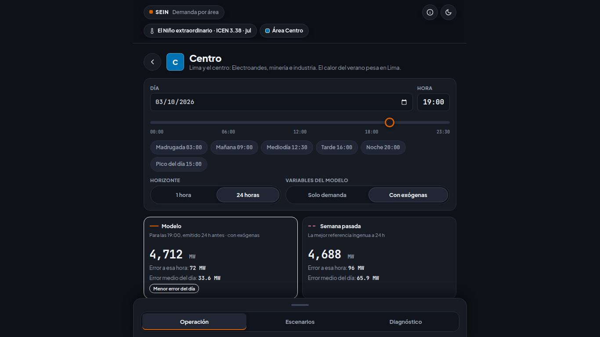 | 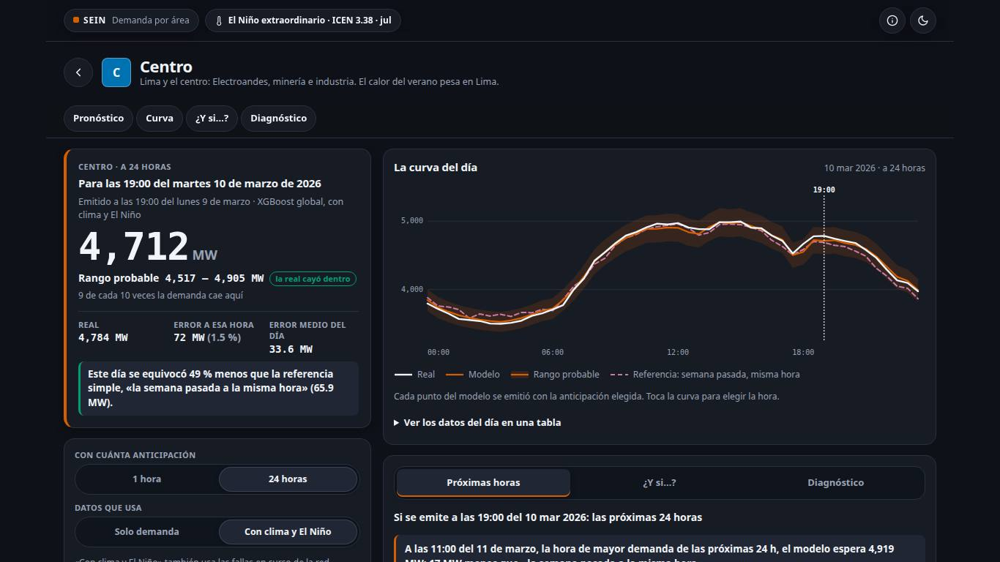 |

## 1. Para quién y para qué

| Persona | Contexto | Qué necesita saber |
|---|---|---|
| **Operador o programador del despacho del COES** | Escritorio de la sala de control; a veces el celular | Cuánta demanda viene en un área a 1 h y a 24 h, con qué margen, y si puede fiarse del número |
| **Evaluadora académica** | Una demo de 3 minutos en un proyector (1366 × 768) | Qué pronostica el modelo, qué tan bueno es, qué hace El Niño y qué dice el diagnóstico |

Las cuatro tareas clave, con un caso fijo para poder repetirlas: **Centro, martes 10 de marzo de 2026, 19:00, a 24 h**
(un día de la prueba de 2026, con El Niño extraordinario y en la subida de la noche).

| Tarea | Pregunta | Se cumple cuando en la pantalla se vio… |
|---|---|---|
| **T1** | ¿Cuánto pronostica el modelo para ese día y hora, con qué rango y cuánto fue lo real? Empieza en el inicio. | el pronóstico (4,712 MW), los dos extremos del rango (4,517 y 4,905 MW) y lo real (4,784 MW) |
| **T2** | ¿Me puedo fiar? | el error del modelo en el día (33.6 MW) y la comparación con la referencia simple (65.9 MW o la diferencia) |
| **T3** | ¿Cuánto cambia el pronóstico si hace 2 °C más? | el cambio que calcula el modelo (15 MW, o 4,934 MW en la hora de mayor demanda) |
| **T4** | ¿Con qué fase de El Niño se equivoca más el modelo? | la fase (Niño débil) y su error (86.8 MW) |

Las cifras esperadas no se escriben a mano: el guion las pide a la API antes de cada corrida, así que el oráculo no
depende de la interfaz y sirve igual para las tres versiones.

## 2. Método

Se tomó de la auditoría HCD que Rody hizo en su página personal (R0SEWT/mypage: la metodología en el issue #67, las
iteraciones en los PR #64 a #80 y el cierre en los PR #77 y #81):

1. **Línea base medida** sobre la versión de `develop`, antes de tocar nada.
2. **Cambio mínimo atado a una métrica que falla.** Cada cambio de la tabla final dice qué número buscaba mover.
3. **Re-medición después de cada iteración.** Si un cambio no mueve la métrica o la empeora, se corrige o se revierte y
   se anota (aquí pasó con la iteración 1: ver §4).
4. **Antes y después en una tabla** con capturas, y una sección de lo que no mejoró.
5. **Límites declarados**: las personas sintéticas detectan regresiones, pero no reemplazan sesiones con personas
   reales (Agnew et al., CHI 2024).

Lo que se adaptó. mypage medía la atención con un lector de saliencia entrenado en UEyes y la calidad visual con UIClip;
aquí no hacen falta para estas tareas y piden GPU. En su lugar, cada tarea se mide por su resultado:

| Instrumento | Qué mide | Archivo |
|---|---|---|
| Tareas con Playwright | Si se cumple (y qué cifra falta), acciones (clics, pulsaciones y gestos de desplazamiento, también los que hacen falta para llegar a un botón fuera de la vista), segundos del robot y segundos estimados para una persona con el Keystroke-Level Model (Card, Moran y Newell, 1980; valores de Kieras, 2001: M 1.35 s, P 1.1 s, B 0.2 s, K 0.28 s, H 0.4 s; un gesto de desplazamiento, 1 s, supuesto propio) | `tareas.mjs`, `versiones.mjs` |
| axe-core | Infracciones WCAG 2.2 A y AA en 28 pantallas: 7 estados × móvil y escritorio × modo oscuro y claro | `accesibilidad.mjs` |
| Recorrido de foco | Tabulaciones hasta controles clave, foco sin indicador visible (WCAG 2.4.7) o tapado por barras fijas (2.4.11) | `accesibilidad.mjs` |
| Estructura | Si el número pronosticado se ve sin desplazarse, su tamaño, el % de la ventana ocupado por barras fijas, objetivos táctiles de menos de 44 px (2.5.5; el mínimo AA de 24 px de 2.5.8 ya se cumplía), desborde horizontal a 320 px | `accesibilidad.mjs` |
| Color | Contraste de cada serie contra el fondo (WCAG 1.4.11, 3:1) y separación ΔE entre series con protanopía, deuteranopía y tritanopía simuladas (Machado, Oliveira y Fernandes, 2009) | `color.mjs` |
| Rendimiento | Peso y peticiones de la vista del área, peticiones a terceros, tiempo hasta ver el número en red local y en red lenta (150 ms, 1.6 Mbps, CPU × 4), mediana de 5 cargas | `rendimiento.mjs` |
| Lighthouse | Rendimiento, accesibilidad y buenas prácticas en móvil y escritorio, mediana de 3 corridas | `lighthouse.mjs` |
| Honestidad | Menciones visibles a la Programación Diaria del COES, una comparación que el proyecto no hizo | `accesibilidad.mjs` |

Para que la comparación sea justa, **las tres versiones se midieron con el mismo guion y contra el mismo backend**: la
base y la iteración 1 se sirven desde sus commits (`git archive`). Los objetivos se fijaron después de ver la línea base,
como en mypage: cada uno ataca algo que fallaba o fija lo que ya estaba bien para no perderlo.

## 3. Línea base

### Recorrido heurístico

Un recorrido de las cuatro tareas con las diez heurísticas de Nielsen, en móvil (375 × 812) y en el proyector
(1366 × 768). Severidad de 0 a 4 (Nielsen, 1994). La última columna dice qué número de la tabla final lo mide, cuando
hay uno.

| # | Heurística | Hallazgo | Sev. | Tarea | Se mide con |
|---|---|---|---|---|---|
| H1 | Honestidad | La app afirma que compara con la Programación Diaria del COES (notas de Operación, «Qué hace» y fuentes de la ficha técnica); con el backend simulado incluso dibuja esa curva con datos sintéticos. El proyecto no hizo esa comparación. | 4 | T2 | Menciones visibles |
| H2 | Reconocer antes que recordar | El rango probable no está junto al número. A 24 h solo aparece como una banda sin cifras dentro de la hoja «Operación», y para otro instante (desde la hora elegida, no para ella). | 3 | T1 | T1: cifras vistas |
| H3 | Diseño minimalista y jerarquía | En el celular, los controles ocupan la primera pantalla y media; el número pronosticado queda bajo el pliegue y tapado por la hoja inferior fija. | 3 | T1 | Número visible sin desplazarse |
| H4 | Jerarquía | En el proyector, columna de 760 px en una pantalla de 1366; la curva queda bajo el pliegue y la hoja fija tapa la cuarta parte de la ventana, incluida la frase con el valor real. | 3 | T1, T2 | % ocupado por barras fijas |
| H5 | Relación con el mundo real | La misma «Hora» significa «para las 19:00» en las tarjetas y «desde las 19:00» en la hoja. | 3 | T1 | — |
| H6 | Visibilidad del estado | Al cambiar el horizonte o la fecha, las tarjetas siguen mostrando los números anteriores hasta que llega la respuesta; el único indicio es una opacidad en el gráfico. | 3 | T1 | — |
| H7 | Jerarquía | Las tarjetas del modelo y de la referencia pesan lo mismo: la referencia parece otro pronóstico. | 2 | T1 | Tamaño del número |
| H8 | Lenguaje | «exógenas», «M0/M3», «persistencia», «MAE», «ablación», «bootstrap» y «dependencia parcial» sin explicar. | 2 | T2–T4 | — |
| H9 | Prevención de errores | Una fecha fuera del rango con datos se corrige en silencio. | 2 | T1 | — |
| H10 | Relación con el mundo real | El selector de fecha sigue el idioma del navegador (03/10/2026 en uno en inglés, que en Perú se lee 3 de octubre) y el subtítulo dice «mar 10 mar 2026». | 2 | T1 | — |
| H11 | Visibilidad del estado | Qué modelo se está viendo (XGBoost global) solo figura dentro de la ficha técnica. | 2 | T2 | — |
| H12 | Ayuda | La ayuda está concentrada en la ficha técnica; nada breve junto al rango, la referencia o el error. | 2 | T2 | — |
| H13 | Accesibilidad | Ningún objetivo táctil llega a 44 px (miden de 32 a 40). | 2 | todas | Objetivos de menos de 44 px |
| H14 | Accesibilidad | El cuerpo desplazable de la hoja no se alcanza con el teclado (axe: `scrollable-region-focusable`). | 2 | T3, T4 | axe |
| H15 | Eficiencia | 18 tabulaciones hasta el selector de horizonte. | 1 | T1 | Tabulaciones |
| H16 | Consistencia | Dos «picos» distintos: el chip «Pico del día» (el máximo real) y «la hora de mayor demanda de las próximas 24 h». | 1 | — | — |
| H17 | Dependencias | Tres peticiones a Google Fonts: sin internet la tipografía cambia, y en red lenta retrasan el primer pintado. | 1 | — | Peticiones a terceros |

**Lo que ya estaba bien y había que conservar:** Lighthouse daba 100 en accesibilidad y buenas prácticas; axe solo
marcaba la hoja; la paleta de Wong (Okabe-Ito) con trazos distintos por serie ya separaba bien las series con
daltonismo simulado; las pestañas seguían el patrón ARIA con flechas; y las URL guardan el área, la fecha, la hora y el
horizonte.

## 4. Iteración 1: la respuesta primero

Atacaba H1 a H8 y H11 (commit «App, iteración 1 de HCD»):

- La vista del área abre con **la respuesta**: para qué hora y cuándo se emitió, el número en 44 px (52 en escritorio),
  el rango probable, lo real, el error a esa hora y en el día, y una frase que compara con la referencia simple.
- **«¿Qué tan bueno es?»**: barras con el error del día del modelo y de la referencia, cuántas medias horas del día
  cayeron dentro del rango y el error de la prueba de 2026.
- La curva del día dibuja el rango probable (requirió el campo `intervalo` en la serie: §7).
- Sin hoja inferior fija: el detalle pasa a pestañas dentro de la página y el escritorio usa dos columnas.
- Fuera la Programación Diaria; lenguaje llano; estado «Actualizando…» anunciado y números atenuados mientras llegan
  los nuevos; aviso si la fecha cae fuera del rango; la fecha larga bajo el selector.
- Selector de modelo con el único modelo de hoy.

**Re-medición** (`resultados/historial/it1-inicial.json`, contra el backend de ese momento). Mejoró lo que buscaba:
T1 de 2 a 4 cifras, el número visible sin desplazarse en el celular, barras fijas de 23 % a 12 %, axe de 6 a 0. Pero
**empeoró cuatro cosas**, y por eso hubo una segunda iteración:

| Regresión | Base → iteración 1 | Causa |
|---|---|---|
| T3 y T4 en el celular | 2 → 5 y 1 → 5 acciones | Sin la hoja fija, los escenarios y el diagnóstico quedaron al final de una página larga |
| Saltos de diseño en escritorio (CLS) | 0.069 → 0.392; Lighthouse rendimiento 99 → 81 | La página se ensanchaba al entrar a un área y la curva y la respuesta crecían al llegar los datos |
| Lighthouse buenas prácticas | 100 → 96 | Error en la consola: la app pedía `/modelos`, que el backend no tenía (404) |
| Hasta ver el número, red local | 325 → 438 ms | Ese pedido iba después de los otros, una ida y vuelta más antes de la serie |

## 5. Iteración 2: devolver lo que la iteración 1 quitó, y accesibilidad

Commits «El backend lista sus modelos en /modelos» e «iteración 2 de HCD»:

- **Barra de secciones pegajosa** (Pronóstico, Curva, ¿Y si…?, Diagnóstico) que elige la pestaña y la lleva arriba; la
  cabecera deja de ser pegajosa. El panel de detalle mide al menos una ventana, para que el salto lo deje arriba aunque
  el diagnóstico siga cargando (sin eso, T4 en el celular seguía en 2 acciones).
- **`GET /modelos` en el backend**, pedido en paralelo con `/salud`, `/areas` y `/resumen`.
- **Sin saltos de diseño**: la cabecera tiene el mismo ancho en las dos vistas; la curva y la respuesta reservan su
  altura.
- **Fuentes del sistema** en lugar de Google Fonts (H17).
- **44 px en pantallas táctiles**, enlace «Saltar al pronóstico», indicador de foco en el selector de fecha, y los
  controles empiezan por «Con cuánta anticipación» y «Datos que usa» (H13, H15).
- **Tabla de datos de la curva** (alternativa al gráfico para lectores de pantalla) y **una frase con la conclusión** de
  cada gráfico del diagnóstico, por ejemplo «Donde más se equivoca: Niño débil (86.8 MW). Le gana a la referencia simple
  en las 5 fases».
- «Máximo real del día» en lugar de «Pico del día» (H16).

**Re-medición**: T3 y T4 vuelven a costar lo mismo que en la base (2 y 1 acciones), CLS 0.04, buenas prácticas 100,
cero peticiones a terceros y el número aparece en 59 ms en red local.

### Ruido del instrumento

La línea base se midió dos veces con el mismo código (`historial/base-inicial.json` y `base.json`). Entre una y otra,
el tiempo hasta ver el número varió 325 → 288 ms en red local y 1381 → 1143 ms en red lenta, el LCP móvil 2582 → 1994 ms
y el rendimiento de Lighthouse en móvil 94 → 96. **En los tiempos, una diferencia de menos de un 25 % no se distingue
del ruido** (las peticiones a Google Fonts dependen de internet). Las cuentas de tareas, axe, foco, objetivos y barras
fijas salieron idénticas en las dos corridas.


## 6. Antes y después

Las tres versiones con el mismo guion y contra el mismo backend real (XGBoost global), el 13 de noviembre de 2026. La
tabla sale de `node app/medicion/tabla.mjs base it1 it2`; «Cumple» compara la iteración 2 con el objetivo.

|  | Métrica | Base | It. 1 | It. 2 | Objetivo | Cumple |
|---|---|---|---|---|---|---|
| Tareas | T1 pronóstico con rango y real: cifras vistas (escritorio / móvil) | 2/4 / 2/4 | 4/4 / 4/4 | 4/4 / 4/4 | 4/4 | sí |
|  | T1 acciones (escritorio / móvil) | 17 / 17 | 17 / 17 | 16 / 16 | ≤ base | sí |
|  | T2 ¿se puede confiar?: acciones (escritorio / móvil) | 0 / 1 | 0 / 0 | 0 / 0 | ≤ base | sí |
|  | T3 efecto de +2 °C: acciones (escritorio / móvil) | 2 / 2 | 3 / 5 | 2 / 2 | ≤ base | sí |
|  | T4 diagnóstico: acciones (escritorio / móvil) | 1 / 1 | 2 / 5 | 1 / 1 | ≤ base | sí |
|  | Tiempo estimado (KLM) de las 4 tareas, s (escritorio / móvil) | 26.8 / 27.8 | 27.2 / 32.2 | 24.2 / 24.2 | ≤ base | sí |
| Jerarquía | Número pronosticado visible sin desplazarse (móvil / escritorio) | no / sí | sí / sí | sí / sí | sí / sí | sí |
|  | Tamaño del número pronosticado, px (móvil / escritorio) | 22 / 26 | 44 / 52 | 44 / 52 | ≥ 32 / 40 | sí |
|  | Ventana ocupada por barras fijas, % (móvil / escritorio) | 23 / 24 | 12 / 13 | 8 / 7 | ≤ 10 | sí |
| Accesibilidad | axe-core WCAG 2.2 AA: infracciones (nodos) en 28 pantallas | 6 (6) | 0 (0) | 0 (0) | 0 | sí |
|  | Lighthouse accesibilidad (área, móvil / escritorio) | 100 / 100 | 100 / 100 | 100 / 100 | 100 | sí |
|  | Objetivos táctiles de menos de 44 px (móvil) | 21 de 21 | 21 de 22 | 0 de 27 | 0 | sí |
|  | Tabulaciones hasta el selector de horizonte / hasta «Diagnóstico» | 18 / 24 | 18 / 24 | 12 / 10 | < base | sí |
|  | Elementos con foco sin indicador visible / tapados | 1 / 0 | 1 / 0 | 0 / 0 | 0 / 0 | sí |
| Color | Contraste mínimo de las series contra el fondo (WCAG 1.4.11) | 3.87:1 | 3.87:1 | 3.87:1 | ≥ 3:1 | sí |
|  | ΔE mínimo entre series con daltonismo simulado (oscuro / claro) | 33.3 / 27.7 | 33.3 / 27.7 | 33.3 / 27.7 | ≥ 20 | sí |
| Rendimiento | Peso de la vista del área, KB / peticiones | 157 / 11 | 165 / 12 | 115 / 9 | ≤ base | sí |
|  | Peticiones a terceros | 3 | 3 | 0 | 0 | sí |
|  | Hasta ver el número, ms: red local / red lenta y CPU ×4 (mediana de 5) | 288 / 1143 | 212 / 1345 | 59 / 1213 | ≤ base | **no** |
|  | Lighthouse rendimiento (área, móvil / escritorio) | 96 / 99 | 94 / 81 | 99 / 100 | ≥ base | sí |
|  | LCP móvil, ms / CLS escritorio (Lighthouse, área) | 1994 / 0.068 | 2579 / 0.393 | 1853 / 0.04 | CLS ≤ 0.1 | sí |
|  | Lighthouse buenas prácticas (área, móvil) | 100 | 100 | 100 | 100 | sí |
| Honestidad | Menciones visibles a la Programación Diaria del COES | 3 | 0 | 0 | 0 | sí |

La columna de la iteración 1 se midió contra el backend actual, que ya tiene `/modelos`: por eso ahí no aparecen el
error en la consola ni la ida y vuelta de más que se vieron al medirla en su momento (§4). El CLS de 0.393 sí persiste.

Lo que dice la tabla y lo que no:

- **T1 casi no se acorta** (17 → 16 acciones): lo dominan escribir la fecha y mover la hora. La mejora de T1 es que se
  cumple. Atajos como «último día con datos» o días destacados de la prueba la acortarían, pero no se agregaron para no
  diseñar a la medida del caso medido; conviene decidirlo con personas.
- **Red lenta: no cumple.** 1143 → 1213 ms, dentro del ruido. En red local la mejora (288 → 59 ms) es grande porque el
  script ya no espera la hoja de estilos de Google Fonts; en red lenta manda la cadena de idas y vueltas (página →
  script → datos base → serie), que no cambió.
- **Lighthouse ya daba 100 en accesibilidad** y casi 100 en lo demás: la mejora no está ahí, sino en lo que Lighthouse no
  mide (si la tarea se cumple, cuánto cuesta, qué tapa la pantalla).
- **El color no cambió** a propósito: ya cumplía 3:1 y se distinguía con daltonismo simulado.
- En escritorio, 25 de 27 controles miden menos de 44 px; con mouse rige el mínimo AA de 24 px (2.5.8), que se cumple.

### Capturas

| | Base | Iteración 1 | Iteración 2 |
|---|---|---|---|
| Área, celular | 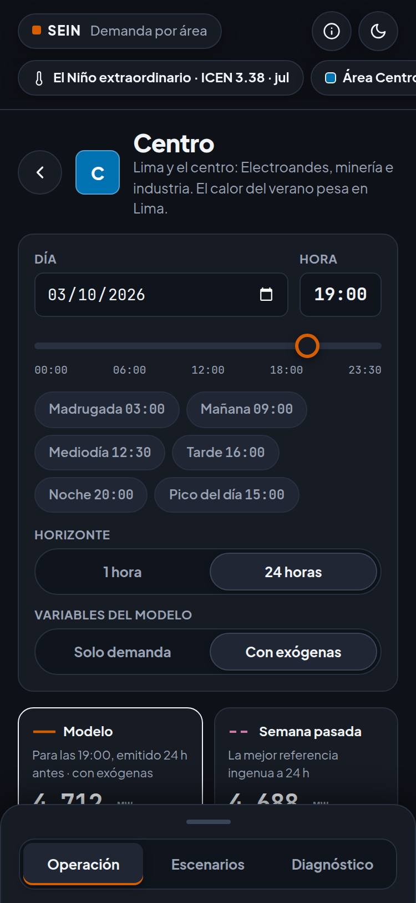 | 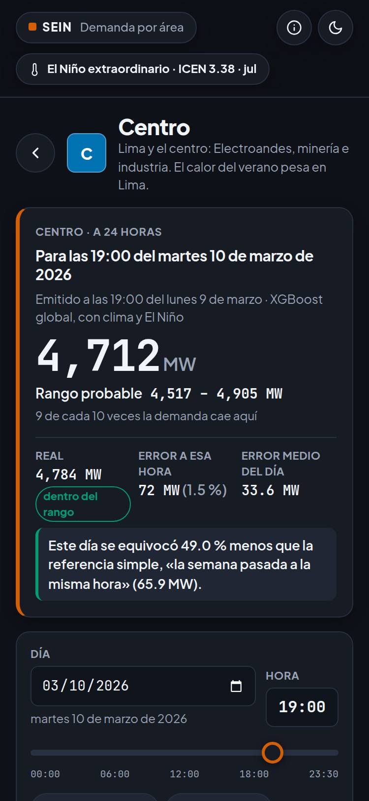 | 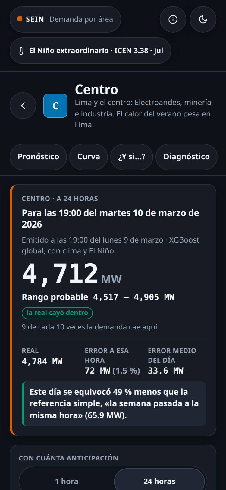 |
| Área, proyector |  | 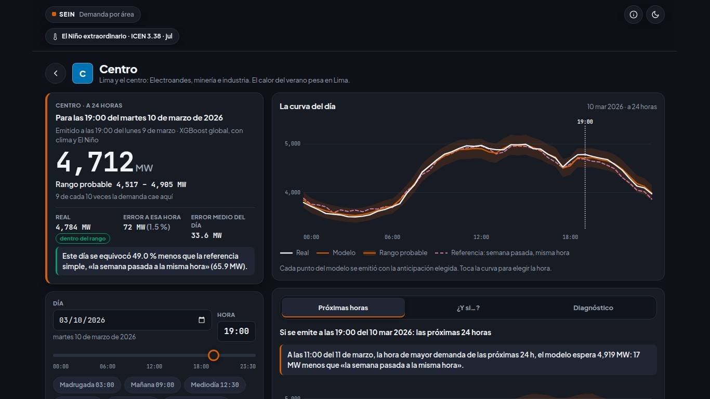 |  |
| Área, modo claro | 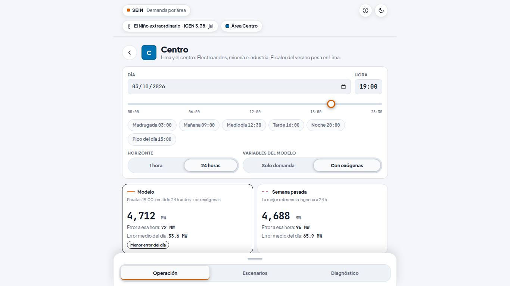 | 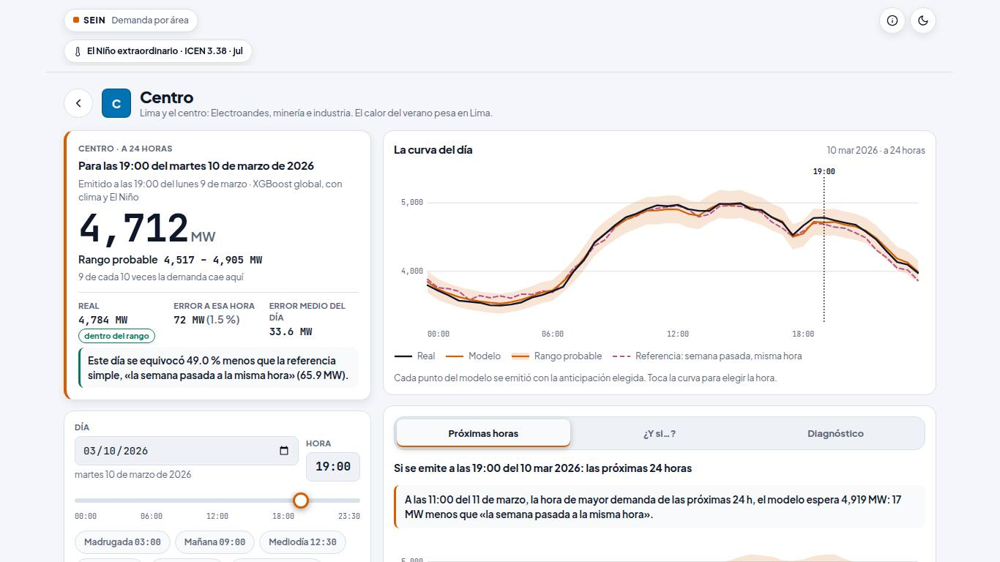 | 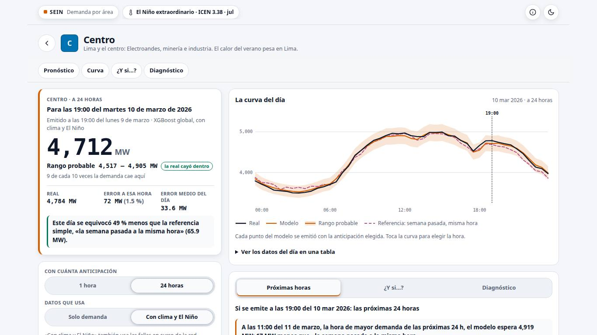 |
| ¿Y si…? | 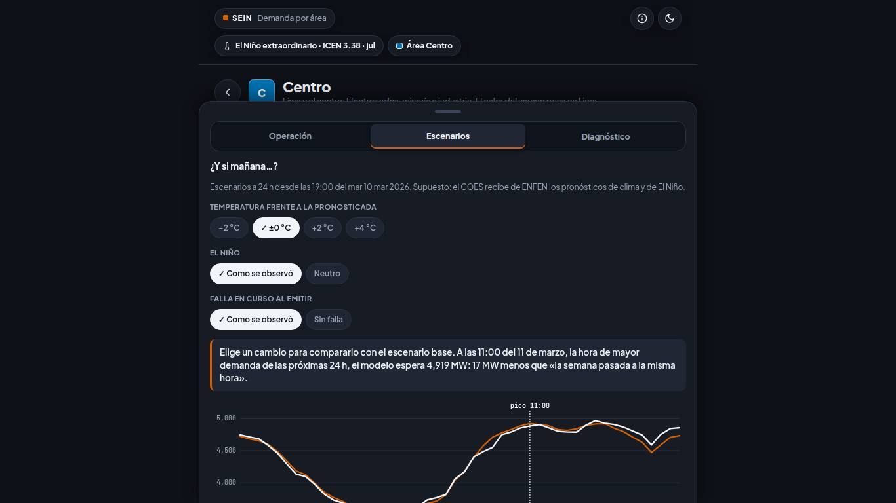 | 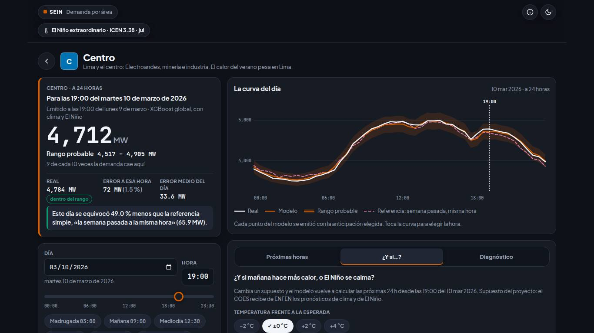 | 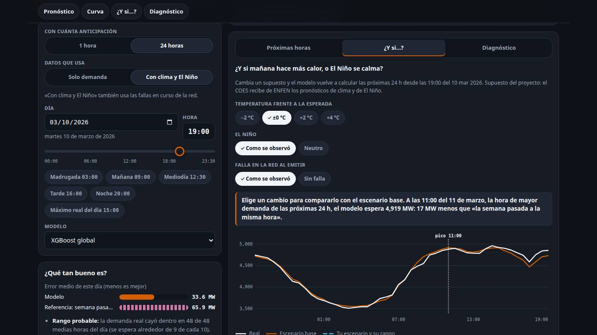 |
| Diagnóstico | 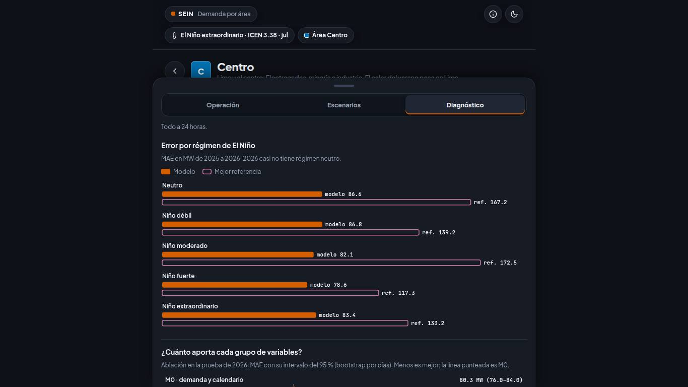 | 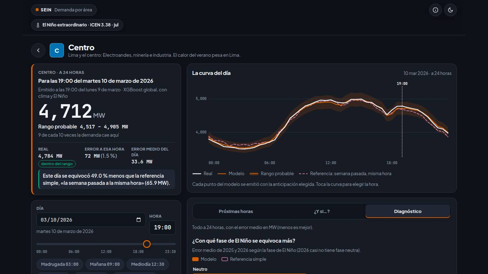 | 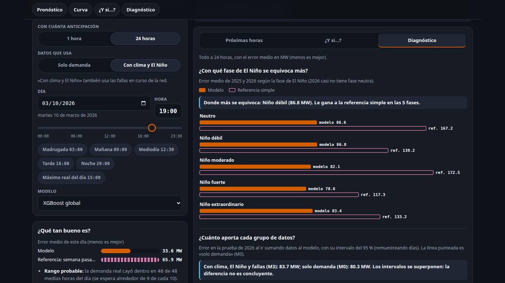 |
| Próximas horas, celular | 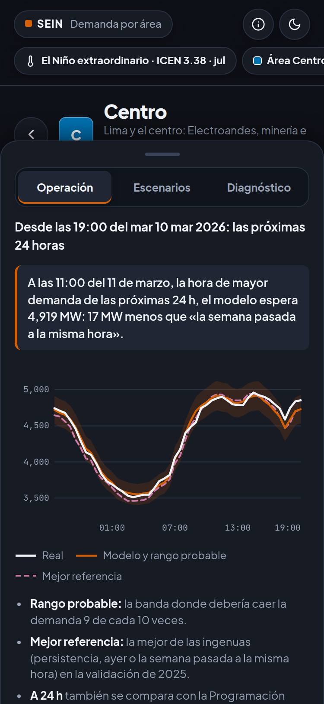 | 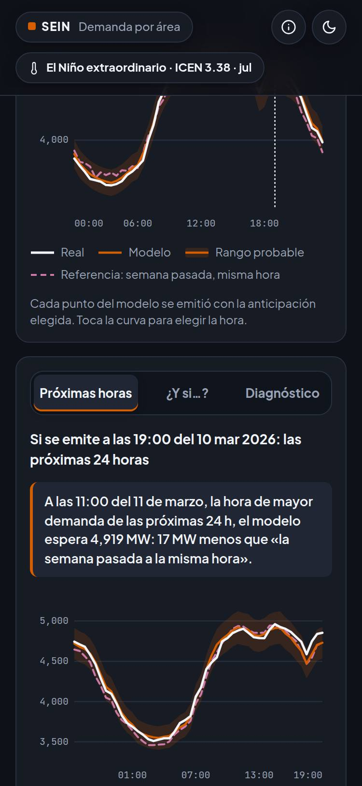 | 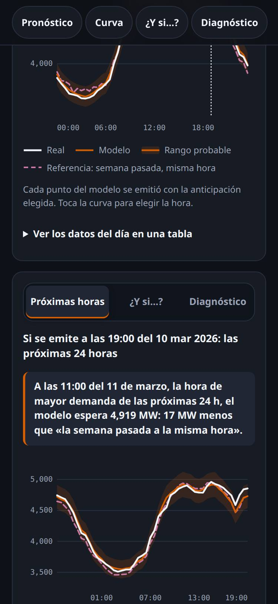 |
| Inicio, celular | 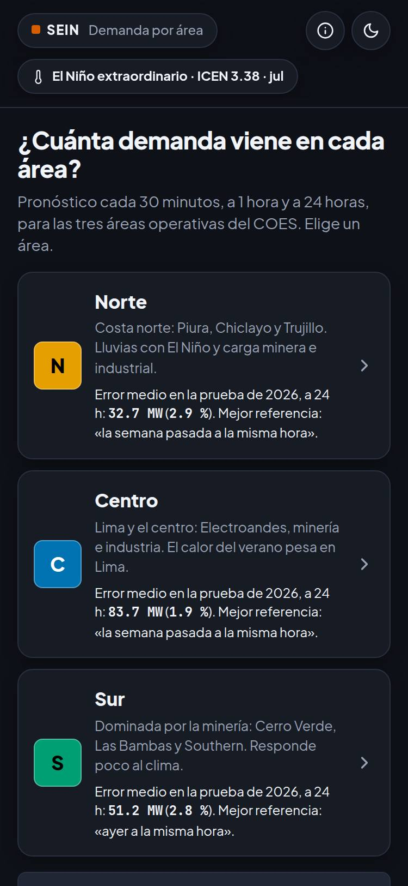 | 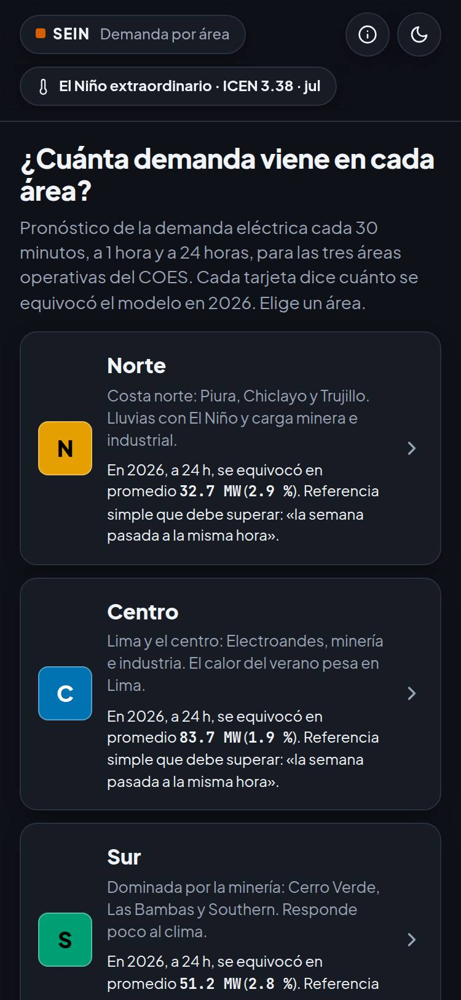 | 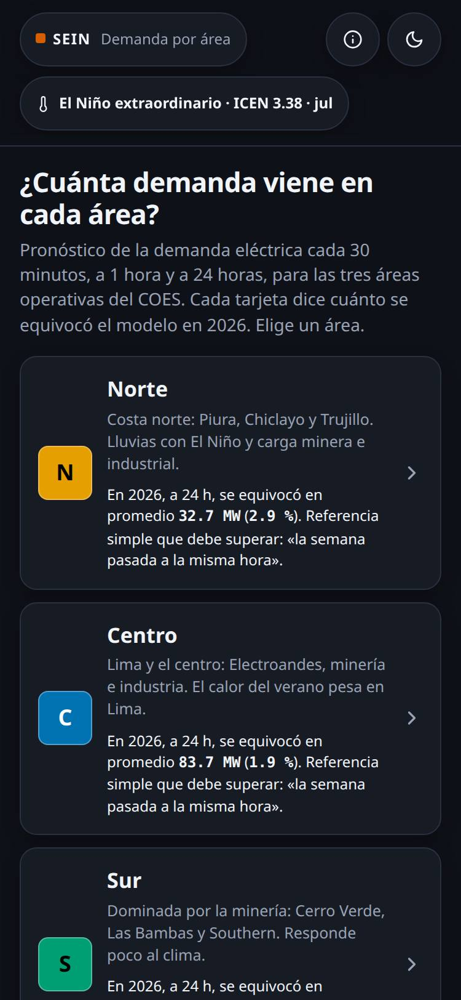 |


## 7. Decisiones

- **La hora elegida es la hora pronosticada.** La respuesta dice «Para las 19:00 del martes 10 de marzo de 2026» y debajo
  «Emitido a las 19:00 del lunes 9 de marzo», que es lo que se compara con lo real. «Próximas horas» deja explícito
  el otro sentido: «Si se emite a las 19:00…».
- **Primero la respuesta, luego cómo pedir otra.** En el celular la respuesta va antes de los controles; en escritorio,
  la respuesta y los controles a la izquierda y la curva y el detalle a la derecha. El orden del DOM sigue el orden de
  lectura, para el teclado y los lectores de pantalla.
- **«¿Qué tan bueno es?» junto al número**, siguiendo la pauta de dejar claro qué tan bien hace el sistema lo que hace
  (Amershi et al., CHI 2019) y la evidencia de que mostrar la incertidumbre ayuda a decidir (Kay et al., CHI 2016):
  el veredicto del día frente a la referencia simple, la cobertura del rango en el día y el error de la prueba de 2026.
- **El rango probable en la serie del día** (`intervalo`, campo opcional del contrato). Es el mismo que ya devolvía
  `/pronostico` para ese periodo emitido H pasos antes; una prueba lo verifica. Sin él, el número de la respuesta no
  podía ir con su rango.
- **Sin hoja inferior fija**, reemplazada por una barra de secciones pegajosa y delgada. La hoja tapaba la cuarta parte
  de la ventana; quitarla sin más alejó los escenarios y el diagnóstico (§4), y la barra los devolvió a un toque.
- **Fuentes del sistema.** Plus Jakarta Sans y JetBrains Mono venían de Google Fonts; en una sala de control sin internet
  no cargan, y en red lenta retrasaban el primer pintado.
- **Selector de modelo preparado sin romper el contrato.** `GET /modelos` devuelve hoy un solo modelo y la app lo muestra
  en un selector. La app solo agrega el parámetro `modelo` a `/series`, `/pronostico`, `/sensibilidad` y
  `/diagnostico` (y a la URL) cuando `/modelos` trae más de uno. Para sumar Chronos-2 basta con que el backend lo liste
  y acepte ese parámetro; la app no necesita cambios.
- **Dentro o fuera del rango con texto, no solo con color**: «la real cayó dentro», con verde Okabe-Ito; el veredicto
  dice «menos» o «más» además del borde verde o naranja.

### Probado y descartado

Para que nadie lo repita:

- **Quitar la hoja fija sin reemplazo** (iteración 1): T3 y T4 en el celular subieron a 5 acciones. Reemplazado por la
  barra de secciones.
- **Pedir `/modelos` después de los demás datos y sin el endpoint**: error en la consola y una ida y vuelta más.
- **Ensanchar la página solo al entrar a un área**: CLS 0.392 en escritorio.
- **La marca «dentro del rango» en la columna «Real»**: a 375 px se montaba sobre la columna vecina; pasó junto al rango.
- **Saltar al diagnóstico con el panel todavía corto**: la página no podía desplazarse lo suficiente y la conclusión
  quedaba bajo el pliegue.

## 8. Límites y pendientes

1. **Sesiones con personas reales.** Todo lo de arriba es sintético: un robot que sigue el camino experto, un oráculo
   que verifica que las cifras estuvieron a la vista (no que se entendieron) y tiempos estimados con KLM, que no cuentan
   el tiempo de lectura. Lo siguiente es probar las cuatro tareas con 3 a 5 personas (estudiantes de ingeniería
   eléctrica en el papel de operador y la profesora en el de evaluadora), pensando en voz alta, con tiempo por tarea y
   el cuestionario SUS.
2. **Red lenta.** Se puede ganar una ida y vuelta pidiendo la serie en paralelo con los datos base cuando la URL ya trae
   un área.
3. **La fecha del selector** sigue el idioma del navegador (mm/dd/aaaa en uno en inglés). Se mitigó con la fecha larga
   debajo; no se resolvió.
4. **Tableta** (768 a 959 px) y **lectores de pantalla reales** (NVDA, VoiceOver) sin probar; la tabla de datos y los
   anuncios de carga solo se verificaron con axe y el árbol de accesibilidad.
5. **Selector de modelo.** Cuando el backend sume Chronos-2 u otro modelo: listarlo en `/modelos`, aceptar `modelo` en
   `/series`, `/pronostico`, `/sensibilidad` y `/diagnostico`, y volver a medir (es un control más en la ruta de las
   tareas).


## 9. Cómo repetir la medición

```bash
# 1. Levantar la app (modelo real si encuentra los datos en ../tetouan-power-forecast/data)
export UV_PROJECT_ENVIRONMENT=/ruta/al/.venv   # el venv del proyecto
app/levantar.sh                                # API en :8000, web en :8080

# 2. Medir (en otra terminal)
cd app/medicion
npm install                                    # playwright, @axe-core/playwright, lighthouse
node medir.mjs --version it2 --etiqueta it2    # unos 10 minutos; --rapido omite Lighthouse
node tabla.mjs base it1 it2                    # la tabla de §6
node capturas.mjs --version it2 --etiqueta it2 # capturas en docs/img/app-hcd/
```

Usa el Chrome del sistema (o el de Playwright si no lo hay). Para medir una versión anterior, servirla desde su commit
y apuntar el guion a ella:

```bash
git archive 2c54312 app/web | tar -x -C /tmp/base
python3 -m http.server 8081 --directory /tmp/base/app/web &
TPF_WEB=http://localhost:8081 node medir.mjs --version base --etiqueta base
```

Para una interfaz nueva, se agrega su camino en `versiones.mjs` (cómo llega a cada estado y a cada tarea); las métricas
y los oráculos no cambian.

## Referencias

- Agnew, W. et al. (2024). The illusion of artificial inclusion. *CHI 2024*.
- Amershi, S. et al. (2019). Guidelines for Human-AI Interaction. *CHI 2019*.
- Card, S. K., Moran, T. P. y Newell, A. (1980). The keystroke-level model for user performance time with interactive
  systems. *Communications of the ACM*, 23(7).
- Kay, M., Kola, T., Hullman, J. y Munson, S. (2016). When (ish) is my bus? User-centered visualizations of uncertainty
  in everyday, mobile predictive systems. *CHI 2016*.
- Kieras, D. (2001). *Using the Keystroke-Level Model to Estimate Execution Times*. Universidad de Míchigan.
- Machado, G. M., Oliveira, M. M. y Fernandes, L. A. F. (2009). A physiologically-based model for simulation of color
  vision deficiency. *IEEE TVCG*, 15(6).
- Nielsen, J. (1994). *Usability Engineering* (heurísticas y escala de severidad). Morgan Kaufmann.
- Okabe, M. e Ito, K. (2008). *Color Universal Design (CUD): How to make figures and presentations that are friendly to
  colorblind people*.
- W3C (2023). *Web Content Accessibility Guidelines (WCAG) 2.2*.
