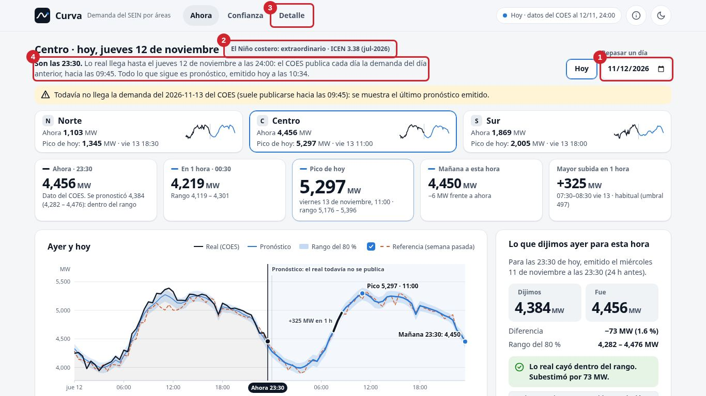
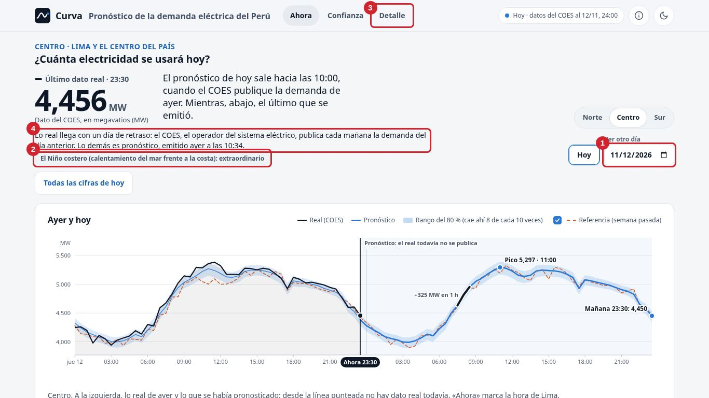
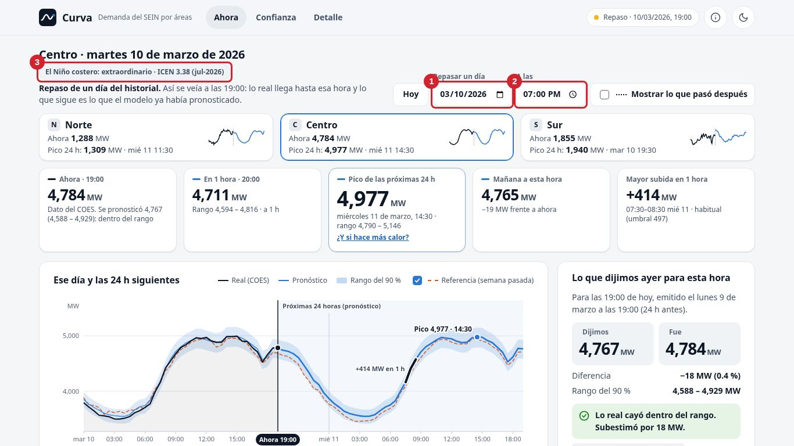
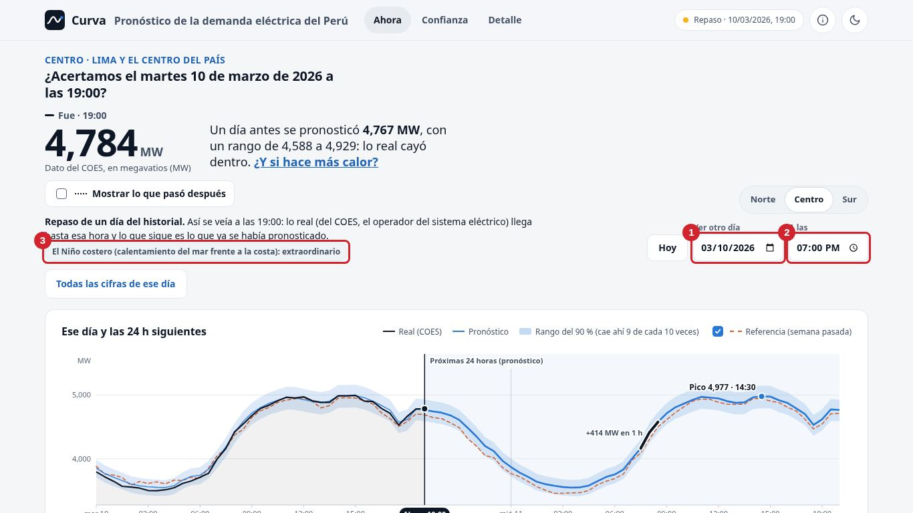
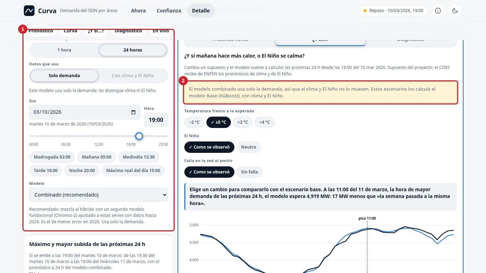
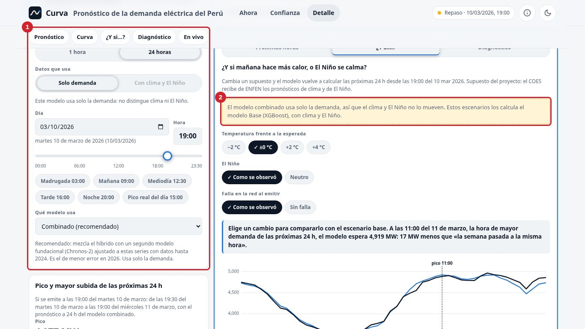

# Validar como se valida un juego: el método para Curva

El dueño pidió mirar cómo la industria del videojuego logra saber que un juego **se entiende, se disfruta y se vuelve
a usar**, y qué de eso sirve para Curva. Su dolor sigue siendo el de la auditoría: *«cuando abro la app como que me
pierdo»*. [`onboarding.md`](onboarding.md) ya tomó del diseño de niveles **cómo se diseña** un primer nivel; este
documento toma **cómo se valida**: los playtests, la iteración rápida, los embudos y la telemetría, con un filtro
crítico (qué no aplica a una herramienta de datos y qué sería maquillaje). Y lo convierte en un instrumento: un
**playtest sintético** reproducible, con un evaluador automático externo haciendo de jugador que no conoce Curva, y su
línea base antes y después de los PR #40–#43.

| Documento | Qué tiene |
|---|---|
| [`juego.md`](juego.md) | Este: la investigación, Curva como juego (bucle, primer nivel, mecánicas), las medidas, el playtest sintético y su línea base |
| [`plan-juego.md`](plan-juego.md) | El ciclo RITE en la serie de PR, las mejoras con su medida y umbral, y el protocolo de 30 minutos con cinco personas |
| [`juego/`](juego/) | Capturas de las pantallas del playtest con los tropiezos señalados y la hoja de registro para las sesiones con personas |
| [`app/medicion/juego/`](../../app/medicion/juego/) | El instrumento: `capturar.mjs`, `jugar.py`, `analizar.py`, personas, tareas y respuestas crudas |

## 1. Cómo valida la industria, y qué se lleva Curva

Cada idea con su fuente primaria cuando la hay, lo que hace la industria y su veredicto para un producto de datos:
**sí** (transferible tal cual), **con cuidado** (sirve si se cambia el objetivo) o **no** (no aplica o sería
maquillaje).

### 1.1 Mirar a alguien jugar, arreglar, volver a mirar

| Idea | Fuente | Qué enseña | En Curva | Veredicto |
|---|---|---|---|---|
| **RITE** (*Rapid Iterative Testing and Evaluation*) | Medlock, Wixon, Terrano, Romero y Fulton (2002), *Using the RITE method to improve products*, UPA ([copia de terceros](https://jpattonassociates.com/wp-content/uploads/2015/04/rite_method.pdf)); Medlock (2018), capítulo en *Games User Research* ([DOI](https://doi.org/10.1093/oso/9780198794844.003.0013)) | En el tutorial de *Age of Empires II*, con 16 personas que nunca habían jugado estrategia en tiempo real, se corregía **entre una sesión y la siguiente** apenas el problema era claro: 6 iteraciones, 31 problemas encontrados y 30 corregidos; un problema corregido tras el primer participante no reapareció en los 15 siguientes | Es la forma natural de la serie de PR: probar, arreglar el tropiezo más grave, volver a probar ([`plan-juego.md`](plan-juego.md) §1) | **Sí** |
| **El diseño es una hipótesis; el playtest, el experimento** | Ambinder (2009), *Valve's Approach to Playtesting*, GDC ([diapositivas](https://cdn.fastly.steamstatic.com/apps/valve/2009/GDC2009_ValvesApproachToPlaytesting.pdf)); Swift y Wolpaw (2008), *Portal post-mortem*, GDC ([diapositivas](https://cdn.fastly.steamstatic.com/apps/valve/2008/GDC2008_PortalPostMortem.pdf)); Brown (2023), *Valve's "Secret Weapon"*, Game Maker's Toolkit ([artículo](https://gmtk.substack.com/p/valves-secret-weapon), fuente secundaria) | Valve pesa más lo que la gente **hace** que lo que **dice**; *Portal* se probó casi cada semana, observando en silencio, sin ayudar al jugador | Cada pantalla se escribe como hipótesis comprobable («en 5 s se sabe cuánta demanda hay ahora») y se mide la conducta (primer clic, lectura correcta), no la opinión | **Sí** |
| **Pensar en voz alta** | Nielsen (2012), *Thinking Aloud: The #1 Usability Tool*, NN/g ([artículo](https://www.nngroup.com/articles/thinking-aloud-the-1-usability-tool/)); Ambinder (2009) | Barato y robusto aun mal ejecutado; pero es poco natural, la persona filtra lo que dice y el moderador puede sesgarla. Valve lo usa para el «por qué», no para el «qué» | El guion del playtest (sintético y con personas) pide voz alta, pero las medidas salen de lo que hace (dónde toca, qué cifra copia) | **Sí** |
| **Investigación de usuarios de juegos** como disciplina | Drachen, Mirza-Babaei y Nacke (eds., 2018), *Games User Research*, Oxford; Bromley (2021), *How To Be A Games User Researcher* ([sitio](https://gamesuserresearch.com/book/)) | Manuales de playtests, encuestas, biometría y casos | El protocolo de 30 minutos de [`plan-juego.md`](plan-juego.md) sigue su estructura (guion, tareas, hoja de registro) | **Sí**; la biometría y las salas con espejo, **no** |

### 1.2 La primera experiencia y sus embudos

| Idea | Fuente | Qué enseña | En Curva | Veredicto |
|---|---|---|---|---|
| **FTUE y embudo por paso** | McCalmont (GameAnalytics, act. 2025), *10 Tips for a Great FTUE* ([artículo](https://gameanalytics.com/blog/tips-for-a-great-first-time-user-experience-ftue-in-f2p-games)); GameAnalytics (2025), *Exploring gaming funnels* ([artículo](https://www.gameanalytics.com/blog/exploring-gaming-funnels)) | Cada paso del tutorial es un paso de un embudo; se busca dónde se cae más gente. Sus cifras son ilustrativas, no un estándar | El **embudo de la primera apertura** (dice qué es → lee la cifra → sabe qué momento muestra → acierta el primer clic → volvería) y el de cada tarea, medidos por sesión (§3 y §5) | **Sí**, como evidencia cualitativa: con 5 personas no es una estadística |
| **Enseñar sin tutorial** | Miyamoto sobre el World 1-1 (Eurogamer, 2015, [video](https://www.youtube.com/watch?v=zRGRJRUWafY); [cobertura en Game Developer](https://www.gamedeveloper.com/design/how-miyamoto-built-i-super-mario-bros-i-legendary-world-1-1)); comentario del desarrollador de *Portal* (Valve, 2007; [transcripción de fans](https://theportalwiki.com/wiki/Portal_developer_commentary)) | El 1-1 enseña jugando; *Portal* es un entrenamiento extendido, una herramienta a la vez, y cuando los jugadores no descubrían una mecánica la cámara siguiente los obligaba a usarla | Ya está en [`onboarding.md`](onboarding.md) (concepto A). Lo nuevo aquí: medir si la mecánica se descubre (primer clic) y, si no, rediseñar el paso que la obliga | **Sí** |
| **Tutoriales y complejidad** | Andersen et al. (2012), *The Impact of Tutorials on Games of Varying Complexity*, CHI ([proyecto](https://grail.cs.washington.edu/projects/game-abtesting/chi2012/)) | Con más de 45,000 jugadores, los tutoriales solo ayudaron en el juego complejo (+29 % de tiempo, +75 % de progreso en Foldit); en los simples no cambiaron nada; la ayuda en contexto rindió mejor que la ayuda a pedido | Curva tiene pocas mecánicas: ayuda pegada al elemento (una frase junto a la cifra), no recorridos | **Sí** |
| **Cuatro tiempos: aprender, complicar, girar, dominar** (*kishōtenketsu*) | Hayashida, director de *Super Mario 3D Land*, entrevistado por Nutt (2012, [Game Developer](https://www.gamedeveloper.com/design/the-structure-of-fun-learning-from-i-super-mario-3d-land-i-s-director)); Brown (2015, [GMTK](https://www.youtube.com/watch?v=dBmIkEvEBtA)) | Una mecánica por nivel en cuatro pasos. La fórmula popular «*teach, test, twist*» no tiene fuente primaria: es una paráfrasis comunitaria de este esquema | «Ahora» presenta una mecánica (la cifra); «Confianza», la complica (el error); «Detalle», la gira (¿y si hace más calor?) | **Con cuidado**: el orden sirve; el giro narrativo, no |

### 1.3 El bucle central y la sensación de control

| Idea | Fuente | Qué enseña | En Curva | Veredicto |
|---|---|---|---|---|
| **«30 segundos de diversión»** | Griesemer, en *Behind the Scenes: Making of Halo 2* (Bungie, 2004; [transcripción](https://www.halopedia.org/Behind_the_Scenes:_Making_of_Halo_2)) y su aclaración en Kietzmann (2011, [Joystiq/Engadget](https://www.engadget.com/2011-07-14-half-minute-halo-an-interview-with-jaime-griesemer.html)) | La cita circula recortada y al revés: Griesemer dice que esos 30 s **cambian** de entorno, arma y enemigo, y que hay un bucle de 3 s dentro de uno de 30 s dentro de uno de 3 min | Tres bucles anidados (§2): 3 s (toco y la cifra responde), 30 s (respondo una pregunta), un día (vuelvo a ver si acertó) | **Con cuidado**: los bucles anidados, sí; la variedad por la variedad, no (en una herramienta de operación vale más la consistencia) |
| **Átomos de habilidad** | Cook (2007), *The Chemistry of Game Design* ([Game Developer](https://www.gamedeveloper.com/design/the-chemistry-of-game-design)) | Acción → simulación → respuesta → modelo mental; un átomo que se abandona delata un diseño que falla, y se detecta registrando el uso | Los átomos de Curva: leer la cifra, leer la curva, mover el tiempo, juzgar el rango, comparar con la referencia, pedir un escenario. El playtest mide cuáles se descubren | **Sí** |
| **Game feel** | Swink (2008), *Game Feel*, Morgan Kaufmann ([editorial](https://www.routledge.com/Game-Feel-A-Game-Designers-Guide-to-Virtual-Sensation/Swink/p/book/9780123743282)) | La sensación de control nace de la respuesta en tiempo real, los indicadores auxiliares y la metáfora | Respuesta en menos de 0.1 s al tocar el gráfico (el umbral de manipulación directa de Nielsen, 1993, [NN/g](https://www.nngroup.com/articles/response-times-3-important-limits/)), transiciones que muestran qué cambió (Heer y Robertson, 2007, [DOI](https://doi.org/10.1109/TVCG.2007.70539): las transiciones animadas bien hechas mejoran la percepción de los cambios en gráficos estadísticos) y estados que enseñan | **Sí**, lo que informa |
| **«Juice»** | Jonasson y Purho (2012), *Juice It or Lose It*, GDC Europe ([GDC Vault](https://gdcvault.com/play/1016487/Juice-It-or-Lose)); Hicks et al. (2019), *Juicy Game Design*, CHI PLAY ([DOI](https://doi.org/10.1145/3311350.3347171)); Kao (2020), *Entertainment Computing* ([DOI](https://doi.org/10.1016/j.entcom.2020.100359)); Kao et al. (2024), CHI ([DOI](https://doi.org/10.1145/3613904.3642656)) | Los efectos suben el atractivo, pero la competencia percibida solo en ciertas condiciones; con 3,018 jugadores, tanto «nada» como «extremo» rindieron peor que niveles medios; amplificar la respuesta **bajó** la competencia y la curiosidad, mientras que la respuesta ligada al desempeño mejoró todos los motivos medidos | Solo respuesta ligada a información: el punto que sigue al dedo, la banda que se ensancha, el veredicto «cayó dentro del rango» | **No** como adorno (partículas, sacudidas, sonidos, celebrar un acierto): en un tablero de demanda eléctrica comunica una urgencia falsa |

### 1.4 Motivación, dificultad e interés

| Idea | Fuente | Qué enseña | En Curva | Veredicto |
|---|---|---|---|---|
| **MDA** | Hunicke, LeBlanc y Zubek (2004), *MDA: A Formal Approach to Game Design and Game Research*, AAAI ([PDF](https://users.cs.northwestern.edu/~hunicke/MDA.pdf)) | El diseñador parte de las mecánicas; el jugador, de la experiencia («estética») | Mecánicas (controles) → dinámicas (comparar pronóstico y real) → experiencia objetivo: **competencia informada** («sé cuánto habrá y cuánto fiarme») | **Sí**, como cadena de razonamiento; las estéticas de fantasía o compañerismo, **no** |
| **Autonomía y competencia** | Ryan, Rigby y Przybylski (2006), *The Motivational Pull of Video Games*, *Motivation and Emotion* ([DOI](https://doi.org/10.1007/s11031-006-9051-8)); el cuestionario PENS ([SDT](https://selfdeterminationtheory.org/player-experience-of-needs-satisfaction-pens/)) | La autonomía y la competencia predicen el disfrute; los controles intuitivos ayudan | Competencia = leer bien la cifra y saber cuánto fiarse; autonomía = elegir zona, momento y profundidad | **Sí** la idea; adaptar PENS sin revalidarlo, **no** |
| **Flujo y curva de dificultad** | Csikszentmihalyi (1990), *Flow*; Chen (2007), *Flow in Games (and Everything Else)*, CACM ([DOI](https://doi.org/10.1145/1232743.1232769)) | El reto tiene que acompañar a la habilidad; Chen propone ajustes dentro de la actividad central en vez de una dificultad única | Profundidad a elección (Ahora → Confianza → Detalle) y niveles Ciudadano / Operador ([`onboarding.md`](onboarding.md), concepto C) | **Con cuidado**: en Curva el objetivo es **minimizar** el esfuerzo, no buscar un reto |
| **Curva de interés** | Schell (2008; 3.ª ed. 2019), *The Art of Game Design* ([editorial](https://www.routledge.com/The-Art-of-Game-Design-A-Book-of-Lenses-Third-Edition/Schell/p/book/9781315208435)) | Gancho, subidas con descansos y final; propone que el jugador dibuje su curva | Al cierre de la sesión con personas: «dibuja cuándo te perdiste y cuándo te interesó» (protocolo, [`plan-juego.md`](plan-juego.md) §3) | **Sí** como instrumento de entrevista; el «final», **no** |

### 1.5 Telemetría, retención y pocos jugadores

| Idea | Fuente | Qué enseña | En Curva | Veredicto |
|---|---|---|---|---|
| **Mapas de calor de muertes** | Thompson (2007), *Halo 3: How Microsoft Labs Invented a New Science of Play*, Wired ([enlace](https://www.wired.com/2007/08/ff-halo/), no se pudo abrir el original); Wixon y Pagulayan (2008), *interactions* ([MSR](https://www.microsoft.com/en-us/research/?p=588787)); Seif El-Nasr, Drachen y Canossa (eds., 2013), *Game Analytics*, Springer ([DOI](https://doi.org/10.1007/978-1-4471-4769-5)) | Las muertes en un mapa de *Halo 3* se concentraban junto a una base y se rehízo el terreno | El equivalente es el **mapa de tropiezos** por zona de la pantalla (dónde duda, qué toca que no es control) y, si algún día hay telemetría, dónde se toca el gráfico | **Sí** (los tropiezos del playtest); telemetría real, **con cuidado** (privacidad; no hay usuarios todavía) |
| **Retención D1 / D7 / D30** | GameAnalytics (2026), *Mobile & PC Gaming Benchmarks* ([informe](https://www.gameanalytics.com/reports/2026-mobile-pc-gaming-benchmarks)) | En 16,262 juegos móviles, la mediana de D1 ronda el 22 % y la de D7 queda bajo el 4 % | «Volver» en Curva es «¿la abro mañana para ver si acertó o antes de la punta de la noche?». Se pregunta (personas) y, con uso real, se mide | **No** comparar con juegos gratuitos: los usuarios de una herramienta de trabajo no son comparables |
| **Pocos jugadores, varias rondas** | Nielsen (2000), *Why You Only Need to Test with 5 Users* ([NN/g](https://www.nngroup.com/articles/why-you-only-need-to-test-with-5-users/)); Faulkner (2003), *Behavior Research Methods* ([DOI](https://doi.org/10.3758/bf03195514)); Schell, *Playtesting Games 101* ([diapositivas](https://stewart.sdsu.edu/cs583_spr2013/LearningXNA4_lects/JesseSchell_playtesting101.pdf)); Denisova et al. (2024), PACM HCI ([DOI](https://doi.org/10.1145/3677108)) | Cinco personas encuentran la mayoría de los problemas en el modelo de Nielsen, pero Faulkner mostró que cinco al azar encontraron entre 55 % y 99 %; mejor tres rondas de cinco que una de quince; los jugadores «de un solo uso» dan ojos frescos para la primera impresión | Rondas de 5 con personas nuevas para la primera apertura y las mismas para la segunda visita | **Sí**; afirmaciones estadísticas con 5 personas, **no** |
| **Accesibilidad como diseño** | Game Accessibility Guidelines ([sitio](https://gameaccessibilityguidelines.com/)); Xbox Accessibility Guidelines v3.2 ([Microsoft Learn](https://learn.microsoft.com/en-us/gaming/accessibility/guidelines)); *The Last of Us Part II* ([PlayStation Blog, 2020](https://blog.playstation.com/2020/06/09/the-last-of-us-part-ii-accessibility-features-detailed/)); el modo asistido de *Celeste* ([Vice, 2019](https://www.vice.com/en/article/celeste-assist-mode-change-and-accessibility)) | No transmitir información solo con color, texto legible, ajustes que se guardan, lenguaje simple; nombrar las opciones sin juicio (Celeste cambió el texto de su modo tras las críticas) | La variante **solo texto** del playtest (el árbol de accesibilidad como único material, §4) prueba si la pantalla se entiende sin verla | **Sí** |

### 1.6 Lo que sería maquillaje

| Idea | Fuente de la crítica | Por qué no en Curva |
|---|---|---|
| **Gamificación: puntos, insignias, rachas, tablas de posiciones** | Bogost (2011), *Gamification is bullshit* ([blog](https://bogost.com/writing/blog/gamification_is_bullshit/)); Deterding et al. (2011), MindTrek ([DOI](https://doi.org/10.1145/2181037.2181040)); Nicholson (2012), *Meaningful Gamification* ([PDF](https://scottnicholson.com/pubs/meaningfulframework.pdf)); Hamari, Koivisto y Sarsa (2014), HICSS ([DOI](https://doi.org/10.1109/HICSS.2014.377)) | Toman lo incidental de los juegos y no lo esencial; las recompensas externas desplazan la motivación propia y los efectos medidos dependen mucho del contexto. Una racha de «días que abriste Curva» mide enganche, no decisiones mejores. El ejemplo bueno de Nicholson es la pantalla de flujos de energía del Prius: información para que la persona se ponga sus propias metas. Eso es lo que tiene que ser «Ahora» |
| **Patrones oscuros de tiempo: «vuelve mañana o pierdes»** | Zagal, Björk y Lewis (2013), *Dark Patterns in the Design of Games*, FDG ([Chalmers](https://research.chalmers.se/en/publication/177148)) | El motivo legítimo para volver ya existe: el pronóstico de hoy sale hacia las 10:00 y mañana se sabe si acertó. Avisos que citan a la persona serían un patrón contra su interés |
| **«Juice» decorativo** | Kao et al. (2024), arriba | Celebrar o sacudir ante un pico de demanda comunica urgencia falsa y, según la evidencia, ni siquiera sube la competencia |
| **Benchmarks de retención de juegos gratuitos** | GameAnalytics (2026), arriba | Otra población, otro motivo de uso |
| **Usuarios sintéticos como validación** | Rosala y Moran (2024), *Synthetic Users*, NN/g ([artículo](https://www.nngroup.com/articles/synthetic-users/)); Agnew et al. (2024), CHI ([DOI](https://doi.org/10.1145/3613904.3642703)); Wang, Morgenstern y Dickerson (2025), *Nature Machine Intelligence* ([DOI](https://doi.org/10.1038/s42256-025-00986-z)) | Son complacientes, aplanan a los grupos y dan respuestas superficiales; sirven para pilotar guiones y detectar etiquetas ambiguas (Lu et al., 2025, *UXAgent*, CHI EA, [arXiv](https://arxiv.org/abs/2502.12561); Sun et al., 2025, [arXiv](https://arxiv.org/abs/2509.21501)), no para declarar nada «validado con usuarios». El playtest de §4 se usa así: para decidir qué observar con personas y para detectar regresiones |

**Las cinco ideas más transferibles**, en orden: (1) el **ciclo RITE** (arreglar entre sesiones el tropiezo más
grave); (2) el **embudo de la primera experiencia** por paso, para saber dónde se pierde la gente; (3) el **primer clic
y la lectura como conducta medida**, por encima de la opinión (Valve); (4) el **bucle central anidado** (3 s, 30 s, un
día) con un motivo legítimo para volver: ver si acertó; y (5) el **game feel que informa**: respuesta inmediata al
tocar, transiciones que muestran qué cambió, estados que enseñan. **Las dos que serían maquillaje:** la gamificación de
puntos, rachas e insignias, y el «juice» decorativo (celebraciones, sacudidas, sonidos).

## 2. Curva como juego

### El bucle central

En la forma de Cook (acción → simulación → respuesta → modelo mental) y con los tres tiempos de Griesemer:

| Bucle | Acción | Respuesta | Lo que se aprende | Hoy |
|---|---|---|---|---|
| **3 s** | Tocar o recorrer el gráfico, cambiar de zona | La cifra y la hora cambian al instante; el punto sigue al dedo | «Este punto es ahora; a la izquierda, lo que pasó» | El gráfico de «Ahora» solo muestra un tooltip; fijar la hora exige escribir en dos campos (PR 5 y 6 de [`plan.md`](plan.md)) |
| **30 s** | Hacer una pregunta: ¿cuánta demanda hay?, ¿cuándo es el pico?, ¿acertó ayer?, ¿y si hace más calor? | Una respuesta en lenguaje llano con su cifra y su rango | «Cuánto habrá y cuánto fiarme» | La pregunta del día (PR 3) responde la primera; las otras exigen cambiar de pantalla |
| **Un día** | Volver mañana | «Lo que dijimos ayer»: ¿cayó dentro del rango? | «Este pronóstico lleva la cuenta de sus aciertos» | Existe, pero queda bajo el pliegue en tablet y móvil (PR 9) |

**El motivo para volver** no se fabrica: es la rendición de cuentas. Curva dice hoy cuánto habrá y mañana muestra si
acertó; el pronóstico del día sale hacia las 10:00. Si el bucle de un día no está a la vista, no hay motivo para volver.

### El primer nivel y las mecánicas

El **primer nivel** es «Ahora» en la URL raíz, sin parámetros. Siguiendo a Hayashida, cada pantalla presenta una
mecánica y la siguiente la complica:

| Mecánica (verbo) | Dónde se aprende | Cómo se sabe que se aprendió (§3) |
|---|---|---|
| **Leer la cifra del momento** | «Ahora», arriba | Lectura correcta de la cifra |
| **Leer la curva** (pasado / ahora / futuro) | El gráfico de «Ahora» | Sabe qué momento muestra; dónde mira primero |
| **Mover el tiempo** (otro día, otra hora) | Los controles de fecha y hora; mañana, el propio gráfico | Primer clic de T1 |
| **Juzgar la confianza** (rango, error, referencia) | La respuesta («cayó dentro del rango») → «Confianza» | Lectura completa; T2 y T4 |
| **Preguntar «¿y si…?»** | «¿Y si hace más calor?» → «Detalle» | T3, los tres pasos |

### Game feel legítimo

1. **Respuesta inmediata al tocar el gráfico** (bucle de 3 s): el punto, la cifra y la hora cambian en menos de
   0.1 s, sin esperar a la red cuando el dato ya está cargado. Se mide en el navegador (latencia entre el
   `pointerdown` y el cambio de la cifra): es una propiedad del sistema y vale sin personas.
2. **Transiciones que explican**: al pasar de hoy a un repaso, la línea de «ahora» se desplaza hasta el nuevo momento
   en lugar de saltar; al activar +2 °C, la curva nueva sale de la base. Heer y Robertson (2007) muestran que las
   transiciones bien hechas ayudan a seguir el cambio; con `prefers-reduced-motion`, sin animación.
3. **Estados que enseñan**: el vacío dice qué hacer («el pronóstico de hoy sale hacia las 10:00; mientras, el
   último»), el error dice cómo seguir y lo que no es un control **no parece** un control (el playtest encontró una
   falsa affordance: §5).
4. **Respuesta ligada al desempeño, no al adorno**: el veredicto de «lo que dijimos ayer» y la banda del rango son la
   respuesta; nada de celebraciones.

## 3. Las medidas

Doce medidas, cada una con su definición operativa, cómo se obtiene sin personas y si vale sin ellas. **Sintético**
quiere decir el playtest de §4 (o el arnés de atención de [`metodo.md`](metodo.md)); **sistema**, una propiedad que se
mide con el navegador y no depende de quién mire.

| # | Medida | Definición operativa | Sin personas | ¿Vale sin personas? |
|---|---|---|---|---|
| M1 | **Dice qué es** | % de sesiones cuya respuesta a «¿qué es esto?», tras 5 s con la primera ventana, menciona **pronóstico** (o predicción, estimación) **y electricidad** (o demanda, energía, luz) | Playtest (entrada) y prueba de 5 s del arnés de atención | Como señal temprana: el evaluador lee mejor que una persona; la prueba de 5 s con personas decide |
| M2 | **Lee la cifra del momento** | % de sesiones que copian la cifra del momento que muestra la pantalla, a ±1 MW del oráculo de la API | Playtest (entrada) | Detecta cifras ilegibles o ambiguas; no prueba que una persona la entienda |
| M3 | **Lee cifra, pronóstico y rango** | % que copian además lo que se había pronosticado para ese momento y los dos extremos del rango (T1) | Playtest | Igual que M2 |
| M4 | **Sabe qué momento muestra** | % que clasifican bien la pantalla como «hoy, en vivo» o «un día pasado» (de madrugada, «hoy» muestra un momento del día anterior y la respuesta correcta es discutible: ahí se lee junto con las dudas) | Playtest | Igual que M2 |
| M5 | **Primer clic acertado por tarea** | % de primeros clics en un control que lleva a la tarea: *acierto* (camino previsto) o *aceptable* (más largo, p. ej. «Detalle» para T3); se informa también el estricto | Playtest; el primer clic por «olor de información» del arnés de atención | Sí para comparar versiones con la misma regla; la cifra absoluta, solo con personas |
| M6 | **Falsas affordances** | Primeros clics en algo que **no** es un control (el texto citado está en la pantalla pero no en un `a`, `button`, `input`…), por sesión | Playtest | Sí: si el evaluador lo toca, algo lo hace parecer tocable; con personas se confirma |
| M7 | **Embudo de la primera apertura** | Sesiones que pasan cada paso habiendo pasado los anteriores: dice qué es → lee la cifra → sabe qué momento muestra → acierta el primer clic en 3 de 4 tareas → volvería (sí o tal vez) | Playtest | Dónde se pierde, sí; cuántos, solo con personas |
| M8 | **Tareas sin tropiezo** | Corridas (persona × repetición) que hacen **todos** los pasos de una tarea bien: T1 (primer clic → lectura del repaso), T2 (primer clic → lectura en «Confianza»), T3 (primer clic → +2 °C → lectura), T4 (primer clic → lectura en «Confianza») | Playtest, un paso por sesión aislada | Igual que M5 |
| M9 | **Puntos de duda** | Dudas declaradas por sesión y su zona en la pantalla (la AOI o el contenedor del texto citado) | Playtest | Para decidir qué observar con personas |
| M10 | **Términos no entendidos** | Términos distintos que el jugador dice no entender, por sesión, agrupados en categorías (MW, COES, rango…) | Playtest; el arnés de atención cuenta los términos sin definir a la vista | Para encontrar candidatos; si Rosa entiende «MW» lo decide una persona |
| M11 | **Volvería mañana y por qué** | % de «sí» y «tal vez», con el motivo | Playtest (solo como guion piloto) | **No**: el evaluador es complaciente (Rosala y Moran, 2024). Solo personas y, con uso real, retención |
| M12 | **Respuesta al tocar** | Milisegundos entre tocar el gráfico y que cambie la cifra; acciones y segundos KLM hasta cada respuesta (`tareas.mjs`) | Sistema | Sí |

**Ruido.** Cada medida sintética se calcula por repetición (cada una sobre las cinco personas) y se informa con su
rango; una diferencia entre versiones solo cuenta si los rangos no se solapan. Además se informa el **acuerdo entre
repeticiones**: la fracción de personas que responden lo mismo en sus tres repeticiones.

## 4. El playtest sintético

**Qué es.** Un evaluador automático externo, invocado en modo solo lectura, hace de **jugador que no conoce Curva**.
Recibe una persona, una consigna y un guion de pensar en voz alta, y **solo** las capturas de una pantalla, copiadas a
una carpeta temporal aparte, sin el código ni las otras pantallas. Responde un JSON con un esquema fijo; las
respuestas se codifican por reglas, sin otro modelo.

**Las personas** ([`personas.json`](../../app/medicion/juego/personas.json)): Rosa (47, comerciante, sabe lo que dice
su recibo de luz), Diego (21, estudiante de ingeniería eléctrica), Marta (39, operadora de un centro de control, poco
tiempo y desconfiada de los pronósticos sin error), Luis (34, periodista de datos, busca una cifra citable) y Carmen
(55, profesora de estadística que evalúa el proyecto). Ninguna descripción dice qué es Curva.

**Las tareas** ([`tareas.json`](../../app/medicion/juego/tareas.json)), alineadas a T1–T4 del arnés: T1, ver lo
pronosticado y lo real de otro día y hora (el 20 de marzo de 2026 a las 20:00); T2, saber cuánto se equivoca y si es
mejor que una referencia; T3, cuánto cambia la demanda con 2 °C más; T4, en qué situación de El Niño se equivoca más.

**Las sesiones** (cada una, una llamada aislada):

| Sesión | Pantalla (escritorio 1366×768, tema claro) | Qué se pregunta |
|---|---|---|
| `entrada-hoy` | La URL raíz, en vivo | Primera apertura: qué es (solo la primera ventana, «5 segundos»), qué mira primero, voz alta, qué momento muestra, la lectura de la cifra, el primer clic de las cuatro tareas, dudas, palabras, qué le importó y si volvería mañana |
| `entrada-1030`, `entrada-1900` | «Ahora» en repaso, 10-mar-2026 a las 10:30 y a las 19:00 (reproducibles) | Lo mismo |
| `confianza` | «Confianza», tras tocar «Confianza» | T2 (el error y la comparación) y T4 (el régimen de El Niño con más error) |
| `escenarios` | «Detalle» en la sección de escenarios, tras «¿Y si hace más calor?» | T3: qué toca para ver +2 °C |
| `escenario-2c` | La misma, con +2 °C aplicado | T3: cuánto cambia la demanda |

Cada pantalla se entrega como la ventana al abrir (`vista-1`) y una o dos ventanas más abajo, como las vería alguien
que se desplaza. Las sesiones de los pasos siguientes ponen al jugador **en el camino previsto** aunque haya fallado el
paso anterior (como una prueba de primer clic por paso): así cada paso se mide solo, y el éxito de una tarea entera es
que la misma corrida acierte todos sus pasos (M8).

**La variante solo texto.** El mismo guion con el árbol de accesibilidad exportado con Playwright como único material
(lo que leería un lector de pantalla). El evaluador sí lee imágenes (se comprobó: copia cifras y botones de una captura
sin error), así que la variante no reemplaza a la principal: prueba si la pantalla se entiende sin verla.

**Cómo repetirlo:**

```bash
# La app desde este worktree en puertos libres (no 8000/8080), y la web de otra versión en un tercero si se compara
PUERTO_API=8130 PUERTO_WEB=8190 UV_PROJECT_ENVIRONMENT=<venv> TETOUAN_DATA=<datos> app/levantar.sh
# Capturas, textos y controles por vista, árbol de accesibilidad y oráculos (las dos versiones en el mismo minuto)
cd app/medicion && TPF_API=http://localhost:8130 TPF_WEB=http://localhost:8190 node juego/capturar.mjs punta
# El playtest: 5 personas × 3 repeticiones × 6 sesiones (≈ 40 min con 4 en paralelo); se puede cortar y retomar.
# Si el evaluador se queda sin cuota, jugar.py cancela lo pendiente; otro modelo va con --modelo y --carpeta
python3 juego/jugar.py punta --repeticiones 3 --paralelo 4
python3 juego/jugar.py punta --modo texto --sesiones entrada-hoy,entrada-1900 --repeticiones 1
# Codificación, medidas y comparación
python3 juego/analizar.py develop punta && python3 juego/analizar.py develop punta --modo texto
pytest -q app/medicion/juego   # las reglas de codificación
```

## 5. Línea base: antes y después de los PR 1–4

**Cómo se midió.** `develop` (antes de los PR #40–#43) y la punta de la serie (`hcd/04-palabras`), servidas contra la
misma API y capturadas en el mismo minuto (14-nov, 02:11 de Lima). Cinco personas × tres repeticiones × seis sesiones
= **90 sesiones por versión**, todas válidas, con el modelo del evaluador fijado en `jugar.py`. Como control, una
primera corrida con otro modelo del mismo evaluador (que se quedó sin cuota: 44 sesiones por versión, una repetición
completa y parte de la segunda) y la variante solo texto (5 sesiones por versión y pantalla de entrada). Todo en
[`app/medicion/juego/resultados/`](../../app/medicion/juego/resultados/): las respuestas crudas, `analisis.md` por
versión y las comparaciones.

### ¿Se pierden menos?

**En dónde miran y en las palabras, sí; en el camino hacia las tareas, no.** Entre paréntesis, el rango entre las tres
repeticiones (el ruido del evaluador); una diferencia cuenta si los rangos no se solapan.

| Medida (escritorio, tema claro) | `develop` | Punta (PR 1–4) | ¿Supera el ruido? |
|---|---|---|---|
| Lo primero que mira es la cifra o la respuesta: hoy / repaso 10:30 / repaso 19:00 | 0 / 0 / 0 % (miran el título: 14 de 15) | **87 / 87 / 93 %** (80–100) | **Sí** (el otro modelo: 0 → 40 / 50 / 67 %) |
| Términos no entendidos por sesión: hoy / 10:30 / 19:00 | 4.0 / 5.1 / 5.4 | **3.1 / 3.4 / 3.4** | **Sí** en las tres (el otro modelo: 5.0 / 6.1 / 6.2 → 3.5 / 3.7 / 3.6) |
| Términos no entendidos por sesión: «Confianza» · escenarios · con +2 °C | 3.7 · 3.2 · 3.4 | 3.4 · 2.9 · 3.0 | Sí en «Detalle»; en «Confianza», dentro del ruido |
| Dice qué es (hoy) | 93 % (80–100) | 93 % (80–100) | Igual (en los repasos, 93–100 % en las dos versiones) |
| Lee la cifra del momento y su rango (las tres entradas) | 100 % | 100 % | Igual: techo |
| Primer clic acertado, media de 4 tareas: hoy / repasos | 50 / 75 % | 50 / 75 % | Igual |
| …T3 desde hoy · T4 desde cualquier entrada | 0 · 0 % | 0 · 0 % | Igual: los PR no los tocaron |
| Dudas por sesión (hoy) | 3.7 (3.4–3.8) | 3.5 (3.4–3.6) | Dentro del ruido |
| Sesiones que dudan sobre el chip de El Niño (hoy · 19:00, de 15) | 13 · 14 | 7 · 7 | — (la explicación del PR 4 ayuda; el chip sigue pareciendo un botón) |
| Volvería mañana, sí o tal vez (hoy) | 80 % | 87 % (80–100) | Dentro del ruido (y no vale: §6) |
| Tareas sin tropiezo en ningún paso: T1 · T2 · T3 · T4 | 15 · 15 · 15 · 0 de 15 | 15 · 15 · 15 · 0 de 15 | Igual |

Lo que esto dice:

1. **El hito funciona.** Antes, los quince jugadores empezaban por el título («Centro · hoy, jueves 12 de
   noviembre»); con la pregunta del día y la cifra al frente (PR 2 y 3), trece o catorce de quince empiezan por la
   cifra o la respuesta. Lo confirma el otro modelo y coincide con el arnés de atención (8.2 % de la atención a 3 s en
   la cifra tras el PR 2).
2. **Las palabras bajaron, pero no lo bastante.** El PR 4 sacó del camino «ICEN» y otras siglas (en `develop`, «El Niño
   costero / ICEN» lo citaban 15 de 15 en la entrada) y bajó entre 0.9 y 2.0 términos por sesión. Pero las definiciones
   no bastan para los nombres del modelo: «Chronos-2 / modelo fundacional» lo siguen citando 12 de 15, «Simons» 14 de
   15 en los repasos e «IEOD» 11 de 15 en hoy, aunque estén explicados.
3. **El evaluador no se pierde leyendo; se pierde buscando.** Las lecturas están en el techo en las dos versiones. Lo
   que falla son dos caminos que no existen: **T3 desde hoy** (no hay nada que diga calor o temperatura) y **T4**
   (todos tocan el chip de El Niño, que no es un control). El embudo de la primera apertura lo muestra: en las dos
   versiones, 14 de 15 llegan a leer la cifra y **0 de 15** aciertan el primer clic en 3 de las 4 tareas.

**Embudo de la primera apertura** (hoy, punta): abre 15 → dice qué es 14 → lee la cifra 14 → sabe qué momento muestra
13 → acierta el primer clic en 3 de 4 tareas **0** → volvería 0. En los repasos: 15 → 15 → 15 → 15 → 15 → 13 y 12.

**Ruido.** El acuerdo entre repeticiones es 1.0 en casi todo (cada persona responde lo mismo en sus tres
repeticiones) y 0.8 en «dice qué es»; los rangos entre repeticiones son de ±0.2 dudas y ±0.2 términos por sesión, y de
hasta 20 puntos en las medidas de porcentaje (una persona de cinco). Entre modelos, la dirección coincide siempre y
las tasas no: el otro modelo toca el chip de El Niño en el 60 % de las sesiones de hoy (este, en el 100 %) y no sabe
qué tocar para T3 en el 70 % (este, en el 100 %). **Las cifras absolutas dependen del modelo; las diferencias entre
versiones medidas con el mismo modelo, no tanto.**

### Los cinco tropiezos más graves (en la punta)

Ordenados por puntaje (frecuencia × severidad), con la zona de la pantalla y una frase de un jugador. Señalados en las
capturas de [`juego/`](juego/).

| # | Tropiezo | Dónde | Frecuencia y severidad | Evidencia (voz alta del jugador) |
|---|---|---|---|---|
| 1 | **«¿Y si hace más calor?» no tiene camino desde hoy** (T3) | «Ahora» en vivo: el enlace solo aparece en un repaso; el único camino es «Detalle», que no lo dice | 15 de 15 sesiones, 5 de 5 personas; sev. 4 (no sabe qué tocar) | «No existe en la pantalla ningún botón […] ni mención a […] la temperatura» |
| 2 | **El chip de El Niño parece un botón** (T4) | El chip bajo el párrafo de modo, en las tres entradas | Hoy 15 de 15, repaso 19:00 14 de 15, repaso 10:30 9 de 15 (más 6 que no saben qué tocar); sev. 3 (toca algo que no es control) | «Tiene aspecto de filtro o botón y es el único sitio que menciona a El Niño» |
| 3 | **De madrugada, «hoy» no es hoy** | La entrada en vivo a las 02:11 del sábado 14 muestra «Ahora 23:30» del jueves 12, un pronóstico «emitido ayer a las 10:34» y «Lo que dijimos ayer» «emitido el miércoles 11 a las 23:30» | 12 de 15 sesiones dudan en «Lo que dijimos ayer» o en el párrafo de modo; en la variante solo texto, 2 de 5 dicen que la pantalla habla de un día pasado | «Dice “en vivo” pero a la vez “reconstruido” […]; me confunde si es un pronóstico auténtico previo o una simulación posterior» |
| 4 | **La fecha en mes/día/año y la hora en AM/PM** | Los campos «Ver otro día» y «A las»: `11/12/2026`, `03/10/2026`, `07:00 PM` | 11 de 15 sesiones de hoy y 10 de 15 del repaso de las 19:00 dudan ahí; es lo que más piden cambiar | «En el título dice 10 de marzo, pero la caja dice 03/10/2026 en formato gringo» |
| 5 | **«Detalle» dice un modelo y calcula con otro** | Escenarios: el panel de la izquierda marca «Solo demanda» y «Combinado (recomendado)»; el aviso dice que el clima no lo mueve y que el escenario lo calcula «Base (XGBoost)» | 15 de 15 sesiones dudan en el panel de controles, en escenarios y con +2 °C (todas las personas) | «Dice que el modelo no lo mueve el clima; me hace dudar si al tocar los grados va a funcionar» |

Le siguen, con severidad 1 pero en casi todas las sesiones: **los nombres del modelo** (Chronos-2, Simons, IEOD) y, en
«Confianza», **PJM y Elia** (15 de 15: «no sé qué es PJM ni qué relación tiene con nuestro sistema eléctrico») y
**MAE / MAPE / WAPE** (12 de 15).

### Lo que les importó y por qué volverían

Las respuestas a «¿qué te importó?» caen sobre todo en la **rendición de cuentas** (si acertó y cuánto se equivoca):
60 % de las sesiones de hoy en la punta, 40 % en `develop`; después, el pico y la hora de más consumo, los datos para
descargar y la cifra de ahora. Los motivos para no volver son de contenido, no de interfaz: Rosa quiere saber «si la
luz va a alcanzar o si habrá cortes» y no megavatios; Marta, el pronóstico de la punta de la noche al empezar su turno;
Diego y Luis, que el CSV traiga la demanda real. Es el bucle de un día de §2: lo que hace volver es ver si acertó.

### La variante solo texto

Con el árbol de accesibilidad como único material (una sesión por persona, sin repeticiones), las lecturas siguen en
el techo y T1 y T2 se aciertan, pero **el chip de El Niño casi deja de parecer un botón**: lo tocan 1 de 5 en la punta
y 2 de 5 en `develop`, contra 15 de 15 con imagen (el árbol lo anuncia como texto: la falsa affordance es sobre todo
visual), y T4 se acierta en 2 de 5. Nadie empieza por la cifra (el lector de pantalla lee en orden: marca, navegación,
título) y T3 desde hoy sigue sin camino. Los términos no entendidos bajan de 4.0 a 2.8 por sesión entre versiones en
hoy (de 5.2 a 4.2 en el repaso de las 19:00), como en la variante con imagen.

### Un ciclo RITE de ensayo

Para saber si el instrumento detecta un arreglo, se jugó una copia **descartable** de la punta (fuera del repositorio:
no es parte de este PR) con los dos primeros tropiezos atacados: el enlace «¿Y si hace más calor?» también en la
respuesta en vivo y el chip de El Niño como enlace a «Confianza» («… · ¿cuándo se equivoca más? →»). Quince sesiones de
`entrada-hoy`:

| Medida (hoy) | Punta | Con el arreglo de ensayo | ¿Supera el ruido? |
|---|---|---|---|
| Primer clic T3 · T4 | 0 · 0 % | **100 · 100 %** | Sí |
| Primer clic, media de 4 tareas | 50 % | **100 %** | Sí |
| Dudas por sesión | 3.5 (3.4–3.6) | **2.9** (2.8–3.0) | Sí |
| Marcadores de confusión en la voz alta | 0.9 (0.6–1.2) | **0.4** | Sí |
| Términos no entendidos por sesión | 3.1 | 2.8 | Dentro del ruido |

El instrumento ve el arreglo de una vez y sin efectos laterales en las lecturas. Que una persona también lo vea es lo
que tiene que confirmar la primera ronda con personas ([`plan-juego.md`](plan-juego.md)).

### Las capturas

| Antes (`develop`) | Después (punta) |
|---|---|
|  |  |
|  |  |
|  |  |

Marcas: en «hoy», (1) la fecha en mes/día/año, (2) el chip de El Niño, (3) «Detalle», el único camino para T3, y (4) el
párrafo con las horas de emisión que no cuadran de madrugada; en el repaso, (1) `03/10/2026`, (2) `07:00 PM` y (3) el
chip; en escenarios, (1) el panel que marca «Solo demanda» y «Combinado» y (2) el aviso de que el escenario lo calcula
otro modelo.

## 6. Cuánto vale el playtest sintético

- **El evaluador lee como un experto.** Copia cifras, rangos y fechas sin error y encuentra lo que está bajo el
  pliegue: las lecturas (M2–M4) y buena parte de los primeros clics quedan cerca del techo. Lo que sí distingue entre
  versiones es lo que una persona también tropezaría aunque leyera bien: **caminos que no existen** (no hay nada que
  tocar para la tarea), **falsas affordances**, **vocabulario** y **dudas** sobre lo que la pantalla quiere decir. No
  mide cuán fácil es; mide si se puede.
- **Es complaciente y no tiene necesidades reales.** Que «volvería mañana» (M11) no vale como medida (Rosala y Moran,
  2024); se registra solo para pilotar la pregunta y por sus motivos, que sí sugieren qué mirar.
- **Las personas son descripciones**, no muestras de nadie (Agnew et al., 2024). Sirven para variar el vocabulario y
  las metas, no para afirmar qué piensa un grupo.
- **Un evaluador, un modelo y una vista.** Las cifras son de un modelo del evaluador (el que fija
  `jugar.py`), en escritorio 1366×768 y tema claro. El control con otro modelo (§5) muestra que la dirección de las
  diferencias se mantiene pero las tasas no: el techo depende del modelo. El móvil y el tema oscuro quedan por probar.
- **Capturas, no interacción.** No prueba tooltips, arrastre ni latencia (M12 se mide aparte), y las sesiones de los
  pasos siguientes ponen al jugador en el camino previsto: mide cada paso, no cómo se recupera de un error.
- **«Hoy» depende del reloj.** Las capturas de `hoy` son de madrugada (antes de que el COES publique el día y salga el
  pronóstico); de día la pantalla es otra. Por eso la comparación entre versiones usa capturas del mismo minuto y los
  dos repasos, que son reproducibles.
- **Lo que sí aporta**: es barato (90 sesiones por versión en unos 40 minutos, sin personas), reproducible (mismo guion,
  mismas capturas, codificación por reglas, ruido medido) y produce **qué observar** en la ronda con personas y
  **regresiones** entre PR. La validación sigue siendo el protocolo de [`plan-juego.md`](plan-juego.md) §3.
