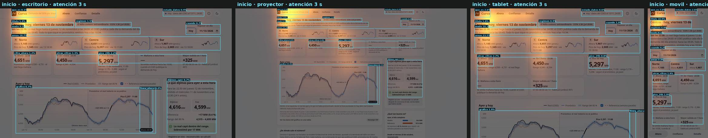
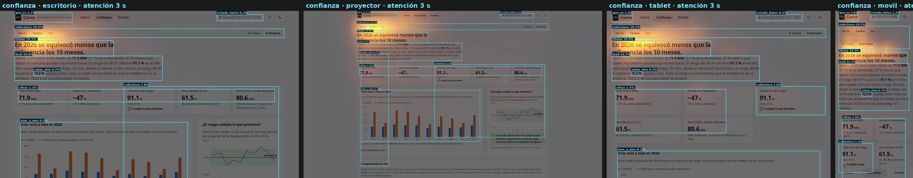

# Línea base: la app de `develop` medida con el arnés de atención

`develop` en `d67ca77` (iteración 8: «Ahora», «Confianza» y «Detalle»), con el backend real (combinado; en vivo,
Chronos-2 ajustado), el 13 de noviembre de 2026 a las 22:30 de Lima. 32 capturas: 4 pantallas × 4 viewports × claro y
oscuro. Método y validez en [`metodo.md`](metodo.md); las tablas completas (todas las AOI, las 32 capturas) en
[`app/medicion/resultados/atencion/base.md`](../../app/medicion/resultados/atencion/base.md) y el detalle en
`base.json`.

**Antes de leer las cifras.** Es atención **sintética**: un lector de saliencia de visión libre (CC 0.69 con las miradas
reales de UEyes) predice dónde caen los primeros vistazos, no qué entiende una persona ni qué busca con una tarea.
Las pruebas de 5 segundos y de primer clic son reglas sobre lo que está a la vista. Nada se probó con personas.

**Ruido del instrumento.** Dos corridas completas del mismo build (`base` y `base-r2`, minutos de diferencia): la
cuota de atención de las AOI no cambia ni en la cuarta decimal. El lector es determinista; lo que mueve las cifras es el
contenido. «Inicio» está en vivo y cambia con la hora (a las 22:30 el pico del día ya pasó), así que se compara con
capturas de la misma media hora o en repaso (`ahora`).

## 1. Los hallazgos, en orden

| # | Hallazgo | Cifra (claro; escritorio salvo que se diga) | PR |
|---|---|---|---|
| 1 | **En la primera apertura no hay punto de entrada**: compiten 12 controles y 56 cifras, y la atención se va a las tarjetas de área, la marca y el párrafo de modo, no a la respuesta | Tarjetas de área 18.7 %; cifra de ahora 1.2 %; pico 2.2 %; 40 magnitudes + 16 horas a la vista (proyector: 56 + 22) | 1–3 |
| 2 | **No se entiende qué es Curva ni sus palabras** | Prueba de 5 s: 4 / 3 / 3 / 3 de 6 (escritorio, proyector, tablet, móvil); «¿qué es esto?» solo pasa en escritorio y al límite (5.2 %); 11 términos a la vista sin definir, 9 sin explicación en ninguna parte de la pantalla | 1, 3, 4 |
| 3 | **El punto de «ahora» del gráfico no se ve**, y en tablet y móvil el gráfico ni entra en la primera pantalla | 0.0 % de la atención (lift 0.09) en escritorio, 0.1 % (lift 0.36) en proyector; gráfico 6.7 % (lift 0.32) a 1366 px; en móvil empieza a 989 px de 812 | 7, 8 |
| 4 | **La jerarquía de cifras está invertida**: el pico (40 px) opaca a ahora (28 px), y en vivo habla del pasado; una de cinco tarjetas está vacía | Pico 2.2 % frente a ahora 1.2 %; a las 22:30, «Pico de hoy 5,297 MW… según el pronóstico, ya pasó»; «Mañana a esta hora: —» | 2 |
| 5 | **La rendición de cuentas queda fuera del recorrido** | «Lo que dijimos ayer»: 0.7 % (lift 0.16); fuera de la vista en tablet y móvil | 9 |
| 6 | **Confianza: el aviso que importa se pierde junto a un veredicto que dice lo contrario** | Titular 29.1 % (lift 9.4, funciona); aviso en vivo (el rango del 80 % cubrió 73.2 %) 0.2 % y 1.4 % de su área a la vista; la tarjeta de cobertura dice «Cumple lo que promete» (91.1 %); selectores 20.9 % (lift 4.2) | 10, 11 |
| 7 | **Fijar otra hora cuesta 15 acciones** con controles nativos que hablan en formato estadounidense | T1: 13 pulsaciones, 7.1 s KLM; `03/10/2026` y `07:00 PM` con la página en español | 5, 6 |
| 8 | **El camino a las tareas no tiene olor**: dos de seis tareas no tienen ningún control con sus palabras en la entrada | Primer clic sintético: 3 de 6 en las cuatro vistas; T3 (calor) y T4 (El Niño) caen en la tarjeta de área o la marca | 1–4, 8 |
| 9 | **«Detalle» es otro sistema** y repite lo de «Ahora» | 12 tamaños de letra (5 propios); Jaccard de tamaños con «Ahora» 0.44 (Ahora~Confianza 0.73); 19 / 29 controles a la vista (escritorio / proyector) | 13 |
| 10 | **Un mismo concepto, varios nombres** | 5 conceptos con más de un nombre entre pantallas: Pronóstico/Modelo, Rango del N %/Rango probable, Pico de hoy/Pico 24 h/Máximo, Referencia (…)/Referencia: …, Error medio/MAE | 4 |
| 11 | **Párrafos demasiado anchos** | 4 bloques de más de 80 caracteres por línea en «Ahora» (101, 112, 113 y 117) y 3 en «Confianza» (103, 111 y 129); en tablet, hasta 158 | 3, 13 |
| 12 | **La banda del rango casi no se ve en claro** | 1.22:1 contra su fondo (1.36:1 en oscuro), calculado de los tokens | 7 |

**Lo que está bien y hay que conservar:** 0 px de desborde horizontal en las 32 capturas; 0 colores fuera del sistema
(los tokens de `:root` cubren todo; 1 o 2 mezclas `color-mix` derivadas por pantalla); una sola familia tipográfica;
el titular de «Confianza» se lleva casi un tercio de la atención; el estado de los datos («Hoy · datos del COES al
12/11») responde «¿es real o pronóstico?» en la prueba de 5 s en tres de cuatro vistas; y la pantalla activa siempre
está marcada en la navegación.

## 2. Atención por AOI

Cuota de la atención predicha a 3 s (y lift: cuota ÷ fracción del área; más de 1 = se mira más que lo que ocupa).
Tema claro; el oscuro difiere en uno a tres puntos y está en `base.md`.

### Inicio (la URL raíz, en vivo)

| AOI | Escritorio 1366×768 | Proyector 1920×1080 | Tablet 1024×768 | Móvil 375×812 |
|---|---|---|---|---|
| Cifra de ahora | 1.2 % (2.5) | 0.9 % (3.7) | 1.7 % (2.7) | 2.1 % (1.5) |
| Pico de 24 h | 2.2 % (3.2) | 1.5 % (4.1) | 0.8 % (0.9) | 1.9 % (0.8) |
| Línea y pastilla de «ahora» | 0.0 % (0.09) | 0.1 % (0.36) | 0.0 % (0.02; asoma el 14 %) | fuera de la vista |
| Estado de los datos (cabecera) | 0.4 % (0.6) | 0.4 % (0.9) | 0.6 % (0.6) | 2.6 % (1.8) |
| Lo que dijimos ayer | 0.7 % (0.17) | 1.1 % (0.5) | fuera de la vista | fuera de la vista |
| Título (área y fecha) | 5.4 % (5.7) | 3.9 % (8.1) | 5.8 % (4.6) | 18.9 % (4.3) |
| Marca («qué es») | 8.1 % (7.3) | 5.9 % (10.5) | 2.6 % (5.1) | 7.0 % (5.3) |
| Párrafo de modo | 9.5 % (3.4) | 6.9 % (4.8) | 10.3 % (2.8) | 8.1 % (0.9) |
| Otras cifras (1 h, mañana, subida) | 1.3 % (1.0) | 1.0 % (1.5) | 2.7 % (1.5) | 1.4 % (0.4) |
| Gráfico (el resto) | 6.7 % (0.32) | 15.4 % (1.2) | 1.9 % (0.10) | fuera de la vista |
| Tarjetas de área | 18.7 % (1.9) | 14.3 % (2.9) | 23.5 % (1.9) | 7.3 % (1.0) |
| Controles de fecha | 0.7 % (0.6) | 0.6 % (1.0) | 1.0 % (0.6) | 9.2 % (1.3) |
| Chip de El Niño | 1.5 % (1.7) | 1.4 % (3.2) | 0.9 % (0.8) | 6.0 % (2.0) |

Lectura: lo que la pantalla tiene que comunicar primero (cifra de ahora, pico, punto de «ahora», estado de los datos y
«lo que dijimos ayer») suma **4.6 %** en escritorio; las tarjetas de área, la marca, el título y el párrafo de modo,
**41.7 %**. Las cifras tienen lift alto (se miran más que su área) pero son diminutas frente a lo que las rodea.

### Ahora en repaso (el caso de las tareas: Centro, 10-mar-2026, 19:00)

| AOI | Escritorio | Proyector | Tablet | Móvil |
|---|---|---|---|---|
| Cifra de ahora | 1.0 % (2.1) | 0.9 % (3.9) | 0.8 % (1.2) | 1.6 % (1.1) |
| Pico de 24 h | 2.4 % (2.9) | 1.4 % (3.3) | 1.1 % (1.0) | 1.5 % (0.5) |
| Línea y pastilla de «ahora» | 0.0 % (0.14) | 0.1 % (0.67) | 0.0 % (0.07; asoma el 8 %) | fuera de la vista |
| Lo que dijimos ayer | 0.6 % (0.13) | 1.1 % (0.5) | fuera de la vista | fuera de la vista |
| Tarjetas de área | 17.8 % (1.9) | 15.0 % (3.1) | 19.5 % (1.6) | 5.9 % (0.8) |
| Controles de fecha | 4.0 % (1.1) | 2.6 % (1.5) | 15.9 % (3.2) | 16.7 % (1.3) |
| Gráfico | 6.2 % (0.30) | 14.1 % (1.1) | 0.5 % (0.05) | fuera de la vista |

En repaso los controles de fecha crecen (fecha, hora y «Mostrar lo que pasó después») y en tablet y móvil se llevan
más atención que todas las cifras juntas.

### Confianza

| AOI | Escritorio | Proyector | Tablet | Móvil |
|---|---|---|---|---|
| Titular-veredicto | 29.1 % (9.4) | 15.9 % (10.1) | 29.9 % (7.2) | 24.3 % (4.0) |
| Cobertura del rango (tarjeta y gráfico) | 1.8 % (0.18) | 3.0 % (0.59) | 1.6 % (0.30) | 1.2 % (0.18) |
| Aviso en vivo (73.2 %) | 0.2 % (1.7) | 0.2 % (0.95) | 0.2 % (1.4) | 0.1 % (0.29) |
| Error mes a mes | 0.5 % (0.04) | 3.7 % (0.42) | 0.1 % (0.04) | fuera de la vista |
| Párrafo de entrada | 10.0 % (1.4) | 11.4 % (3.1) | 10.7 % (1.1) | 15.2 % (0.6) |
| Selectores de área y horizonte | 20.9 % (4.2) | 14.7 % (5.9) | 18.1 % (3.5) | 29.7 % (2.4) |

### Detalle

| AOI | Escritorio | Proyector | Tablet | Móvil |
|---|---|---|---|---|
| Cifra (4,767 MW, 52 px) | 7.3 % (4.9) | 6.2 % (8.1) | 8.6 % (4.3) | 14.5 % (2.4) |
| Rango | 2.6 % (1.7) | 3.2 % (4.0) | 3.1 % (1.5) | 6.7 % (1.0) |
| Curva | 11.8 % (0.67) | 10.0 % (1.1) | 10.5 % (0.67) | fuera de la vista |
| Botones de sección | 10.0 % (1.5) | 8.2 % (2.5) | 11.4 % (1.4) | 9.0 % (1.2) |

En «Detalle» la cifra sí manda (52 px, lift 4.9): es la jerarquía que «Ahora» perdió (hallazgo 4).





Las láminas de «Ahora» en repaso, «Detalle» y las versiones en oscuro están en [`img/`](img/).

## 3. Primera apertura

Detalle y conceptos en [`onboarding.md`](onboarding.md).

| Sin desplazarse | Escritorio | Proyector | Tablet | Móvil |
|---|---|---|---|---|
| Controles a la vista | 12 | 14 | 12 | 10 |
| Magnitudes / horas a la vista (más las del eje del gráfico) | 40 / 16 (+9) | 56 / 22 (+9) | 29 / 14 (+6) | 22 / 11 |
| Palabras a la vista | 356 | 577 | 249 | 170 |
| Pantallas de alto de la página | 1.9 | 1.3 | 2.8 | 3.8 |
| Términos a la vista sin definir (de ellos, sin explicación en toda la pantalla) | 11 (9) | 10 (9) | 9 (8) | 7 (7) |

**Prueba de 5 segundos sintética** (se responde si la respuesta está a la vista con su texto y se lleva ≥ 5 % de la
atención a 7 s):

| Pregunta | Escritorio | Proyector | Tablet | Móvil |
|---|---|---|---|---|
| ¿Qué es esto? | sí (5.2 %) | no (4.0 %) | no (subtítulo oculto) | no (subtítulo oculto) |
| ¿De qué zona habla? | no (3.7 %) | no (2.6 %) | no (4.1 %) | sí (11.7 %) |
| ¿Cuánta demanda hay ahora? | no (1.1 %) | no (0.8 %) | no (1.8 %) | no (3.0 %) |
| ¿Es real o pronóstico, y hasta cuándo hay datos? | sí (7.6 %) | sí (5.7 %) | sí (9.8 %) | sí (9.9 %) |
| ¿Viene más o menos demanda? | sí (13.4 %) | sí (20.3 %) | sí (7.6 %) | no (4.2 %, sin gráfico) |
| ¿Qué puedo hacer aquí? | sí | sí | sí | sí |
| **Respondidas** | **4 de 6** | **3 de 6** | **3 de 6** | **3 de 6** |

**Primer clic sintético** desde la raíz (el control con más palabras de la tarea; a igualdad, el más mirado):

| Tarea | Escritorio y tablet | Móvil | Correcto |
|---|---|---|---|
| T1 pronóstico de un día pasado | «Repasar un día» ✓ | ✓ | fecha |
| T2 ¿me puedo fiar? | «Confianza» ✓ | ✓ | Confianza |
| T3 ¿y si hace 2 °C más? | tarjeta Norte ✗ | marca ✗ | en vivo no hay enlace; «Detalle» no lo dice |
| T4 ¿con qué fase de El Niño yerra más? | tarjeta Norte ✗ | marca ✗ | «Confianza», que no dice «error» ni «El Niño» |
| T5 ver el Sur | tarjeta Sur ✓ | ✓ | tarjeta Sur |
| T6 descargar los datos | «Modelo y datos» ✗ | marca ✗ | «Descargar CSV», bajo el pliegue |

En el proyector, T6 acierta (el CSV entra en la pantalla) y T1 falla por un artefacto de la regla: «Referencia
(semana pasada)» comparte la raíz «pasad-» con la tarea. Es una regla burda a propósito; sirve para comparar
versiones, no como predicción de lo que hará una persona.

**Pasos hasta la primera acción útil** (del arnés de tareas, iteración 8): ver el pronóstico de un día y hora concretos
desde la raíz son 15 acciones (13 pulsaciones en los campos de fecha y hora), 7.1 s estimados con KLM. Las tareas T2 a
T4 del arnés empiezan en el caso en repaso, no en la primera apertura: el plan agrega esa variante.

## 4. Métricas baratas

| | Inicio | Ahora (repaso) | Confianza | Detalle |
|---|---|---|---|---|
| Pantallas de alto (escritorio / móvil) | 1.9 / 3.8 | 1.8 / 3.8 | 4.3 / 7.7 | 3.9 / 5.9 |
| Desborde horizontal, px (las 4 vistas) | 0 | 0 | 0 | 0 |
| Caracteres por línea: mediana (máx.), escritorio | 35 (117) | 37 (133) | 39 (129) | 54 (76) |
| Bloques de más de 80 ch/línea (escritorio / tablet) | 4 / 4 | 2 / 2 | 3 / 4 | 0 / 0 |
| Colores fuera del sistema | 0 | 0 | 0 | 0 |
| Tamaños de letra distintos | 11 | 11 | 8 | 12 |
| Controles a la vista (escritorio / proyector / móvil) | 12 / 14 / 10 | 15 / 17 / 13 | 11 / 12 / 10 | 19 / 29 / 12 |

Consistencia entre pantallas (Jaccard, escritorio claro): tamaños de letra Ahora~Confianza 0.73, Ahora~Detalle 0.44,
Confianza~Detalle 0.43; colores 0.62, 0.65 y 0.65. En móvil, 0.82, 0.53 y 0.50 en tamaños.

## 5. Cómo se obtuvo

```bash
PUERTO_API=8100 PUERTO_WEB=8180 UV_PROJECT_ENVIRONMENT=<venv> app/levantar.sh
export UV_PROJECT_ENVIRONMENT=<venv> TPF_WEB=http://localhost:8180 TPF_API=http://localhost:8100
LAMINAS=docs/auditoria/img app/medicion/atencion/medir.sh base
COMPARAR=base app/medicion/atencion/medir.sh base-r2
```
