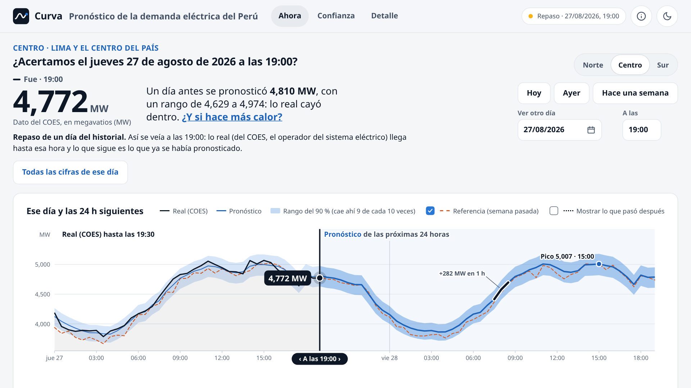
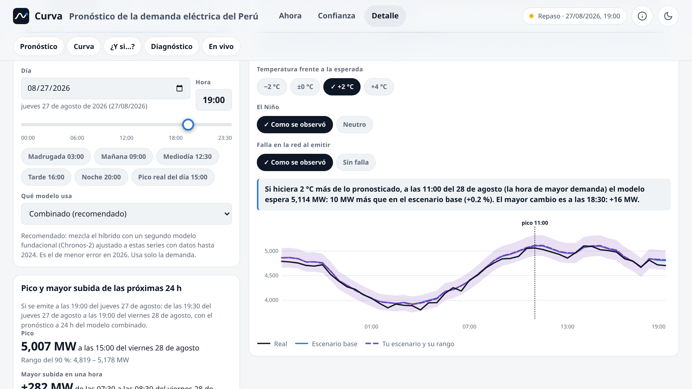
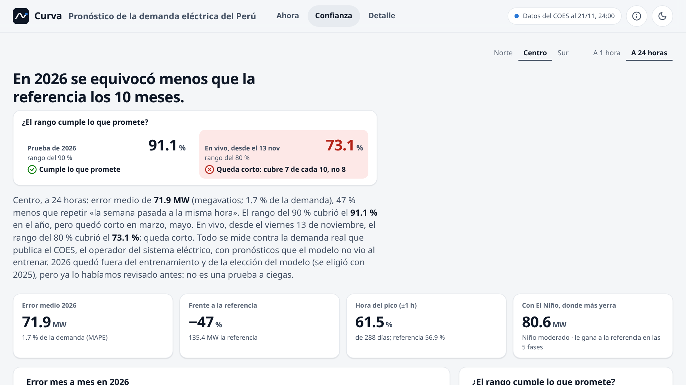

## {.portada background-color="#0E1726" background-image="img/portada.svg" background-size="44% auto" background-position="95% 78%"}

[]{.quien}

[{width=46 height=46} Curva]{.marca}

::: {.titulo-portada}
Pronóstico de la demanda eléctrica ante niveles nunca vistos
:::

::: {.sub}
De Tetuán a El Niño de 2026 en el SEIN
:::

::: {.autores}

:::

::: {.curso}
Trabajo final (TB1) · Metodología para Data Science · UPC, ciclo 2026-2 · Grupo 3
:::

::: notes
[0:00–0:20 · Expositor 1]
«Buenas noches. Somos el Grupo 3.»
«Nuestro trabajo pronostica la demanda eléctrica del Perú una hora y un día antes.»
«Y lo pone a prueba en el peor momento posible: El Niño Costero de 2026.»
(El dibujo de la derecha es la demanda media mensual del SEIN de 2016 a 2026: la caída es la cuarentena de 2020 y la línea celeste, 2026, pasa por encima del máximo de los nueve años anteriores, la línea punteada.)
:::

## El problema: saber la demanda antes de que ocurra

[]{.quien}

::: {.tarjetas .dos}
::: {}
[Operación en tiempo real]{.k}

[1 h]{.cifra .azul}

[Subir o bajar centrales, la reserva, arrancar unidades rápidas.]{.t}
:::

::: {}
[Programa del día siguiente]{.k}

[24 h]{.cifra .azul}

[Qué centrales generan mañana y con cuánta reserva.]{.t}
:::
:::

::: {.chips}
[Norte]{.chip .on} [Centro]{.chip .on} [Sur]{.chip .on}
[Por área: las líneas entre áreas tienen límite. Un desvío en el Norte no siempre se cubre desde el Centro.]{.chip}
:::

::: {.aviso .fragment}
**Subestimar cuesta más que sobrestimar:** obliga a arrancar generación cara de urgencia o, en el extremo, a cortar
carga.
:::

::: notes
[0:20–1:40 · Expositor 1]
«El COES es el que opera el sistema eléctrico nacional, el SEIN.»
«Todos los días decide qué centrales generan y cuánta reserva deja.»
«El problema es que la demanda la conoce recién cuando ya ocurrió.»
«Por eso necesita anticiparla a dos plazos.»
«A una hora, para la operación en tiempo real: subir o bajar centrales, arrancar unidades rápidas.»
«A 24 horas, para armar el programa del día siguiente.»
«Y la necesita por área: Norte, Centro y Sur. Las líneas entre áreas tienen límite, así que un desvío en el Norte
no siempre se cubre desde el Centro.»
[clic] «Equivocarse por abajo cuesta más que equivocarse por arriba: obliga a arrancar generación cara de urgencia
o, en el extremo, a cortar carga.»
Cifra: ninguna. Fuente: informe técnico, §3 y tabla de negocio de §4.1.
:::

## ¿Por qué ahora? El Niño Costero de 2026

[]{.quien}

::: {.par}
[[]{.cifra .naranja} ICEN de agosto de 2026: el mayor desde 1997-98 (en setiembre, )]{}

[[+ %]{.cifra .naranja} demanda del Norte sobre el mismo mes de 2025: sale de lo que el modelo vio]{}
:::

::: {.chips style="margin-top: 0.9em;"}
[Objetivo: una metodología que aguante cuando la demanda sale de lo visto, y medir qué ayuda más a adaptarla]{.chip .on}
:::

::: {.chips}
[OE1 · Tetuán]{.chip} [OE2 · Ceuta]{.chip} [OE3 · SEIN, el caso central]{.chip .azul}
[de menor a mayor dificultad]{.nota}
:::

::: {.llamada .fragment}
**Criterio de éxito, fijado antes de modelar:** ganarle a la mejor de tres reglas simples (lo mismo que ahora, que
ayer o que la semana pasada a esa hora) en cada área y en cada horizonte.
:::

::: notes
[1:40–3:00 · Expositor 1]
«¿Por qué ahora? Porque 2026 es un año extraordinario.»
«El Índice Costero El Niño, el ICEN, llegó a 3.98 en agosto, el valor más alto desde 1997-98, y siguió subiendo:
4.50 en setiembre.»
«Y la demanda del Norte creció hasta 17 % sobre 2025.»
«Ese es justo el caso en que un modelo entrenado con el pasado puede fallar: la demanda sale de lo que vio.»
«Nuestro objetivo es una metodología que aguante eso, y medir qué ayuda más a adaptarla.»
«La probamos tres veces, cada vez más difícil: Tetuán, Ceuta y el SEIN.»
[clic] «Y fijamos el criterio de éxito antes de modelar: el modelo tiene que ganarle a la mejor de tres reglas
simples, en cada área y en cada horizonte.»
«Las reglas son: lo mismo que ahora, lo mismo que ayer a esa hora y lo mismo que la semana pasada a esa hora.»
Ojo: para el ENFEN el evento empezó en marzo de 2026; no decir que empezó en noviembre.
Pase: «Ahora [Expositor 2] les cuenta con qué datos trabajamos.»
:::

## Tres casos, de menor a mayor dificultad

[]{.quien}

::: {.tarjetas .tres}
::: {}
[OE1 · Marruecos · UCI]{.k}

[Tetuán]{.t}

[]{.cifra .media}

Un solo año, 2017, cada 10 minutos, tres zonas.
:::

::: {}
[OE2 · España · Red Eléctrica]{.k}

[Ceuta]{.t}

[]{.cifra .media}

De 2019 a 2026, cada 10 minutos: siete veranos para ver si lo de Tetuán se repite.
:::

::: {.destacada}
[OE3 · Perú · COES]{.k}

[SEIN, el caso central]{.t}

[]{.cifra .media .azul}

De 2016 a octubre de 2026, cada 30 minutos, por área.
:::
:::

::: {.chips}
[A la demanda del SEIN le sumamos:]{.nota} [clima (ERA5)]{.chip} [El Niño (ICEN y Niño 1+2)]{.chip}
[eventos del COES]{.chip} [feriados]{.chip}
:::

::: {.particion}
::: {.entrenar}
**2016-2024** · entrenar
:::

::: {.validar}
**2025** · elegir
:::

::: {.probar}
**2026** · probar, una vez
:::
:::

::: notes
[3:00–4:30 · Expositor 2]
«Trabajamos con tres sistemas eléctricos, todos con datos públicos.»
«Tetuán, en Marruecos: un dataset de la UCI con un solo año, 2017, cada 10 minutos.»
«Ceuta, en España: siete veranos de datos de Red Eléctrica. Nos sirve para ver si lo de Tetuán se repite en otro
sistema.»
«Y el caso central, el SEIN: datos del COES de 2016 a octubre de 2026, cada 30 minutos, por área. Son 189,504
periodos.»
«A la demanda le sumamos el clima, los índices de El Niño, los eventos del COES y los feriados.»
«Partimos el tiempo en tres: entrenamos con 2016 a 2024, elegimos el modelo con 2025 y probamos en 2026, una sola
vez.»
Cifras: 52,416 registros (Tetuán), 391,975 intervalos (Ceuta), 189,504 periodos (SEIN).
Ojo: no decir que se usó el SAIDI; aparece en la tabla de fuentes, pero esa variante no se corrió.
:::

## Lo que encontramos en los datos

[]{.quien}

::: {.hallazgos}
::: {}
[**1** · La demanda crece **+ %**]{.t}

La media del SEIN pasó de  MW en 2016 a  en 2025. Un modelo que
aprende el nivel envejece rápido.
:::

::: {}
[**2** · El pico se movió]{.t}

El máximo caía entre las 18 y las 23 h el  % de los días en 2016; desde 2023, entre el
 %. Las horas de mayor demanda van por área y por año.
:::

::: {}
[**3** · El Sur es distinto]{.t}

El domingo casi no baja ( %) y la temperatura no explica su demanda
(r = ): es carga minera e industrial.
:::

::: {}
[**4** · El Niño no es una sola señal]{.t}

La demanda del Norte:  % en 2017,  % en 2023 y
 % en 2026. Si el efecto cambia de signo, el índice difícilmente ayuda.
:::
:::

::: {.aviso}
**Aviso de calidad:** la variable de fallas del COES está activa en el  % de los
periodos de 2025. Refleja cómo se registran los eventos, no si la red falla.
:::

::: notes
[4:30–6:30 · Expositor 2]
«Antes de modelar exploramos los datos. Cuatro cosas cambiaron nuestro diseño.»
«Uno: la demanda crece. La media del SEIN pasó de 5,496 megavatios en 2016 a 6,982 en 2025. Es 27 % más.»
«Si el modelo aprende el nivel, queda viejo rápido. De ahí sale nuestra idea principal, que les explica mi
compañero.»
«Dos: el pico se movió. En 2016, el 87 % de los días el máximo caía entre las seis y las once de la noche. Desde
2023, solo entre el 25 y el 33 %.»
«Por eso las horas de mayor demanda las definimos por área y por año.»
«Tres: el Sur es distinto. El domingo casi no baja y la temperatura no explica su demanda. Es carga minera e
industrial.»
«Cuatro: El Niño no es una sola señal. En 2017 la demanda del Norte cayó; en 2023 y en 2026, subió.»
«Si el efecto cambia de signo, es difícil que el índice de El Niño ayude como variable. Lo vamos a ver en los
resultados.»
«Y un aviso de calidad: la variable de fallas del COES está activa en el 91 % de los periodos de 2025. Refleja cómo
se registran los eventos, no si la red falla.»
Pase: «[Expositor 3] les explica cómo preparamos los datos.»
:::

## Preparación: tres decisiones

[]{.quien}

::: {.tarjetas .tres}
::: {}
[1]{.num}

[Regla de información]{.t}

Cada variable entra solo con lo que se sabía al predecir: el ICEN, con dos o tres meses de rezago; la temperatura,
con la última hora publicada. Cubierto con pruebas automáticas.
:::

::: {.destacada}
[2]{.num}

[Objetivo en razón]{.t}

Demanda futura ÷ media de las últimas 24 horas. Tetuán, Zona 1, mismo algoritmo:

[[]{.cifra .chica .azul} kW de error pidiendo la razón · []{.cifra .chica .tenue} kW pidiendo el nivel]{}
:::

::: {}
[3]{.num}

[Partición por fechas, con hueco]{.t}

Nunca al azar. Entre tramos queda un hueco para que nada del futuro se cuele. 2026 se apartó en la primera celda.
:::
:::

::: {.particion}
::: {.entrenar}
**** periodos para entrenar · 2016-2024
:::

::: {.hueco}
:::

::: {.validar}
**** · validar · 2025
:::

::: {.hueco}
:::

::: {.probar}
**** · probar · 2026
:::
:::

[Periodos de 30 minutos por área, a 1 hora.]{.nota}

::: notes
[6:30–8:40 · Expositor 3]
«Tomamos tres decisiones de preparación.»
«La primera es la regla de información: cada variable entra solo con lo que el operador sabía en el momento de
predecir.»
«Por ejemplo, el ICEN se publica con dos o tres meses de rezago, y así entra. De la temperatura, solo la última hora
ya publicada.»
«Así evitamos la fuga de información, que es el error más común en series de tiempo. Y está cubierto con pruebas
automáticas en el código.»
«La segunda es la más importante: no le pedimos al modelo los megavatios. Le pedimos una razón.»
«La razón es la demanda futura dividida entre la media de las últimas 24 horas. Después multiplicamos por esa media
para volver a megavatios.»
«¿Por qué? Porque los modelos de árboles no pueden predecir valores que nunca vieron. Pero la forma del día, en
comparación con ayer, sí la conocen.»
«En Tetuán, con el mismo algoritmo: pidiendo el nivel, 738.5 kilovatios de error; pidiendo la razón, 613.4.»
(La mejor referencia daba 1,159.6.)
«La tercera: partimos por fechas, nunca al azar, y dejamos un hueco entre tramos para que nada del futuro se
cuele.»
«Quedan 154,791 periodos para entrenar, 17,518 para validar y 13,920 para la prueba, en cada área.»
«Y 2026 se apartó en la primera celda del notebook de modelado. No volvió a aparecer hasta la prueba final.»
«Esta idea de la razón nació de un error nuestro. Lo contamos al final.»
:::

## Modelado: tres algoritmos y una regla para elegir

[]{.quien}

:::: {.columns}
::: {.column width="56%"}
[Mejora frente a la mejor referencia · validación de 2025]{.eyebrow}

::: {.d3 data-grafico="barras" data-serie="validacion" data-ancho="640" data-etiqueta="200"}
:::

::: {.lista style="font-size: 0.62em;"}
- Validación cruzada temporal de 5 pliegues, siempre con el pasado
- La regla para elegir se escribió antes de ver las cifras: gana el que más reduce el error, en promedio de las
  tres áreas
- Random Forest y XGBoost empatan en la práctica: se reportan los dos
:::
:::

::: {.column width="44%"}
[Importancia por permutación · Centro]{.eyebrow}

::: {.par style="flex-direction: column; align-items: flex-start; gap: 0.5em;"}
[[ MW]{.cifra .media .azul} la demanda reciente y el calendario]{}

[[ MW]{.cifra .media .tenue} el clima]{}
:::

::: {.llamada}
Lo que más sirve para saber la demanda de la próxima hora es la demanda de ahora.
:::
:::
::::

::: notes
[8:40–10:30 · Expositor 3]
«Probamos tres familias de algoritmos: Ridge, que es una regresión lineal; Random Forest; y XGBoost.»
«Buscamos los hiperparámetros con validación cruzada temporal: cinco pliegues, siempre entrenando con el pasado y
validando con lo que viene después.»
«Y escribimos la regla para elegir antes de ver los resultados: gana el que más reduce el error frente a la mejor
referencia, en promedio de las tres áreas.»
«En 2025 ganó Random Forest, con 43.2 % de mejora. Pero XGBoost quedó en 42.9 %. En la práctica es un empate, así
que reportamos los dos.»
«Ridge quedó lejos, con 26.4 %: aquí sí importan las combinaciones de hora, día y demanda reciente.»
«¿Qué variables pesan más? Lo medimos con importancia por permutación.»
«En el Centro, la demanda reciente y el calendario suman 248 megavatios de importancia. El clima, apenas 1.1.»
«En palabras simples: lo que más sirve para saber la demanda de la próxima hora es la demanda de ahora.»
Pase: «[Expositor 4] les muestra los resultados.»
:::

## Antes de 2026: todo depende de la referencia

[]{.quien}

::: {.d3 data-grafico="reanalisis"}
:::

::: {.fragment .paso data-paso="1"}
&nbsp;
:::

::: {.fragment .paso data-paso="2"}
&nbsp;
:::

::: {.chips style="margin-top: 0.2em;"}
[SEIN, con nueve años de historia (2023-2025): le gana a las tres reglas en  de  meses-área]{.chip .azul}
:::

::: notes
[10:30–11:40 · Expositor 4]
«Antes de 2026 probamos el método con poca historia: Tetuán y Ceuta.»
«En Tetuán, con un año de datos, el modelo tuvo entre 41 y 56 % menos error que las tres reglas simples.»
(En el gráfico: más a la izquierda, menos error; el punto azul es el modelo.)
[clic] «Después probamos una regla más fuerte, el delta: la demanda de ahora más lo que cambió a esa hora ayer o la
semana pasada.»
«Frente al promedio de los dos deltas, el modelo gana en una zona y pierde en dos.»
[clic] «En Ceuta, el delta semanal le gana los cinco veranos: 2.06 contra 2.33 % de error.»
«La lección: con poca historia, la conclusión depende de contra qué te comparas.»
«Por eso en el SEIN entrenamos con nueve años, solo con lo que se sabía al predecir, y probamos fuera de lo visto.
De 2023 a 2025 le ganó a las tres reglas en los 108 meses-área.»
Cifras: Tetuán frente a las tres reglas 44.8 / 55.9 / 40.7 %; frente al promedio de los deltas +3.8 / −3.9 /
−16.5 %. Ceuta: 2.33 % el modelo sin verano, 2.06 % el delta semanal. SEIN: 108 de 108, mejora mediana de 44.6 %.
Ojo: no decir que en Tetuán «le gana a todo» ni que el delta es «un error del modelo»: es una referencia más fuerte
que agregamos después, sobre ventanas ya vistas, y el resultado es descriptivo. Tampoco decir que en el SEIN le gana
al delta o al COES: esas comparaciones están en curso.
:::

## La prueba: 2026, con El Niño extraordinario

[]{.quien}

::: {.d3 data-grafico="prueba"}
:::

::: {.fragment .paso data-paso="1"}
&nbsp;
:::

::: {.fragment .paso data-paso="2"}
&nbsp;
:::

[Del 1 de enero al 17 de octubre de 2026 (al 16 a 24 horas). Modelo entrenado hasta 2025, sin tocar y corrido una sola vez; los intervalos al 95 % quedan lejos del cero. La mejora es mayor que en 2025 en  de los 6 casos.]{.nota}

::: notes
[11:40–12:40 · Expositor 4]
«Ahora, la prueba de verdad: 2026, con El Niño extraordinario.»
«El modelo se entrenó hasta 2025 y no se tocó durante la prueba. La corrimos una sola vez.»
«A una hora, el error bajó 51.7 % en el Norte, 57.9 % en el Centro y 29.1 % en el Sur, frente a la mejor de las
tres reglas simples.»
«A 24 horas, 34.5, 42.2 y 11.9 %.»
«Ganó en las tres áreas y en los dos horizontes, con intervalos lejos del cero.»
«Y en cinco de los seis casos la mejora fue mayor que en 2025, que fue un año normal.»
[clic] (El XGBoost global, en celeste, empata con el Random Forest, como en 2025.)
[clic] (La barra más oscura es el combinado con un modelo fundacional: se los cuenta [Expositor 5].)
Cifras: §5.4, tabla «El modelo fijo frente a las referencias» (Random Forest; del 1 de enero al 17 de octubre de
2026 a 1 h y al 16 de octubre a 24 h).
:::

## Mes a mes: no se degrada a medida que El Niño crece

[]{.quien}

::: {.d3 data-grafico="mensual"}
:::

::: {.fragment .paso data-paso="1"}
&nbsp;
:::

::: {.fragment .paso data-paso="2"}
&nbsp;
:::

[MAE mensual en MW. La mejora es la reducción del error del modelo frente a la mejor de las tres reglas en ese mes.]{.nota}

::: notes
[12:40–13:20 · Expositor 4]
«Mes a mes, la curva azul del modelo queda por debajo de la referencia todo el año, en las tres áreas y los dos
horizontes.»
[clic] «En el Norte, la mejora subió a medida que El Niño crecía: de 42.9 % en enero a 61.6 % en septiembre.»
[clic] «El único mes en que perdió fue en el Sur, a 24 horas, en octubre», cuando la demanda minera sube de golpe.
«La clave es la razón con la media de 24 horas: absorbe el salto de nivel.»
Cifras: §5.4, «No se degrada a medida que El Niño se intensifica» (Sur a 24 h en octubre: −4.1 %).
:::

## ¿Qué ayuda a adaptarse? Las dos cosas, alrededor de 1 %

[]{.quien}

:::: {.columns}
::: {.column width="58%"}
[Centro, a 1 hora, 2026 · error en MW, a la misma escala]{.eyebrow}

::: {.d3 data-grafico="barras" data-serie="adaptacion" data-ancho="680" data-etiqueta="270"}
:::

[Reentrenar cada semana baja el error a 1 hora en las tres áreas ( MW). A 24 horas, sin exógenas, no se distingue de no hacerlo.]{.nota}
:::

::: {.column width="42%"}
::: {.aviso style="margin-top: 0.2em;"}
**A 24 horas, el clima empeoró el pronóstico:** Centro  MW
(IC ) y Norte  MW. Temperaturas nunca vistas: los
árboles no extrapolan.
:::

::: {.llamada}
**Hipótesis escritas antes de evaluar 2026:**  no se cumplieron
(). Las reportamos tal como quedaron.
:::

[«Sin efecto» también es un resultado.]{.cierre style="display: block;"}
:::
::::

::: notes
[13:20–14:40 · Expositor 4]
«Nuestra pregunta del tercer objetivo era: ¿qué ayuda más a adaptarse, sumar clima y El Niño, o reentrenar más
seguido?»
«La respuesta: las dos cosas mueven el error alrededor de 1 %. Es poco.»
«A una hora, el clima ayuda algo solo en el Centro: menos de medio megavatio sobre 54.» (−0.46 MW el clima solo;
con El Niño, −0.55.)
«A 24 horas, el clima empeoró el pronóstico en el Norte y el Centro. Hubo temperaturas que nunca se habían visto, y
los árboles no extrapolan.»
«Reentrenar cada semana baja un poco el error a una hora en las tres áreas. A 24 horas, sin exógenas, no se
distingue de no hacerlo; con clima y El Niño baja algo, pero no alcanza al modelo sin exógenas.»
«Escribimos nuestras hipótesis antes de evaluar el modelo en 2026. Tres no se cumplieron, y lo reportamos así.»
«Para nosotros, "sin efecto" también es un resultado.»
Cifras: clima a 24 h, Centro +1.35 MW (IC 0.10 a 2.97) y Norte +0.42; reentrenar a 1 h sin exógenas, −0.14 / −0.43
/ −0.09 MW (§5.4). Efectos de 0.09 a 1.48 MW, alrededor del 1 % del error (§6.4, punto 2).
Ojo: no decir «las fallas no ayudan»; la variable de fallas no se pudo evaluar.
Pase: «[Expositor 5] les cuenta cómo quedamos frente a los modelos fundacionales y les muestra la app.»
:::

## Fundacionales: solos ganan a 1 h; combinados, en todo

[]{.quien}

::: {.d3 data-grafico="peso"}
:::

::: {.fragment .paso data-paso="1"}
&nbsp;
:::

::: {.fragment .paso data-paso="2"}
&nbsp;
:::

::: {.chips style="margin-top: 0;"}
[Elegido con 2025 (MW):]{.nota}
[Centro 1 h:  → ****]{.chip}
[Centro 24 h:  → ****]{.chip}
[Sur 24 h:  → ****]{.chip}
:::

[El gráfico es el Centro en 2026, que lo confirma. Círculo vacío: peso estimado como parámetros × 4 bytes, porque no se guardó el archivo. Extensión posterior a la prueba: no es una prueba ciega.]{.nota}

::: notes
[14:40–15:40 · Expositor 5]
«Además probamos ocho modelos fundacionales de series de tiempo, como Chronos-2 y TimesFM.»
«Son modelos preentrenados con millones de series de otros rubros, que pronostican una serie nueva sin entrenarse
con ella. Los corrimos así, sin entrenar, sobre las mismas filas que nuestro modelo.»
(La línea punteada es nuestro Random Forest: por debajo, mejor. Abajo, cuánto pesa cada modelo en disco.)
[clic] «Sin entrenar, ya ganan a una hora. A 24 horas no, en el Centro ni en el Norte: les falta el calendario.»
[clic] «Entonces ajustamos uno, Chronos-2, con nuestros datos hasta 2024 y el feriado, y lo sumamos a nuestro
modelo.»
«En el Centro, el error baja de 55 a 48 megavatios a una hora y de 86 a 75 a 24 horas. Y el Sur a 24 horas, que era
nuestro punto débil, mejora de 57 a 52.»
«¿Por qué funciona? El modelo preentrenado aporta el patrón reciente de la serie; nuestro XGBoost, el calendario y
el nivel.»
«Es una extensión posterior a la prueba: lo elegimos con 2025 y en 2026 se sostiene. Y necesita GPU para generar el
pronóstico; la app lo lee ya calculado y es el modelo con el que abre.»
Cifras (§5.5, MAE de 2025 en el Centro): Random Forest 54.6 → combinado 48.2 MW a 1 h; 86.1 → 75.2 a 24 h; Sur a
24 h, 56.7 → 51.8. En 2026: 54.1 → 48.8, 78.1 → 71.9 y 48.3 → 44.6.
Ojo: no decir que fue una prueba ciega en 2026 ni que reemplaza al modelo del paper; es la siguiente versión
propuesta, y sus pesos se fijaron en 2025, así que las cifras de 2025 son optimistas. El peso en disco de varios
fundacionales es estimado (círculo vacío). Si preguntan por la semilla: el ajuste fino se repitió con tres semillas
y el error cambia como mucho 0.2 MW. Tabla completa: respaldo.
:::

## La demo: un día de El Niño, pronosticado un día antes

[]{.quien}

::: {.d3 data-grafico="dia"}
:::

::: {.chips style="margin-top: 0.1em;"}
[[curva.rosewt.dev](https://curva.rosewt.dev)]{.chip .on}
[1 · «Ahora», hoy]{.chip} [2 · 27 de agosto, 19:00]{.chip} [3 · ¿y si hace 2 °C más?]{.chip}
[4 · «Confianza»]{.chip} [recorrido de  min]{.nota}
:::

::: notes
[15:40–18:40 · Expositor 5 · demo de la app]
Pasar a la ventana de Chrome con la app (zoom al 150 %). Este gráfico es el mismo día que se ve en el paso 2: el
combinado a 24 horas, emitido un día antes, con su rango del 90 %.
1 · «Ahora», hoy (Centro): «Esta es Curva: corre nuestros modelos sobre la demanda que publica el COES. Lo real
llega hasta ayer, porque el COES publica cada día a la mañana siguiente; desde la línea punteada todo es pronóstico,
emitido hoy antes de conocer el real. [bajar] Aquí, lo que dijimos para ayer a esta hora y lo que pasó.»
2 · El 27 de agosto de 2026, 19:00: «Ahora, un día de la prueba: el 27 de agosto de 2026, el mes en que el ICEN
llegó a 3.98. El modelo no vio 2026 al entrenarse. Un día antes pronosticó 4,810 megavatios para las 19:00; fue
4,772, dentro del rango. [tocar el pico] Toco el pico: para las 15:00 del día siguiente dijo 5,007 y fue 5,027.»
3 · «¿Y si hace más calor?», +2 °C: «¿Y si mañana hace dos grados más? Lo calcula el XGBoost, el único modelo que
usa el clima. [+2 °C] El pico sube 8 megavatios, 0.2 %: casi nada. Y en 2026 el clima empeoró el pronóstico a 24
horas: no conviene apoyarse en él en un evento extraordinario.»
4 · «Confianza»: «Aquí la app dice cuánto acertó: en 2026 le ganó a la referencia los diez meses, con 71.9
megavatios de error a 24 horas, 47 % menos, y su rango del 90 % cubrió el 91 %. Y lo honesto: en vivo, desde el 13
de noviembre, el rango del 80 % cubre el [leer la cifra roja] %: queda corto y lo mostramos en rojo. Es seguimiento
en curso, no un resultado.»
Volver a la presentación: «El diseño lo medimos con instrumentos sintéticos; falta probarlo con personas.»
Pase: «[Expositor 1] cierra.»
Plan B: si en 20 segundos la app no carga, sale un error o aparece el chip «Datos de prueba», no se arregla en vivo:
pasar a la pestaña de https://curva.rosewt.dev (ya despierta). Si tampoco responde: «Para no perder tiempo, les
muestro las capturas que tomamos con el mismo recorrido» (este gráfico y el respaldo R1 a R3). Si se cae la conexión
del Expositor 5, el Expositor 3 dice «Sigo yo» y comparte.
No decir «tiempo real» (es en vivo con un día de retraso), ni «el combinado está en vivo», ni «validado con
usuarios». La cifra en vivo de «Confianza» cambia cada día: leerla de la pantalla.
:::

## Conclusiones y recomendación

[]{.quien}

::: {.tarjetas .tres}
::: {}
[1]{.num}

[Con poca historia, una regla estacional fuerte es difícil de superar]{.t}

El delta le ganó al modelo en  zonas de Tetuán y en los
 veranos de Ceuta.
:::

::: {.destacada}
[2]{.num}

[En El Niño de 2026, el modelo sin tocar ganó a las tres reglas simples]{.t}

En todas las áreas y horizontes. Combinado con un modelo fundacional, mejora más.
:::

::: {}
[3]{.num}

[Lo que más aporta es pedir la razón, no el nivel]{.t}

El clima y reentrenar mueven el error alrededor de 1 %.
:::
:::

::: {.chips}
[Para el operador:]{.nota} [pronosticar la razón]{.chip .on} [medirse con la regla más fuerte]{.chip .on}
[reentrenar cada semana a 1 h]{.chip .on} [a 24 h, sin clima en un evento extraordinario]{.chip .on}
:::

::: {.leccion}
[**La lección: CRISP-DM es un ciclo.**]{}
[[ kW]{.cifra .tenue} al cambiar el algoritmo]{}
[[más de  kW]{.cifra .azul} al cambiar el objetivo]{}
:::

[Límites: un solo año y un solo evento; la comparación con el pronóstico oficial del COES y con los deltas en el SEIN sigue en curso; el seguimiento en vivo lleva pocos días.]{.nota}

::: notes
[18:40–20:00 · Expositor 1]
«Para cerrar, tres conclusiones.»
«Uno: con poca historia, una regla estacional fuerte es difícil de superar: el delta le ganó al modelo en dos zonas
de Tetuán y en los cinco veranos de Ceuta.»
«Dos: en El Niño de 2026, el modelo entrenado hasta 2025 y sin tocar le ganó a las tres reglas simples en todas las
áreas y horizontes. Combinado con un modelo fundacional, mejora más.»
«Tres: lo que más aporta es pedir la razón, no el nivel. No el clima, ni reentrenar.»
«Nuestra recomendación para el operador: pronosticar la razón, medirse contra la regla simple más fuerte,
reentrenar cada semana a una hora y no apoyarse en el clima a 24 horas durante un evento extraordinario.»
«Y la lección más grande: CRISP-DM es un ciclo. En el Entregable 7 nuestros modelos perdían contra "ayer a la misma
hora". Volvimos a la preparación.»
«Cambiar de algoritmo movió 18 kilovatios. Cambiar el objetivo, más de 1,200.»
«Nuestros límites: un solo año y un solo evento, la comparación con el COES y con los deltas en el SEIN sigue en
curso, y el seguimiento en vivo lleva pocos días.»
«Muchas gracias. Quedamos atentos a sus preguntas.»
Ojo: no decir que el modelo le gana al COES ni al pronóstico oficial.
:::

## {background-color="#0E1726" .center}

:::: {.columns}
::: {.column width="64%"}
[Grupo 3 · Metodología para Data Science · UPC 2026-2]{.eyebrow}

[Gracias]{.pregunta style="font-size: 2.4em; display: block;"}

[¿Preguntas?]{.sub style="font-size: 1.2em; display: block; margin-top: 0.2em;"}

::: {.lista style="margin-top: 1.2em; font-size: 0.66em;"}
- La app: [curva.rosewt.dev](https://curva.rosewt.dev)
- El código, los notebooks y el informe: [github.com/R0SEWT/tetouan-power-forecast](https://github.com/R0SEWT/tetouan-power-forecast)
:::
:::

::: {.column width="36%" .centro}
{.qr}

[Curva, en el celular]{.nota}
:::
::::

::: notes
Queda en pantalla durante las preguntas de la profesora (unos 10 minutos). Si piden ver la app en vivo:
https://curva.rosewt.dev. Después vienen las diapositivas de respaldo: R1 a R3 (capturas de la app, también para
el plan B de la demo), R4 (hipótesis), R5 (ablación), R6 (adaptación), R7 (limitaciones) y R8 (modelos
fundacionales). Las respuestas cortas a las preguntas probables están en docs/guia-defensa.md y en el kit de la
demo (docs/demo/README.md).
:::

# Respaldo {.respaldo background-color="#0E1726"}

::: notes
Solo para el plan B o si preguntan.
:::

## R1 · La pantalla «Ahora», el 27 de agosto de 2026 {.respaldo}

[Respaldo · plan B de la demo, pasos 1 y 2]{.eyebrow}

{.figura .captura style="max-height: 480px;"}

[Centro, jueves 27 de agosto de 2026, 19:00. Un día antes se pronosticó  MW, con rango de  a ; fue .]{.nota}

::: notes
Solo para el plan B o si preguntan. «Ahora, un día de la prueba: el 27 de agosto de 2026, el mes en que el ICEN
llegó a 3.98. El modelo no vio 2026 al entrenarse. Un día antes pronosticó 4,810 megavatios para las 19:00; fue
4,772, dentro del rango.» Al tocar el pico: para las 15:00 del día siguiente dijo 5,007 y fue 5,027.
:::

## R2 · ¿Y si hace 2 °C más? {.respaldo}

[Respaldo · plan B de la demo, paso 3]{.eyebrow}

{.figura .captura style="max-height: 480px;"}

[Solo el XGBoost base usa el clima. En 2026 el clima empeoró el pronóstico a 24 horas: no conviene apoyarse en él durante un evento extraordinario.]{.nota}

::: notes
Solo para el plan B o si preguntan. «¿Y si mañana hace dos grados más? Lo calcula el XGBoost, el único modelo que
usa el clima. El pico sube 8 megavatios, 0.2 %: casi nada. Y en 2026 el clima empeoró el pronóstico a 24 horas: no
conviene apoyarse en él en un evento extraordinario.» No usar el control «Falla en curso»: la variable de fallas no
se pudo evaluar.
:::

## R3 · La pantalla «Confianza» {.respaldo}

[Respaldo · plan B de la demo, paso 4]{.eyebrow}

{.figura .captura style="max-height: 480px;"}

[Centro, a 24 horas: en 2026,  MW de error. En vivo, el rango del 80 % queda corto y se muestra en rojo: es seguimiento en curso, no un resultado, y la cifra cambia cada día.]{.nota}

::: notes
Solo para el plan B o si preguntan. «Aquí la app dice cuánto acertó: en 2026 le ganó a la referencia los diez
meses, con 71.9 megavatios de error a 24 horas, 47 % menos, y su rango del 90 % cubrió el 91 %. Y lo honesto: en
vivo, desde el 13 de noviembre, el rango del 80 % cubre el [leer la cifra roja] %: queda corto y lo mostramos en
rojo. Es seguimiento en curso, no un resultado.» La cifra en vivo de la captura es la del día en que se tomó.
:::

## R4 · Las hipótesis, una por una {.respaldo}

[Respaldo · reportes/sein/prueba_2026/hipotesis.csv (notebook 03)]{.eyebrow}



[Escritas al cerrar 2025, antes de evaluar ningún modelo en 2026 (y después de explorar sus datos). Dos de las tres que no se cumplieron fallaron en la dirección que más interesa al operador: el modelo fue mejor de lo esperado en el Norte (1b) y el clima a 24 horas, peor (4).]{.nota}

::: notes
Solo si preguntan. Se reportan tal como quedaron escritas. Límite que conviene admitir si preguntan: las hipótesis
se escribieron después de explorar los datos de 2026.
:::

## R5 · Ablación de exógenas en 2026 {.respaldo}

[Respaldo · reportes/sein/prueba_2026/ablacion.csv (notebook 03)]{.eyebrow}



[Diferencia de MAE del modelo fijo al sumar cada grupo, en MW, con su intervalo del 95 % por bootstrap de días; negativo, la variable ayuda. En negrita, los intervalos que no cruzan el cero. Sin la variable de fallas, que no se pudo evaluar (activa el 91 % del tiempo).]{.nota}

::: notes
Solo si preguntan. A 1 hora, el clima ayuda algo en el Centro (−0.46 MW sobre 54 MW, menos del 1 %) y nada en las
otras áreas. A 24 horas, el clima empeora el pronóstico en el Norte y el Centro, y El Niño empeora el Sur:
temperaturas fuera del rango de entrenamiento, con las que los árboles no extrapolan, sumadas a un pronóstico de
temperatura simulado con error. El efecto de «las exógenas» se lee en la última columna (clima y El Niño, sin
fallas).
:::

## R6 · Reentrenar en 2026 {.respaldo}

[Respaldo · reportes/sein/prueba_2026/efectos_adaptacion.csv (notebook 03)]{.eyebrow}



[Diferencia de MAE frente al modelo fijo, en MW, con su intervalo del 95 %; negativo, reentrenar ayuda. 41 reentrenamientos semanales y 4 por la alerta de ENFEN. En negrita, los que no cruzan el cero.]{.nota}

::: notes
Solo si preguntan. Reentrenar cada semana baja el error a 1 hora en las tres áreas; con clima y El Niño llega a
−0.70 MW en el Centro, cerca del 1 % del error. A 24 horas, reentrenar sin exógenas no se distingue de no hacerlo;
con exógenas sí baja el error, pero solo compensa parte del daño del clima: el M2 reentrenado (29.2 / 78.8 / 48.5
MW) sigue por encima del modelo fijo sin exógenas (29.0 / 78.1 / 48.3). Reentrenar solo con la alerta de ENFEN es
peor que cada semana en el Centro y el Sur.
:::

## R7 · Limitaciones {.respaldo}

[Respaldo · short paper, «Limitaciones y amenazas a la validez»]{.eyebrow}

::: {.lista style="font-size: 0.6em;"}
1. **Un solo año y un solo evento en la prueba:** los intervalos no dicen nada de otro Niño.
2. **Efectos chicos y muchas comparaciones:** los de exógenas y reentrenamiento salen de 66 intervalos sin
   corrección; lo robusto es su tamaño, no cada signo.
3. **El clima se simuló:** ERA5 hace de observado y el pronóstico de temperatura es el observado más un error de
   1.5 °C sin sesgo. La variable de fallas no se pudo evaluar.
4. **Empate y búsqueda acotada:** Random Forest y XGBoost difieren en 0.3 puntos; los hiperparámetros se buscaron
   solo en el Centro a 1 hora, y las hipótesis se escribieron tras explorar los datos de 2026.
5. **Datos:** la prueba llega al 17 de octubre y el IEOD sustituye al SCADA. Falta la evaluación a día siguiente
   contra el Programa Diario del COES.
6. **Fundacionales:** no es una prueba intacta, las licencias difieren y exigen GPU.
7. **En vivo y diseño:** el seguimiento en vivo lleva pocos días y la validación del diseño es sintética.
:::

::: notes
Solo si preguntan. La más importante para la profesora: la comparación con el pronóstico oficial del COES (Programa
Diario) todavía no está hecha; no decir que el modelo le gana al COES. El detalle de cada una está en el informe
técnico, §6.4.
:::

## R8 · Los modelos fundacionales, 2025 y 2026 {.respaldo .chica}

[Respaldo · reportes/sein/fundacionales/tablas/comparacion.csv (notebook 04)]{.eyebrow}



[MAE en MW, Norte / Centro / Sur, sobre las mismas filas que el modelo elegido. Todo se eligió con 2025; 2026 solo confirma, sobre un año ya inspeccionado.]{.nota}

::: notes
Solo si preguntan. Sin entrenar, seis de los ocho fundacionales le ganan al Random Forest a 1 hora, pero a 24 horas
no en el Centro ni en el Norte. El feriado como covariable sí ayuda a Chronos-2; la temperatura, no. La combinación
le gana al Random Forest en los doce casos, con intervalos que excluyen el cero (Centro a 24 horas en 2026: −6.23
MW, IC −8.67 a −3.81). Sus pesos se fijaron en 2025: las cifras de 2025 son optimistas. Los otros cuatro sin
entrenar (t0-gamma, Toto 2.0, TimesFM 3.0 y TiRex-2) están en el gráfico de peso frente a rendimiento y en el
notebook 04.
:::
