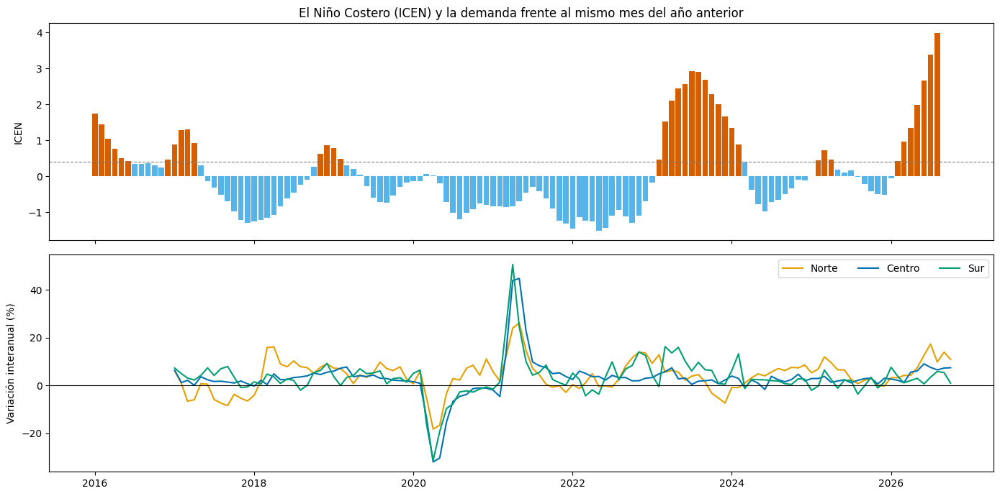
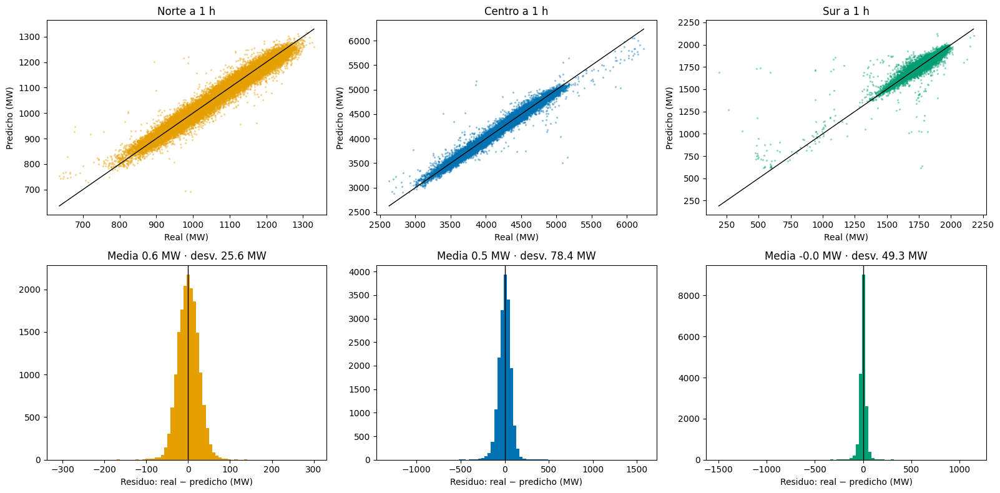
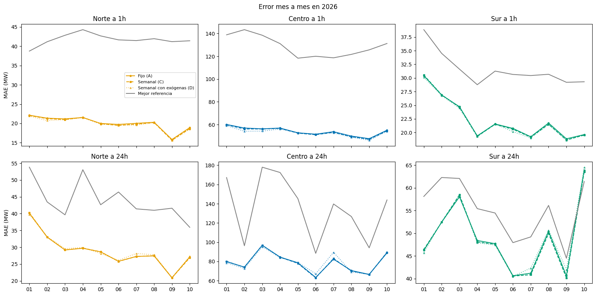
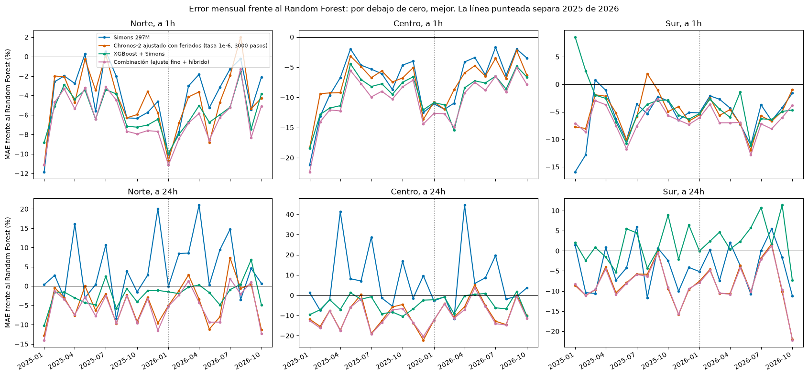
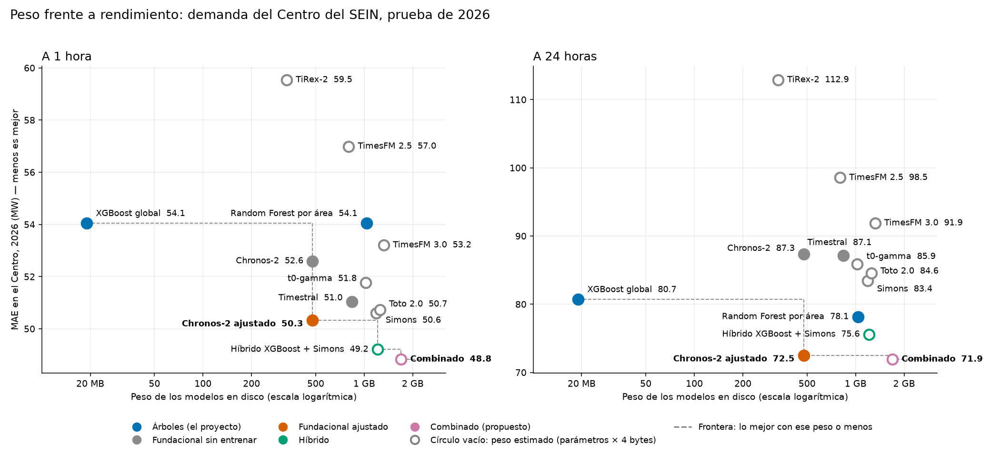

<!-- Versión corta para la entrega, en Quarto. Sale de paper/short-paper.md; el informe técnico completo, con la
fuente de cada cifra en notas al pie, es paper/paper.md. Los comentarios HTML como este indican de qué notebook,
celda o tabla sale cada cifra y no aparecen en el documento compilado. El formato (estilo, columnas, plantilla)
está aislado en _quarto.yml. -->

# Título del proyecto {#sec-titulo}

**Pronóstico de demanda eléctrica de muy corto plazo ante niveles no vistos: el Sistema Eléctrico Interconectado
Nacional (SEIN) del Perú durante El Niño Costero de 2026.** Un problema de regresión sobre series de tiempo,
resuelto de punta a punta con CRISP-DM [@chapman2000].

# Resumen ejecutivo {#sec-resumen}

El COES necesita anticipar la demanda de cada área del SEIN a una hora y a 24 horas, y los pronósticos fallan
cuando la demanda sale de lo que el modelo vio. En 2026, El Niño Costero extraordinario empujó la demanda del
Norte hasta 17 % sobre 2025. Proponemos pronosticar la **razón** entre la demanda futura y la media de las últimas
24 horas, solo con variables conocidas al predecir, contra la **mejor de tres referencias ingenuas** y con
intervalos por **bootstrap de días**. Elegido con 2025 y probado una vez en 2026 sin tocarlo, el modelo redujo el
error a 1 hora en 51.7, 57.9 y 29.1 % (Norte, Centro y Sur) frente a la mejor referencia, y a 24 horas en 34.5,
42.2 y 11.9 %, más que en 2025. Clima, El Niño y reentrenar cambian el error alrededor de 1 %; con temperaturas
nunca vistas, el clima empeora el pronóstico a 24 horas. Como extensión, modelos fundacionales sin entrenar ya
ganan a 1 hora, y una combinación de Chronos-2 ajustado y un XGBoost híbrido baja el error del Centro de 54.6 a
48.2 MW a 1 hora y de 86.1 a 75.2 a 24 horas.

<!-- 2026: data/reportes/sein/prueba_2026/frente_referencias.csv (notebook 03, celda 9). Fundacionales:
data/reportes/sein/fundacionales/tablas/comparacion.csv (notebook 04, celdas 7 a 17). -->

# Introducción al problema {#sec-introduccion}

**El problema del operador.** El Comité de Operación Económica del Sistema (COES) programa cada día qué centrales
generan y con qué reserva, y conoce la demanda cuando ya ocurrió. Necesita anticiparla a **una hora**, para la
operación en tiempo real (redespacho, reserva, arranque de unidades rápidas), y a **24 horas**, para el programa
del día siguiente; y **por área operativa**, porque los enlaces entre el Norte, el Centro y el Sur tienen límite
(como en el pronóstico por zonas de GEFCom2012 [@hong2014]). Subestimar cuesta más que sobrestimar: obliga a
arrancar generación cara de urgencia o a cortar carga.

**Por qué ahora.** El Niño Costero de 2026 es extraordinario: el Índice Costero El Niño (ICEN) llegó a 3.98 en
agosto, el valor más alto desde 1997-98, y la demanda del Norte creció entre 4 y 17 % sobre 2025 según el mes. Es la
situación en la que un pronóstico entrenado con el pasado puede fallar. No encontramos estudios revisados por pares
que midan el efecto de El Niño sobre la demanda del SEIN.

<!-- notebook 01 del SEIN, celdas 16 y 26; spec §1. -->

**Antecedentes del grupo.** La metodología se diseñó con el consumo de Tetuán (Marruecos; UCI 849, un solo año de
2017 cada 10 minutos) [@salam2018; @wei2023], donde el modelo en razón quedó entre 41 y 56 % por debajo de la mejor
referencia ingenua en la prueba. Se verificó en Ceuta (Red Eléctrica, 2019-2026) [@ree_ceuta]: el objetivo en razón
le ganó al nivel en los 25 pares de verano e historia, y no haber visto un verano costó un 20 % más de error, no el
doble (MAPE de 2.31 frente a 1.93 %; 4.62 % la mejor referencia). El detalle de Tetuán y Ceuta está en el informe
técnico.

<!-- Tetuán: reportes/modelado/prueba.csv y notebook 02 de Tetuán, celdas 21 y 24; docs/estado-del-arte.md.
Ceuta: docs/historico.md, §8. -->

**Objetivo y contribución.** Desarrollar y validar una metodología de pronóstico de muy corto plazo que se sostenga
cuando la demanda se sale de lo que el modelo vio, y medir qué ayuda más a adaptarla durante un evento
extraordinario: sumar información exógena (clima, El Niño, fallas) o reentrenar con más frecuencia. La contribución
no es una arquitectura nueva sino un protocolo de evaluación orientado a la operación: regla de información,
objetivo en razón, vara exigente, intervalos y prueba fuera de distribución.

# Metodología CRISP-DM aplicada {#sec-metodologia}

> **Glosario.** *Referencia ingenua:* regla sin aprendizaje (lo mismo que ahora, que ayer o que la semana pasada a
> esa hora). *Objetivo en razón:* el modelo predice demanda(t+H) ÷ media de las últimas 24 h y se multiplica por esa
> media para volver a MW. *Bootstrap de días:* remuestrear días enteros para dar un intervalo del 95 % a una
> diferencia de error. *MAE:* error absoluto medio, en MW.

## Comprensión del negocio {#sec-negocio}

A 1 hora decide la coordinación en tiempo real del COES; a 24 horas, la programación del día siguiente. Criterios de
éxito fijados antes de modelar: (1) en cada área y horizonte, el MAE del modelo queda por debajo del de la mejor de
tres referencias ingenuas, en el origen móvil y en la prueba; (2) también en las horas de mayor demanda; (3) el
efecto de las exógenas y del reentrenamiento se reporta con su intervalo, contra una hipótesis escrita de antemano,
sin meta fija; (4) se reporta dónde falla. **Supuesto de colaboración COES-ENFEN:** el operador recibiría en tiempo
real los pronósticos de clima y de El Niño; en el histórico, el dato observado hace de pronóstico recibido,
degradado con un error.

## Comprensión de los datos {#sec-datos}

La demanda sale de la hoja `DEMANDA_AREAS` del anexo diario del IEOD del COES [@coes_ieod]: 189,504 periodos de
30 minutos del 1 de enero de 2016 al 23 de octubre de 2026, en MW, para el SEIN y sus tres áreas. Exógenas:
temperatura horaria de ERA5 (Open-Meteo) [@openmeteo] por área, ICEN (IGP) [@igp_icen], Niño 1+2 semanal (NOAA)
[@noaa_nino12], eventos del COES y feriados nacionales. Lo que cambió el diseño:

<!-- notebook 01 del SEIN, celdas 3, 6, 8, 10, 14, 16, 18, 22 y 26. -->

- **La demanda crece:** la media del SEIN pasó de 5,496 MW en 2016 a 6,982 en 2025 (+27 %), con la caída de 2020
  (@fig-nino); el Centro es el 60 % del sistema, el Sur el 25 % y el Norte el 15 %. Un modelo que aprenda el nivel
  queda viejo rápido: de aquí sale el objetivo en razón.
- **El pico se movió:** en 2016, el 87 % de los días el máximo del SEIN caía entre las 18 y las 23 h; desde 2023,
  entre 25 y 33 %. Las horas de mayor demanda se definen por área y año.
- **El Sur es distinto:** el domingo casi no baja (−0.6 %, frente a −7.5 y −9 % en el Norte y el Centro) y la
  temperatura no explica su demanda (r = −0.07; 0.34 en el Centro): es carga minera e industrial.
- **El Niño no es una sola señal:** en 2017 la demanda del Norte cayó 6 a 7 %; en 2023 creció 2 a 6 %; en 2026,
  4 a 17 % (@fig-nino). Con signos distintos, el ICEN difícilmente ayuda como variable.
- **Las fallas del COES tienen tendencia:** de 0.47 eventos en curso por periodo en 2016 a 1.67 en 2025, con alguno
  en curso el 91 % del tiempo: la variable refleja cómo se registran los eventos, no si la red falla.
- **Qué tan difícil es cada área:** a 1 hora la mejor referencia es la persistencia en las tres; a 24 horas, "la
  semana pasada" en el Norte y el Centro y la persistencia en el Sur (@tbl-prueba).

**Limitaciones de los datos.** La demanda "en tiempo real" se toma del IEOD, validado y publicado al día siguiente:
el sustituto del SCADA que el operador sí tiene en vivo. ERA5 es un reanálisis en grilla de 0.25° con cinco días de
rezago, no una estación. El COES no publica licencia; se cita como fuente.

## Preparación de los datos {#sec-preparacion}

**Regla de información.** Cada variable entra solo con lo que se sabía en t, el momento en que se emite el
pronóstico de t+H (H = 2 pasos a 1 hora, 48 a 24 horas), con su rezago real de publicación (@tbl-variables). Una
sola función, compartida por los notebooks y la app y cubierta por pruebas automáticas, calcula las razones y los
rezagos.

<!-- src/tetouan_power_forecast/variables_sein.py y exogenas.py; tests/test_variables_sein.py, test_exogenas.py. -->

| Grupo | Variables | Disponible en t |
|---|---|---|
| Demanda del área (M0) | Demanda en t, t−1, t−2 y t−4; la de ayer y la de la semana pasada a la hora de t+H; media y desviación de la última hora; todo dividido por la media de 24 h del área. Las otras dos áreas igual, con su propia media. Media de 24 h sobre la de 7 días | Sí (SCADA; aquí, el IEOD) |
| Calendario (M0) | Hora, minuto, día de la semana y sus senos y cosenos, de t y de t+H; feriado de t+H; cuarentena estricta de 2020 | Sí, de antemano |
| Clima (M1) | Temperatura del área en t (la última hora publicada de ERA5), media de 24 h y anomalía frente a la climatología 2016-2024; a 24 h, además, la temperatura pronosticada para t+H: la observada más un error gaussiano de 1.5 °C por día de emisión y área, con la misma semilla en todos los tramos | ERA5 como sustituto del observado; a 24 h, supuesto de colaboración (pronóstico optimista) |
| El Niño (M2) | ICEN definitivo según su fecha de publicación (m−2 desde el día 20, m−3 antes); Niño 1+2 de la última semana publicada (9 días) | Sí, con su rezago |
| Fallas (M3) | Eventos del COES en curso en t, cada uno como mucho 2 días | Sí; el retraso de publicación del registro no se midió |

: Variables y regla de información. {#tbl-variables tbl-colwidths="[16,56,28]"}

**El objetivo en razón.** El modelo aprende demanda(t+H) ÷ media de 24 h(t) y la predicción vuelve a MW
multiplicando por esa media. Así un modelo de árboles, que no extrapola fuera de lo que vio, puede predecir
niveles nuevos: solo tiene que acertar la forma del día respecto del último día. Sin calendario anual: con pocos
años funciona como identificador de época.

**Partición con hueco.** Entrenamiento 2016-2024, validación 2025 (para elegir) y prueba fuera de distribución de
enero a octubre de 2026 (una sola vez), con H pasos sin usar entre tramos para que ningún objetivo del entrenamiento
se filtre al siguiente. Por área: 154,791 periodos de entrenamiento, 17,518 de validación y 13,920 de prueba a
1 hora (del 1 de enero al 17 de octubre; a 24 horas, 13,871, hasta el 16: la recorta el rezago de ERA5), con 26
variables en M0 y 33 en M3.

<!-- notebook 01 del SEIN, celda 24; notebook 03, celda 5. -->

**Reproducibilidad.** Capas bronze (archivo crudo con sha256), silver (auditado) y gold (con la regla de información
aplicada); semilla fija; ninguna cifra se calculó a mano.

## Modelado {#sec-modelado}

**Algoritmos:** Ridge, Random Forest [@pedregosa2011] y Gradient Boosting (XGBoost) [@chen2016], todos con el
objetivo en razón; además, un XGBoost **global** que aprende de las tres áreas apiladas con el área como variable
[@monteromanso2021]. **Hiperparámetros** con validación cruzada temporal (5 pliegues, hueco de H) solo sobre el
entrenamiento [@bergmeir2018], minimizando el MAE en MW, buscados en el Centro a 1 hora con M0 y reutilizados en las
otras áreas, a 24 horas y en M1-M3. **Regla de elección, escrita antes de ver las cifras:** la mayor mejora del MAE
frente a la mejor referencia, promediada entre áreas, en la validación. **Políticas de reentrenamiento:** modelo
fijo (A, B) o reentrenado cada semana con ventana creciente, hueco de H e hiperparámetros congelados (C, D), sin
(M0) y con exógenas (M3; y M2, sin fallas); más reentrenar solo cuando cambia la categoría del ICEN publicado (la
"alerta de ENFEN") [@enfen2024]. **Importancia** por permutación en la validación, sin la columna de escala.

<!-- notebook 02 del SEIN, celdas 9, 13, 15, 19, 22 y 33; reportes/sein/modelado/busqueda.csv. -->

**Extensión posterior a la prueba: modelos fundacionales.** Después de cerrar 2026 se compararon ocho modelos
preentrenados de Hugging Face [@ansari2025; @das2024; @simons297m; @timestral209m; @t0gamma; @toto2; @tirex2] en
zero-shot, con 2,048 periodos de contexto (43 días) y las mismas filas que el Random Forest (en carga eléctrica,
Chronos-2 fue el mejor de un benchmark reciente [@kaljevic2026]); cuatro variantes de ajuste fino de Chronos-2 solo
con datos hasta 2024; un **híbrido** (el XGBoost global en razón recibe el pronóstico zero-shot, el ancho de su
intervalo y su pronóstico al otro horizonte), entrenado de 2016 a 2024; y una **combinación lineal** del mejor
ajuste fino y del híbrido con un peso por horizonte y área. Todo se eligió con 2025; como 2026 ya se había usado,
esta extensión **no es una prueba ciega**.

<!-- notebook 04, celdas 5 a 17; experimentos/fundacionales/. -->

## Evaluación {#sec-evaluacion}

MAE, RMSE, MAPE y R², siempre en MW sobre la predicción reconstruida. El modelo se compara con la mejor de las tres
referencias en cada área, horizonte y tramo. **Origen móvil mensual** de 2023 a 2025 (cada mes se predice con lo
anterior) [@tashman2000]. **Intervalos:** toda diferencia de MAE va con un intervalo del 95 % por bootstrap de días
enteros (2,000 réplicas), pareado sobre los mismos periodos [@hewamalage2023]. **Regímenes:** horas de mayor
demanda, feriados, categoría del ICEN y, en 2026, días con temperatura por encima de todo lo visto. **Hipótesis
antes que resultados:** lo esperado de 2026 se escribió al cerrar 2025 (tras explorar los datos de 2026, antes de
evaluar ningún modelo en ellos) y se evaluó con reglas fijadas en código. La prueba se corrió una sola vez.

## Implementación {#sec-implementacion}

**La app, Curva.** Una app web propia (FastAPI y HTML/JS) ejecuta los modelos del proyecto sobre las capas reales
del SEIN y pone a la vista cuánto acertó, en tres pantallas: «Ahora» (la demanda de este momento o de cualquier hora
del historial, el pico de las próximas 24 horas anotado sobre la curva, el pronóstico con su rango y «lo que dijimos
ayer para esta hora» frente a lo que pasó), «Confianza» (el error mes a mes y día a día de 2026, la cobertura del
rango contra su meta, el seguimiento en vivo y el contexto internacional) y «Detalle» (el modelo, los escenarios
"¿y si hace más calor?" y el diagnóstico). Ofrece tres modelos: el XGBoost base (el único con escenarios, porque usa
el clima), el híbrido y el combinado de la @sec-fundacionales, que abre por defecto; estos dos necesitan GPU y se
leen precalculados. Está publicada en <https://curva.rosewt.dev>: la web se sirve desde Netlify y la API corre en
Azure Container Apps, que se apaga sola cuando nadie la usa. La rúbrica nombra Streamlit; el grupo asumió el riesgo
de una app propia que ejecuta el modelo.

<!-- Despliegue: despliegue/README.md (PR #62 y #57). -->

**Cómo se validó el diseño.** Midiendo antes y después de cada cambio, con un umbral fijado antes y con
instrumentos sintéticos: tareas con Playwright y tiempos del Keystroke-Level Model [@card1980], axe-core para
WCAG 2.2, un lector de atención entrenado con las miradas de UEyes [@jiang2023], pruebas de 5 segundos y de primer
clic sintéticas y un playtest con personas sintéticas al estilo RITE [@medlock2002], que tienden a ser complacientes
[@agnew2024]. **Nada se probó con personas**; el protocolo está escrito.

**El pronóstico en vivo.** Desde el 13 de noviembre de 2026 una corrida diaria baja el anexo del IEOD del COES, lo
valida, emite con Chronos-2 ajustado con calendario el perfil de hoy a 24 horas y lo registra con su sello de tiempo
y el sha256 de los pesos y del anexo, antes de que exista su real. Cada fila es *ex ante estricto* (el periodo no
había empezado al emitirse), *en vivo* (ya había empezado, pero el COES no podía haber publicado su real) o
*reconstruido* (emitido después: el relleno desde el 23 de octubre y todo el horizonte de 1 hora, que necesita la
demanda de una hora antes).

<!-- app/backend/pronosticador_real.py y contrato.py; docs/app-hcd.md (iteraciones 1 a 8) y docs/auditoria/
(metodo.md, plan.md, plan-juego.md); experimentos/en_vivo/README.md y src/tetouan_power_forecast/en_vivo.py. -->

# Resultados del modelo {#sec-resultados}

## Validación en 2025: elección del modelo {#sec-validacion}

| Método | Norte | Centro | Sur | Mejora media |
|---|---|---|---|---:|
| Mejor referencia | 38.54 | 122.69 | 32.14 | — |
| Ridge por área | 26.05 · 32.4 % | 80.51 · 34.4 % | 28.17 · 12.4 % | 26.4 % |
| **Random Forest por área** | 19.67 · 49.0 % | 54.62 · 55.5 % | 24.06 · 25.1 % | **43.2 %** |
| Gradient Boosting por área | 19.58 · 49.2 % | 53.12 · 56.7 % | 24.79 · 22.9 % | 42.9 % |
| Gradient Boosting global | 19.59 · 49.2 % | 53.54 · 56.4 % | 24.72 · 23.1 % | 42.9 % |

: Validación de 2025, M0 a 1 hora: MAE (MW) y mejora frente a la mejor referencia (la persistencia). {#tbl-validacion tbl-colwidths="[28,18,18,18,18]"}

<!-- reportes/sein/modelado/comparacion_validacion_1h.csv; notebook 02 del SEIN, celdas 7 y 15. -->

Por la regla fijada de antemano, el elegido es el Random Forest por área (@tbl-validacion), pero los tres modelos de
árboles están empatados (0.3 puntos, que decide el Sur); el XGBoost global se reporta también en 2026. A 24 horas,
el Random Forest da 28.83, 86.10 y 56.72 MW (29, 39 y 14 % de mejora); el Sur a 24 horas es el punto débil (R² de
0.33). En el origen móvil, el modelo le gana a la mejor referencia del mes en los **108 meses-área** de 2023 a 2025;
en las horas de mayor demanda la mejora se sostiene (55, 33 y 35 %). Las exógenas casi no aportan: a 1 hora ninguna
variante se aleja de M0 más de 0.32 MW; a 24 horas el clima mejora el Centro 0.61 MW y nada en las otras áreas. En
la importancia por permutación, la demanda y el calendario suman 248.0 MW en el Centro frente a 1.10 del clima;
SHAP sobre el XGBoost de la app repite ese orden en 2026 (@sec-visualizacion). Reentrenar cada semana baja el error
como mucho 0.56 MW, menos del 1 %.

<!-- comparacion_validacion_24h.csv; origen_movil.csv; regimenes.csv; ablacion.csv; importancias_por_grupo.csv
(versión del PR #30); adaptacion.csv y efectos_adaptacion.csv; notebook 02, celdas 17 a 33 y conclusiones. SHAP:
notebooks/05_sein_explicabilidad.ipynb, sección 3. -->

## La prueba de 2026: El Niño extraordinario {#sec-prueba}

**Hipótesis escritas al cerrar 2025:** (1) el modelo fijo le gana a la mejor referencia a 1 hora en las tres áreas,
con una mejora en el Norte menor que en 2025 pero sobre 25 %, y a 24 horas en el Centro y el Norte; (2) reentrenar
ayuda más que en 2025, sobre todo en el Norte; (3) a 1 hora, M3 − M0 no se distingue de cero; (4) a 24 horas el
clima sigue ayudando en el Centro, con el riesgo de temperaturas fuera de rango; (5) El Niño no mejora en ningún
caso.

<!-- notebook 02 del SEIN, celda 34; prueba_2026/hipotesis.csv. -->

| Horizonte | Área | Mejor referencia: MAE · MAPE | Random Forest: MAE · MAPE · mejora | Δ MAE, IC 95 % | XGBoost global: mejora |
|---|---|---|---|---|---|
| 1 h | Norte | Persistencia, 41.8 · 3.67 % | 20.2 · 1.79 % · **51.7 %** | −21.6 (−22.1 a −21.1) | 52.4 % |
| 1 h | Centro | Persistencia, 128.5 · 2.98 % | 54.1 · 1.25 % · **57.9 %** | −74.5 (−75.9 a −72.9) | 58.4 % |
| 1 h | Sur | Persistencia, 31.6 · 1.74 % | 22.4 · 1.24 % · **29.1 %** | −9.2 (−9.6 a −8.7) | 29.2 % |
| 24 h | Norte | Semana pasada, 44.2 · 3.92 % | 29.0 · 2.58 % · **34.5 %** | −15.3 (−18.1 a −12.7) | 33.8 % |
| 24 h | Centro | Semana pasada, 135.3 · 3.12 % | 78.1 · 1.80 % · **42.2 %** | −57.1 (−71.3 a −45.3) | 40.9 % |
| 24 h | Sur | Persistencia, 54.8 · 3.04 % | 48.3 · 2.68 % · **11.9 %** | −6.5 (−8.9 a −4.4) | 10.8 % |

: Prueba de 2026 (del 1 de enero al 17 de octubre a 1 hora; al 16 a 24 horas): el modelo fijo, entrenado hasta 2025 y sin tocar, frente a la mejor referencia. {#tbl-prueba tbl-colwidths="[9,8,23,24,20,16]"}

<!-- prueba_2026/frente_referencias.csv (notebook 03, celda 9). -->

El método se sostiene fuera de lo visto (@tbl-prueba): el modelo gana en las tres áreas y los dos horizontes, con
intervalos lejos del cero, y la mejora es **mayor que en 2025 en cinco de los seis casos** (salvo el Sur a 24
horas). No se degrada a medida que El Niño se intensifica: la mejora del Norte a 1 hora pasa de 42.9 % en enero a
61.6 % en septiembre (@fig-mensual), y los días con temperatura por encima de todo lo visto no son peores a 1 hora.
En las horas de mayor demanda la mejora es 53.0, 34.6 y 30.3 % a 1 hora y la subestimación por encima del
percentil 90 de la referencia, 0.09, 0.99 y 0.95 % de esas horas.

<!-- prueba_2026/mensual.csv y regimenes.csv (notebook 03, celdas 16 y 18). -->

| Horizonte | Área | Clima (M1 − M0) | Clima + El Niño (M2 − M0) | Reentrenar sin exógenas (C − A) | Reentrenar con exógenas (semanal M2 − fijo M2) |
|---|---|---|---|---|---|
| 1 h | Norte | −0.09 (−0.18 a 0.01) | −0.09 (−0.18 a 0.01) | **−0.14 (−0.19 a −0.09)** | **−0.21 (−0.28 a −0.14)** |
| 1 h | Centro | **−0.46 (−0.71 a −0.20)** | **−0.55 (−0.82 a −0.30)** | **−0.43 (−0.56 a −0.29)** | **−0.70 (−0.86 a −0.53)** |
| 1 h | Sur | 0.04 (−0.03 a 0.11) | 0.02 (−0.06 a 0.11) | **−0.09 (−0.15 a −0.03)** | **−0.16 (−0.23 a −0.09)** |
| 24 h | Norte | **+0.42 (0.16 a 0.68)** | **+0.39 (0.14 a 0.62)** | 0.02 (−0.07 a 0.10) | **−0.16 (−0.29 a −0.03)** |
| 24 h | Centro | **+1.35 (0.10 a 2.97)** | **+1.34 (0.19 a 2.74)** | −0.05 (−0.32 a 0.22) | **−0.72 (−1.19 a −0.27)** |
| 24 h | Sur | 0.02 (−0.28 a 0.32) | **+0.85 (0.44 a 1.30)** | −0.14 (−0.32 a 0.03) | **−0.66 (−0.97 a −0.37)** |

: Exógenas y reentrenamiento en 2026: diferencias de MAE (MW) con su intervalo del 95 %; negativo, la variante ayuda. En negrita, los intervalos que no cruzan el cero. {#tbl-exogenas tbl-colwidths="[10,8,20,20,20,22]"}

<!-- prueba_2026/ablacion.csv y efectos_adaptacion.csv (notebook 03, celdas 11 y 14). -->

A 1 hora, el clima ayuda algo en el Centro (−0.46 MW sobre 54, menos del 1 %) y nada en las otras áreas
(@tbl-exogenas). A 24 horas, **el clima empeora** el pronóstico en el Norte y el Centro, y El Niño empeora el Sur:
temperaturas fuera del rango de entrenamiento, con las que los árboles no extrapolan, sumadas a un pronóstico de
temperatura simulado con error. Reentrenar cada semana baja el error a 1 hora en las tres áreas, pero alrededor del
1 %; a 24 horas, sin exógenas, no se distingue de no hacerlo, y con exógenas compensa parte del daño del clima sin
llegar al modelo fijo sin exógenas. Reentrenar solo con la alerta de ENFEN (4 veces) es peor. **Las hipótesis:** 1,
2 y 5 se cumplen (la 1 falló solo en que la mejora del Norte *subió*, de 49 a 51.7 %); la 3 no (el clima sí ayuda
algo en el Centro a 1 hora); la 4 no, en sentido contrario.

<!-- prueba_2026/adaptacion.csv e hipotesis.csv. -->

## Extensión: modelos fundacionales y la combinación final {#sec-fundacionales}

| Modelo | 2025, 1 h | 2025, 24 h | 2026, 1 h | 2026, 24 h |
|---|---|---|---|---|
| Random Forest elegido | 19.7 / 54.6 / 24.1 | 28.8 / 86.1 / 56.7 | 20.2 / 54.1 / 22.4 | 29.0 / 78.1 / 48.3 |
| Simons-297M, zero-shot | 18.8 / 49.7 / 22.4 | 30.0 / 92.9 / 54.2 | 19.3 / 50.6 / 21.3 | 30.9 / 83.4 / 46.8 |
| Chronos-2 ajustado hasta 2024 con el feriado como covariable | 18.8 / 49.8 / 22.9 | 27.1 / 75.6 / 51.8 | 19.2 / 50.3 / 21.1 | 28.2 / 72.5 / 44.6 |
| Híbrido: XGBoost + Simons | 18.6 / 49.0 / 23.5 | 27.9 / 81.3 / 57.0 | 18.9 / 49.2 / 21.2 | 28.7 / 75.6 / 49.8 |
| **Combinación: Chronos-2 ajustado + híbrido (pesos de 2025)** | **18.5 / 48.2 / 22.5** | **26.9 / 75.2 / 51.8** | **18.8 / 48.8 / 20.9** | **27.9 / 71.9 / 44.6** |

: MAE (MW), Norte / Centro / Sur, sobre las mismas filas que el modelo elegido. La extensión se hizo después de la prueba: todo se eligió con 2025 y 2026 solo confirma. {#tbl-fundacionales tbl-colwidths="[32,17,17,17,17]"}

<!-- data/reportes/sein/fundacionales/tablas/comparacion.csv y pesos_combinacion.csv (notebook 04, celdas 7 a 17).
Pesos del Chronos-2 ajustado: 0.35 / 0.45 / 0.65 a 1 h y 0.70 / 0.85 / 0.95 a 24 h. -->

Sin entrenar, seis de los ocho fundacionales ya le ganan al Random Forest a 1 hora (@tbl-fundacionales); a 24 horas
no en el Centro ni el Norte, y el error mensual lo explica: los peores meses son abril y julio, los de Semana Santa y
Fiestas Patrias (@fig-fundacionales). La temperatura como covariable no ayuda a Chronos-2; el feriado sí: el ajuste
fino de tasa 1e-6 con el feriado como covariable es el mejor modelo individual y le gana al Random Forest en todos
los casos salvo el Norte a 24 horas en 2026 (−0.77 MW, IC −1.65 a 0.12). El híbrido mejora en el Centro y el Norte
pero empeora el Sur a 24 horas en 2026 (+1.54, IC 0.34 a 2.79). La combinación le gana al Random Forest en los doce
casos (@tbl-combinacion) y sube la mejora media frente a la mejor referencia de 35.2 a 40.7 % en 2025 y de 37.9 a
42.3 % en 2026. **Los pesos se fijaron en 2025: sus diferencias de 2025 son optimistas; la de 2026 queda fuera del
entrenamiento y de la selección, pero sobre un año ya inspeccionado.** Su ventaja es parecida en los meses neutros y
en los de El Niño fuerte o extraordinario: es mejor en general, no más adaptable. Sus cuantiles 10-90 mezclados con
los mismos pesos cubren entre 77 y 81 % de los periodos; la app muestra otro rango, el del 90 % calibrado con los
errores de 2025, que en 2026 cubrió entre 89.6 y 91.8 % a 24 horas.

| Año | Horizonte | Norte | Centro | Sur |
|---|---|---|---|---|
| 2025 | 1 h | −1.21 (−1.51 a −0.96) | −6.39 (−7.63 a −5.37) | −1.56 (−1.88 a −1.28) |
| 2025 | 24 h | −1.96 (−2.71 a −1.24) | −10.85 (−14.08 a −7.73) | −4.92 (−7.09 a −2.86) |
| 2026 | 1 h | −1.37 (−1.56 a −1.14) | −5.22 (−5.84 a −4.57) | −1.55 (−1.81 a −1.28) |
| 2026 | 24 h | −1.08 (−1.80 a −0.35) | −6.23 (−8.67 a −3.81) | −3.71 (−5.49 a −1.87) |

: La combinación frente al Random Forest elegido: diferencia de MAE (MW) e intervalo del 95 % por bootstrap de días. Todos excluyen el cero. {#tbl-combinacion tbl-colwidths="[10,12,26,26,26]"}

<!-- tablas/comparacion.csv (filas "Combinación (ajuste fino + híbrido)"); ranking.csv; regimenes_2026.csv;
mensual.csv. -->

## Pronóstico en vivo y diagnóstico del sesgo (seguimiento en curso) {#sec-vivo}

| Tramo | Periodos por área | Centro | Norte | Sur |
|---|---|---|---|---|
| En vivo, 13 a 17 de noviembre (emitido antes de que el COES pudiera publicar el real) | 240 | 90.7 (120.3) · −68.3 · 66.7 % | 20.0 (26.5) · −0.1 · 89.2 % | 60.7 (67.2) · +40.4 · 63.7 % |
| Ex ante estricto (solo los periodos que aún no empezaban al emitirse) | 120 | 99.2 (135.6) · −94.0 · 60.0 % | 19.0 (23.2) · −0.7 · 92.5 % | 70.2 (77.9) · +42.7 · 57.5 % |
| Reconstruido, 23 de octubre a 12 de noviembre (emitido después, con los datos hasta su origen) | 1,008 | 79.6 (140.8) · −21.3 · 73.2 % | 32.1 (45.6) · +18.1 · 74.3 % | 34.4 (49.7) · +1.6 · 84.5 % |

: Seguimiento en vivo a 24 horas (Chronos-2 ajustado con calendario) al 17 de noviembre de 2026: MAE en MW (mejor referencia ingenua en las mismas filas) · sesgo (pronóstico − real) · cobertura del rango 10-90. {#tbl-vivo tbl-colwidths="[31,11,20,19,19]"}

<!-- data/reportes/sein/en_vivo/resumen.parquet (nivel "acumulado"), leído el 19 de noviembre con datos del COES
hasta el 17 (51 corridas); experimentos/en_vivo/README.md. A 1 h todo es reconstruido (26 días): Centro 51.3 MW
frente a 135.6 de la persistencia; Norte 20.6 frente a 41.9; Sur 22.7 frente a 33.6. ICEN y Niño 1+2: capas silver
exogenas/silver/icen.parquet y nino12_semanal.parquet. -->

Son pocos días: es **seguimiento en curso, no un resultado** (@tbl-vivo). El modelo le gana a la referencia en
todos los tramos y áreas, pero el Centro subestima (−68 MW en vivo) y el rango del 80 % cubre menos de lo que
promete (67 % en vivo; 73 % en el reconstruido). Noviembre no es el arranque de El Niño sino su pico: para el ENFEN
el evento costero empezó en marzo de 2026, es extraordinario desde agosto y seguiría así hasta febrero de 2027
(Comunicado N.° 20-2026) [@enfen2026comunicado; @enfen2026informe]; el ICEN pasó de 0.96 en marzo a 4.50 en
setiembre (IGP) [@igp_icen] y Niño 1+2 estaba en +5.4 °C el 11 de noviembre [@noaa_nino12]. Lima lleva unos
+4.6 °C sobre lo normal desde octubre (ERA5, no estación) y desde el 20 de octubre su media diaria pasó los
23-24 °C, el umbral desde el que la demanda del Centro sube alrededor de 1.9 % por °C.

Un diagnóstico del 14 de noviembre sobre 2025, 2026 y el tramo en vivo, con la misma regla de información del modo
en vivo, dice cuatro cosas. (1) **El calor explica poco del sesgo diario** (1 a 8 % de lo que varía); lo que hay es
una deriva lenta de estación, de 0.5 a 1 % del nivel: el sesgo mensual del Centro sale negativo cuando arranca el
calor y positivo cuando se enfría. (2) **La falla ya estaba en 2026, en el pico de los días calurosos:** en el 10 %
de días más cálidos el pico del Centro quedó 38 MW más corto (IC por semanas −72 a −6) aunque el MAE del día no
empeoró. Esto matiza la hipótesis 1: la temperatura no aporta en promedio, pero el pico de los días cálidos sí queda
corto. (3) **Ningún remedio barato ayuda en la historia:** de 88 correcciones con los errores recientes ninguna baja
el MAE de 2025 ni de 2026, y corregir por temperatura empeora el Centro 5.6 MW; no se adopta ninguna. (4) **Un rango
adaptativo sí cumple lo que promete:** con un ajuste conforme por lado (γ = 0.2, elegido con 2025) la cobertura a
24 horas pasa de 74-76 % a 79-81 % en 2025 y 2026 y a 82-86 % en vivo, con un rango 12-18 % más ancho; queda
propuesto, sin fusionar. Una revisión del 19 de noviembre añade una quinta: (5) **Noviembre no es un «régimen de
El Niño» que el ICEN pueda marcar:** en los 26 días
con real, el sesgo del Centro no sigue la temperatura del día (r = −0.14), Norte y Sur están sobrestimados y el
ICEN lleva en «extraordinaria» desde agosto, cuando el sesgo era casi nulo; lo que cambió es que Lima cruzó el
umbral de verano dos meses antes de lo normal. La demanda del Centro va 11 % sobre noviembre de 2025; el calor
explicaría 5 a 6 puntos.

<!-- Punto 5 y situación de El Niño: revisión del 19-nov contra ENFEN (Comunicado N.° 20-2026 e Informe Técnico N.° 20),
IGP (ICEN.txt) y NOAA CPC (wksst9120.for); detalle y cautelas en paper.md, nota [^nino-nov]. Diagnóstico:
experimentos/sesgo/ (diagnostico.py, remedios.py, graficos.py; tablas en reportes/sein/sesgo/; PR #53, sin
fusionar); intervalos por bootstrap de semanas enteras, 2,000 réplicas; temperatura de ERA5 (del 8 al 13 de
noviembre, el análisis de la API de pronóstico de Open-Meteo llevado al nivel de ERA5). -->

Después se probó la temperatura **pronosticada** (GFS, con el umbral de 23 °C en Lima): una corrección en línea
sobre Chronos-2 ajustado acorta el error del pico del Centro a 24 horas en el 10 % de días más cálidos de 106 a
74 MW en 2025 (IC por semanas −43 a −19) y de 105 a 90 MW en 2026, sin cambiar el MAE de forma significativa,
aunque deja algo alto el resto de esos días; se registra en vivo en paralelo, sin cambiar lo que muestra la app.

<!-- Temperatura pronosticada: experimentos/temperatura/ y en_vivo.emitir_calor (PR #55, del 19-nov); tablas en
reportes/sein/temperatura/comparacion.csv; informe temperatura-pronosticada-2026-11.md (fuera del repo),
conclusiones 1, 2 y 5. -->

## Contexto internacional {#sec-internacional}

Para situar las cifras, lo que publican operadores con auditoría externa, **sin que sea una comparación de igual a
igual**. La CNMC liga parte de la retribución de Red Eléctrica (España) al error de su pronóstico diario, en la
práctica un WAPE: 1.600 % en 2024 y 1.694 % en 2025 [@cnmc2024umbrales; @cnmc2025; @cnmc2026; @ree_seguimiento].
NESO (Gran Bretaña) publica un archivo abierto con el pronóstico del día siguiente y su error desde 2021 [@neso];
PJM informa cada mes el error horario y del pico [@pjm2026]. El error al día siguiente de los operadores está entre
1.5 y 3 %; el combinado, en la prueba de 2026 a 24 horas, da un WAPE de 1.64 % en el Centro, 2.44 % en el Norte y
2.46 % en el Sur: competitivo en orden de magnitud. Lo que ningún operador revisado hace es poner el error y la
cobertura del rango junto al pronóstico, como «Confianza».

<!-- Revisión de productos del 13 de noviembre de 2026; solo cifras verificadas en su fuente: CNMC, resoluciones
RAP/DE/012/25 y RAP/DE/016/26 (y umbrales 2023-2025); NESO, archivo abierto de desempeño; PJM, informe del Operating
Committee del 5-feb-2026. WAPE y MAPE del combinado: docs/app-hcd.md, iteración 8 (tabla de «Confianza»), sobre las
13,824 medias horas de la prueba. -->

# Visualización y análisis {#sec-visualizacion}

<!-- notebooks/01_sein_datos_preparacion.ipynb, celda 16. -->

{#fig-nino width="100%" fig-alt="El ICEN mensual en barras, con los meses cálidos en naranja, y la variación interanual de la demanda por área, 2016-2026."}

En la @fig-nino, los episodios cálidos del entrenamiento (2016, 2017 y 2023) y el extraordinario de 2026 no mueven
la demanda en la misma dirección: en 2017 el Norte cayó; en 2026 crece hasta 17 %. Las variaciones más grandes son
la cuarentena de 2020 (hasta −30 %) y su rebote en 2021 (+40 %), no El Niño. Por eso el ICEN no sirve como variable.

<!-- notebooks/02_sein_modelado_evaluacion.ipynb, celda 31, segunda figura. -->

{#fig-real-predicho width="100%" fig-alt="Dispersión de real contra predicho por área en 2025, con la diagonal de acierto, y debajo los histogramas de residuos."}

La @fig-real-predicho es el equivalente de la matriz de confusión en una regresión. Los puntos se alinean sobre la
diagonal y los residuos quedan centrados en cero: no hay sesgo hacia subestimar. El Sur muestra periodos con demanda
real baja (500 a 1,000 MW) que el modelo predice alta: cortes de carga minera que la demanda reciente no anticipa.

<!-- notebooks/03_sein_prueba_2026.ipynb, celda 16. -->

{#fig-mensual width="100%" fig-alt="Seis paneles con el MAE mensual de 2026 por área y horizonte para tres políticas del modelo y la mejor referencia."}

En los seis paneles de la @fig-mensual las curvas del modelo quedan por debajo de la referencia todo el año, y las
tres políticas casi se superponen: reentrenar y agregar exógenas cambian poco. El único cruce es el Sur a 24 horas
en octubre, donde la demanda minera sube de golpe.

<!-- tpf-fm/notebooks/04_sein_modelos_fundacionales.ipynb, celda 19. -->

{#fig-fundacionales width="100%" fig-alt="Diferencia porcentual mensual del MAE de cuatro modelos frente al Random Forest, por área y horizonte, en 2025 y 2026."}

En la @fig-fundacionales, a 1 hora los cuatro modelos quedan casi siempre por debajo del Random Forest. A 24 horas
el zero-shot (Simons) se dispara por encima del cero en los meses de feriados (hasta +45 % en el Centro), mientras
el Chronos-2 ajustado y la combinación se mantienen por debajo; en el Sur a 24 horas el híbrido queda a menudo por
encima del cero y el ajustado por debajo, lo que justifica su peso de 0.95 ahí.

<!-- gráfico del 13-nov sobre las tablas del notebook 04 (comparacion.csv); peso de varios fundacionales estimado
como parámetros × 4 bytes (círculo vacío). -->

{#fig-peso width="100%" fig-alt="Dispersión del peso en disco contra el MAE del Centro en 2026 para cada modelo, a 1 y 24 horas, con la frontera de lo mejor por peso."}

En la @fig-peso, el peso no ordena el error: el XGBoost de 20 MB empata con el Random Forest de 1 GB, y TiRex-2
pesa como el Chronos-2 ajustado y es el peor; el combinado, el mejor, es también el más pesado (1.7 GB).

**Explicabilidad.** Con SHAP sobre el XGBoost de la app (notebook 05), la demanda reciente y el calendario explican
casi todo el pronóstico: en 2026, a 1 hora, lo mueven 347 y 93 MW en el Centro, frente a menos de 7 MW del clima y
de El Niño; a 24 horas mandan la semana pasada a la misma hora y la hora del día. Coincide con la importancia por
permutación. El peor error de 2026 (776 MW) fue el feriado del lunes 29 de junio: el modelo restó 558 MW por el
feriado sobre un punto de partida que ya era de fin de semana. El notebook cierra con la privacidad y la seguridad
del modelo, que el grupo entregó también como Entregable 8: sin datos personales, con un registro inmutable de
pronósticos y la validación del anexo.

<!-- notebooks/05_sein_explicabilidad.ipynb, secciones 3, 7 y 8; entregables/Entregable8_MDS_Grupo03.ipynb. -->

## Limitaciones y amenazas a la validez {#sec-limitaciones}

1. **Un solo año y un solo evento en la prueba.** Los intervalos de 2026 miden la incertidumbre dentro de 2026; no
   dicen nada de otro Niño. Como los errores de días vecinos están correlacionados, el bootstrap por días puede
   quedar angosto: remuestreando semanas y meses enteros la combinación sigue ganando al Random Forest en los doce
   casos (Centro a 24 horas en 2026: −6.23 MW, IC −9.32 a −3.43 por semanas).
2. **Efectos chicos y muchas comparaciones.** Los efectos de exógenas y reentrenamiento van de 0.09 a 1.48 MW,
   menos del 2 % del error, con 66 intervalos al 95 % sin corrección: dos o tres "distinguibles" se esperan por
   azar. La conclusión robusta es el tamaño, no cada signo.
3. **El supuesto COES-ENFEN es optimista.** ERA5 hace de observado; el pronóstico a 24 horas parte de la
   temperatura que ocurrió, con un error sin sesgo e independiente entre días (1.5 °C, un solo nivel). Si aun así
   el clima empeora el pronóstico a 24 horas en 2026, con un pronóstico real difícilmente ayudaría.
4. **La variable de fallas no se pudo evaluar** (activa el 91 % del tiempo); los resultados "con exógenas" se
   apoyan en M2.
5. **Empate entre algoritmos y búsqueda acotada:** Random Forest y XGBoost difieren en 0.3 puntos sin intervalo;
   hiperparámetros buscados solo en el Centro a 1 hora; la app ejecuta el XGBoost y abre con el combinado
   precalculado.
6. **Hipótesis y origen móvil.** Las hipótesis se escribieron tras explorar los datos de 2026; el origen móvil usa
   hiperparámetros elegidos con datos hasta 2024: mide estabilidad, no es una prueba ciega.
7. **Datos y periodo.** La prueba va hasta el 17 de octubre (16 a 24 horas); el IEOD sustituye al SCADA; solo
   feriados nacionales; M4 (SAIDI) no se corrió. No se comparó con la Programación Diaria del COES, la vara
   oficial.
8. **La extensión con fundacionales no es una prueba intacta:** 2026 no entra en ningún ajuste ni elección (ajuste
   fino hasta 2024; pesos y variantes elegidos con 2025), pero ya se había inspeccionado; una prueba intacta sería
   el periodo posterior al 22 de octubre de 2026. Además, no se puede auditar qué vieron los modelos al
   preentrenarse, las licencias difieren (TimesFM 3.0 es solo no comercial) y hace falta GPU. El ajuste fino es
   robusto a la semilla (con tres semillas el MAE cambia como mucho 0.19 MW, frente a −10.5 MW de ventaja en el
   Centro a 24 horas) y una revisión del código no encontró fugas (solo ve datos hasta 2024; la única covariable
   futura es el feriado).
   <!-- rango entre semillas: chronos2ftcal_c2048.parquet y las corridas _s2 y _s3 del 13-nov, calculado en local
   sobre las filas de 2025 y 2026; detalle en paper.md, nota [^semillas]. -->
9. **Validez de constructo.** El MAE no refleja la asimetría entre subestimar y sobrestimar; por eso se reporta
   aparte la subestimación en las horas de mayor demanda.
10. **El pronóstico en vivo es un seguimiento en curso:** cinco días emitidos antes del real y 21 reconstruidos, con
    Chronos-2 ajustado (no el combinado) y con un día de retraso: el COES publica el real a la mañana siguiente,
    así que el horizonte de 1 hora solo puede reconstruirse.
11. **El diagnóstico del sesgo** usa 22 días en vivo y ERA5 como temperatura; la revisión de El Niño, 26 días con
    autocorrelación y un umbral estimado con días de verano; el rango adaptativo es una propuesta sin fusionar.
12. **La validación del diseño es sintética:** detecta regresiones, no dice que alguien entendió. Faltan las
    sesiones con personas.

# Conclusiones y lecciones aprendidas {#sec-conclusiones}

**Conclusiones.** (1) Durante El Niño extraordinario de 2026, un modelo en razón entrenado hasta 2025 y sin tocar le
gana a la mejor referencia ingenua en las tres áreas y los dos horizontes (51.7, 57.9 y 29.1 % a 1 hora; 34.5, 42.2
y 11.9 % a 24 horas), más que en un año normal, y no se degrada a medida que El Niño se intensifica. Lo que sostiene
el pronóstico es la metodología (la razón con la media de 24 horas y la vara exigente), no las exógenas ni el
reentrenamiento: ambos cambian el error alrededor de 1 %, el clima empeora el pronóstico a 24 horas con temperaturas
nunca vistas y El Niño no ayuda. Para el operador: modelo en razón, reentrenado cada semana, con el clima a 1 hora
y sin exógenas a 24 horas. (2) Los antecedentes lo respaldan: con un solo año (Tetuán) el error queda 41-56 % bajo
la mejor referencia; en otro sistema (Ceuta), no haber visto un verano cuesta un 20 % más de error. (3) Como
extensión, los modelos fundacionales sin entrenar ya ganan a 1 hora; ajustando Chronos-2 con datos hasta 2024 y el
feriado, y combinándolo con el híbrido, el error del Centro baja de 54.6 a 48.2 MW a 1 hora y de 86.1 a 75.2 a 24
horas en 2025 y el Sur a 24 horas, el punto débil, de 56.7 a 51.8, con diferencias que excluyen el cero en los doce
casos. Se propone como siguiente versión, con tres cuidados: se eligió con un solo año y se confirmó en uno ya
usado, sus pesos son de 2025 y exige GPU. (4) Curva ejecuta los tres modelos y dice cuánto acertó; su diseño se
midió antes y después con instrumentos sintéticos, sin probarse aún con personas. Desde el 13 de noviembre una
tubería diaria emite el pronóstico del día antes de conocer su real: en cinco días le gana a la referencia en las
tres áreas, pero el Centro subestima y su rango queda corto; el diagnóstico lo atribuye a una deriva lenta de
estación y al pico de los días cálidos, no al calor día a día.

**Lecciones aprendidas.** (1) *CRISP-DM es un ciclo.* El Entregable 7 del grupo evaluaba dos modelos en nivel y
contra la persistencia: le ganaban a la persistencia pero perdían contra "ayer a la misma hora". La corrección no
fue cambiar de algoritmo sino volver a la preparación (tres referencias, objetivo en razón, sin calendario anual,
con hueco): los mismos modelos quedaron cerca de la mitad del error de "ayer". Cambiar de algoritmo movió 18 kW;
cambiar el objetivo, más de 1,200. (2) *La referencia define la conclusión:* contra la persistencia cualquier modelo
parece bueno. (3) *"Sin efecto" es un resultado:* escribir las hipótesis antes y reportar intervalos obligó a decir
que las exógenas casi no aportan. (4) *La disciplina temporal se programa y se prueba:* regla de información,
huecos y bloques viven en funciones con tests. **Trabajo futuro:** comparar con la Programación Diaria del COES;
medir la sensibilidad al error del pronóstico de temperatura (1 y 2 °C); una variable de fallas útil; llevar la
combinación con fundacionales a una prueba intacta (desde el 22 de octubre de 2026); evaluar en el verano de 2027
la corrección por temperatura pronosticada que ya corre en paralelo, mirando el pico del Centro; sumar el combinado
y el rango adaptativo a la tubería en vivo; y las sesiones con personas que validen la medición sintética del
diseño.

<!-- entregables/Entregable6_MDS_Grupo03.ipynb, celda 93. -->

# Bibliografía {#sec-bibliografia .unnumbered}

::: {#refs}
:::
